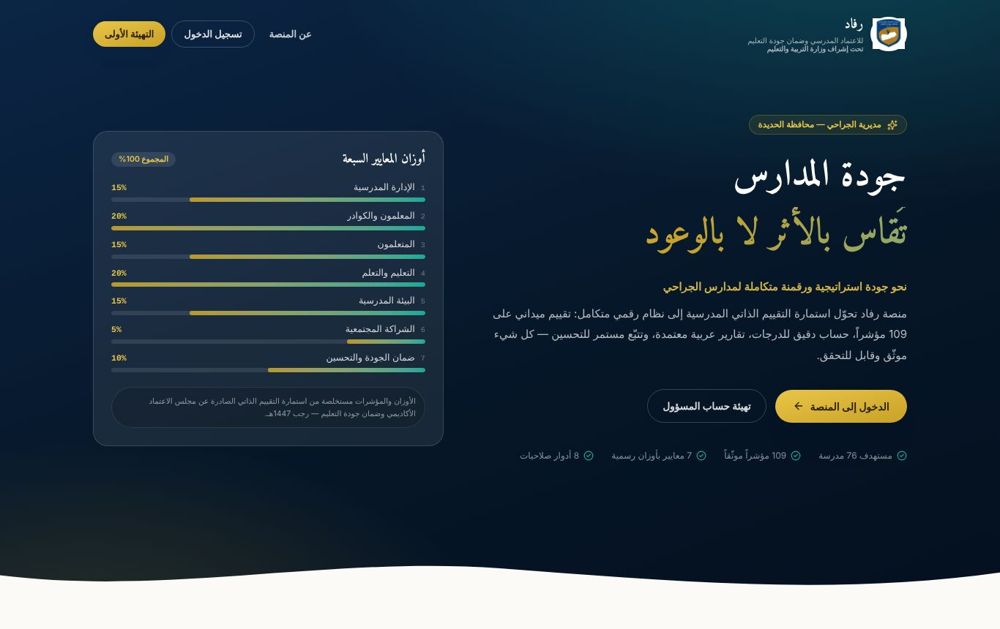

# الفصل الأول: نظرة عامة على منصة رفاد

## ما هي منصة رفاد؟

**منصة رفاد للاعتماد المدرسي وضمان جودة التعليم** نظام إلكتروني يعمل من المتصفح على الكمبيوتر والجوال، وهي **تحت إشراف وزارة التربية والتعليم**. أُعدّت لقسم الجودة والاعتماد المدرسي في إدارة التربية والتعليم بمديرية الجراحي، محافظة الحديدة.

تحوّل المنصة **استمارة التقييم الذاتي للمدارس** الصادرة عن مجلس الاعتماد الأكاديمي وضمان جودة التعليم (رجب 1447هـ – يناير 2026م) من ورقة إلى دورة رقمية متكاملة:

1. **يقيّم مدير المدرسة مدرسته** مؤشراً مؤشراً من خلال اختبار تفاعلي إجباري.
2. **تُرصد نقاط الضعف تلقائياً**، ويُلزَم المدير بوضع **خطة تحسين** لكل نقطة.
3. **يتابع المدير تنفيذ الخطة**، ثم يعلن التحسّن ويرفق الشواهد.
4. **تعتمد الإدارة التحسّن** بعد التحقق، أو تعيده للمدرسة مع ذكر السبب.
5. **يُبنى التكريم على بيانات حقيقية**: تصدر شهادات تقدير موثّقة برمز تحقق، ونصّها يذكر المعيار والمؤشر والعام بدقة.

## لمن صُممت المنصة؟

| المستخدم | ما يفعله في المنصة |
|---|---|
| **مدير النظام** (قسم الجودة) | يدير كل شيء: المدارس، والمستخدمين، والمعايير والمؤشرات، والصلاحيات، ومتابعة كل المدارس، وإصدار الشهادات |
| **مدير الإدارة / المديرية** | يتابع مدارس مديريته، ويعتمد التحسينات، ويصدر الشهادات، ويدير الزيارات والتقارير |
| **المفتش / الموجّه التربوي** | يتابع مدارسه، وينفّذ الزيارات والتقييم الميداني، ويعتمد التحسينات أو يعيدها |
| **مدير المدرسة** | يجري الاختبار التفاعلي، ويعبّئ استمارة مدرسته، ويضع خطط التحسين، ويرفع الشواهد |
| **منسق الجودة في المدرسة** | يعمل مع المدير على الاستمارة والخطط والشواهد |
| **المعلم** | يرفع أدلته وملفات إنجازه ويتواصل مع الإدارة |
| **ولي الأمر** | يطّلع على بيانات أبنائه ويتواصل مع المدرسة |

## المفاهيم الأساسية

### بنية الاستمارة

الاستمارة **هرمية**، كما في النسخة الورقية الرسمية:

- **7 معايير رئيسية** لكل منها وزن من 100%، مثل: الإدارة المدرسية (15%)، والمعلمون والكوادر الإدارية والخدمية (20%)، والمتعلمون (15%)، والتعليم والتعلم (20%)، والبيئة المدرسية (15%)، والشراكة المجتمعية (5%)، وضمان الجودة والتحسين المستمر (10%).
- **معايير فرعية** داخل كل معيار، لكل منها وزن.
- **109 مؤشرات** دقيقة، لكل مؤشر:
  - **الأدلة والشواهد** المطلوبة، مثل: «محضر صياغة الرؤية والرسالة».
  - **أداة التحقق**: فحص وثائق، أو ملاحظة، أو مقابلة.
  - **التقدير**، وهو أحد أربعة مستويات.
  - **الملاحظات**.

يستطيع مدير النظام تعديل كل ما سبق من داخل المنصة دون برمجة (انظر دليل مدير النظام).

### مقياس التقدير

| التقدير | الدرجة | المعنى في دورة التحسين |
|---|---|---|
| غير متحقق | 0 | **نقطة ضعف** تتطلب خطة |
| متحقق بدرجة ضعيفة | 1 | **نقطة ضعف** تتطلب خطة |
| متحقق بدرجة متوسطة | 2 | مقبول |
| متحقق | 3 | محقَّق |

يستطيع المدير أيضاً أن يضع **إشارة ضعف يدوية** على أي مؤشر يرى أنه يحتاج معالجة، حتى لو كان تقديره متوسطاً.

### دورة حياة نقطة الضعف (بالألوان)

| الحالة | اللون | من يغيّرها |
|---|---|---|
| ضعيف — يحتاج خطة | 🔴 أحمر | يحدث تلقائياً عند التقدير الضعيف أو وضع إشارة الضعف |
| خطة موضوعة | 🟠 برتقالي | المدير حين يحفظ الخطة |
| قيد التنفيذ | 🔵 أزرق | المدير بزر «بدأنا التنفيذ» |
| تحسّن — بانتظار الاعتماد | 🟢 أخضر فاتح | المدير بزر «تمّت المعالجة وتحسّن»، مع وصف ما نُفّذ والتقدير الجديد |
| تحسّن معتمد | 🟢 أخضر | الإدارة بزر «اعتماد التحسّن» |

تُسجَّل كل خطوة في **تاريخ المؤشر**، ولا يمكن حذفها أو تعديلها. لذلك ترى الإدارة دائماً القصة كاملة: كان المؤشر ضعيفاً، ثم وُضعت خطة، ثم نُفّذت، ثم تحسّن واعتُمد.

### المعيار «المحقَّق»

يُعدّ المعيار محقَّقاً بالكامل إذا اجتمعت ثلاثة شروط:

- قُيّمت كل مؤشراته.
- لا توجد فيه نقطة ضعف مفتوحة. نقطة الضعف التي عولجت واعتُمد تحسّنها لا تُحسب.
- نسبة تحققه 80% فأكثر.

المعايير المحقَّقة والتحسينات المعتمدة هي وحدها ما تُبنى عليه **شهادات التكريم**.

### العام الدراسي

كل استمارة مرتبطة بمدرسة وعام دراسي، مثل `2026-2027`. يبدأ العام الجديد تلقائياً في أغسطس، فتبدأ المدارس استمارة جديدة، وتظهر لها **مقارنة بالعام السابق**.

## أهم مزايا المنصة

- **اختبار تفاعلي إجباري** يقترح التقدير من الأدلة المتوفرة فعلاً.
- **خطة تحسين إلزامية** لكل نقطة ضعف، ومتابعة حالتها بالألوان حتى الاعتماد.
- **لوحة متابعة للإدارة** لكل المدارس، فيها نقاط الضعف الشائعة والأدلة الأكثر غياباً.
- **تنبيهات تلقائية** يومية، وتذكير المدراء داخل المنصة وعبر واتساب.
- **شهادات تقدير مبنية على البيانات** برمز تحقق عام.
- **رفع الشواهد** (صور وPDF وWord وExcel) لكل مؤشر، مع مراجعة الإدارة لها.
- **التقييم الميداني** للمفتشين في الزيارات، مع حفظ تلقائي وعمل دون اتصال.
- **تقارير PDF وExcel** عربية، برمز تحقق.
- **إدارة كاملة من داخل الموقع**:
  - **البيانات الأساسية:** المدارس (إضافة واستيراد من Excel)، ومواقعها على الخريطة، وهواتفها.
  - **الحسابات:** حسابات المدراء جماعياً، والأدوار والصلاحيات.
  - **محتوى الاستمارة:** المعايير والمؤشرات.
- **أمان عالٍ:** صلاحيات تُفحص في الخادم، وسجل تدقيق، ومصادقة ثنائية، وإلزام بتغيير كلمة المرور المؤقتة.
