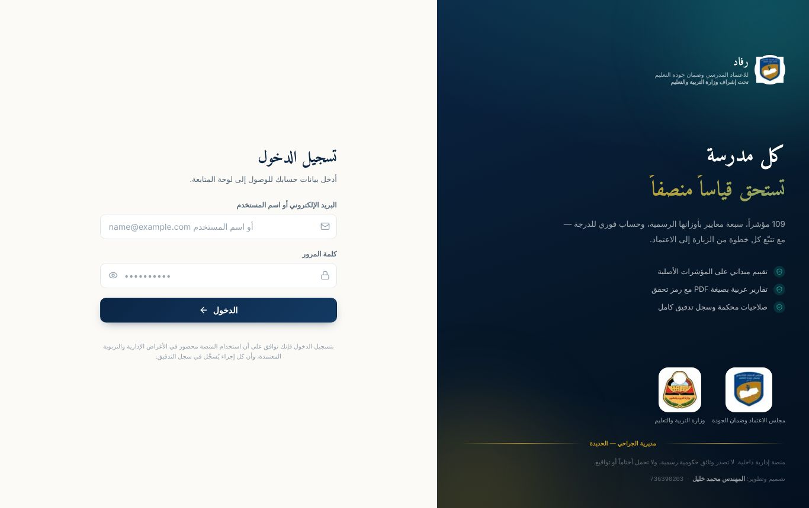
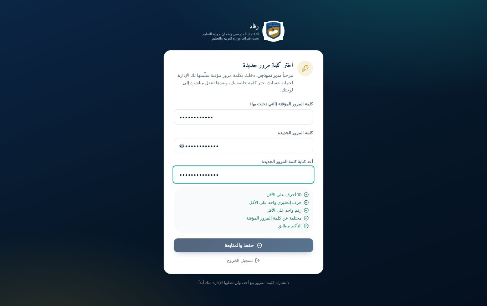
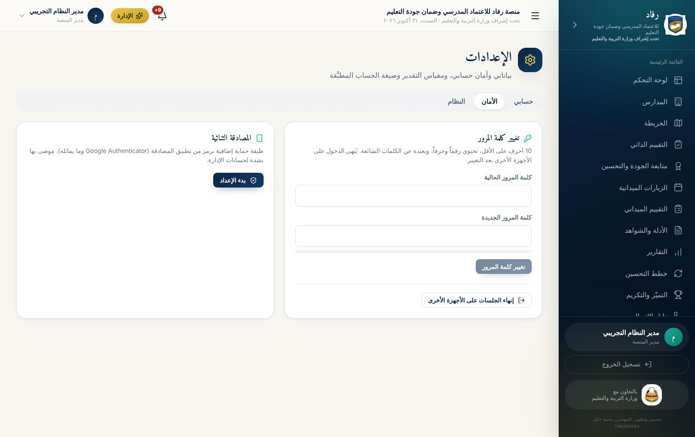

# الفصل الثاني: البدء واستخدام المنصة لأول مرة

## الدخول إلى المنصة

1. افتح رابط المنصة في المتصفح، مثل Chrome أو Edge أو Safari، على الكمبيوتر أو الجوال.
2. اضغط **«الدخول إلى المنصة»** أو افتح صفحة `/login` مباشرة.
3. في خانة الدخول اكتب **البريد الإلكتروني** أو **اسم المستخدم**. مدراء المدارس اسم دخولهم غالباً **رمز المدرسة**، مثل `school-001`.
4. اكتب كلمة المرور، ثم اضغط **«الدخول»**.

> **ملاحظة أمنية:** بعد 5 محاولات خاطئة يُقفل الحساب مؤقتاً لمدة 15 دقيقة. وإذا فعّل المستخدم المصادقة الثنائية، يُطلب منه رمز من تطبيق المصادقة على هاتفه.

## تغيير كلمة المرور المؤقتة (أول دخول)

كل حساب ينشئه مدير النظام يحصل على **كلمة مرور مؤقتة**. عند أول دخول تظهر صفحة **«اختر كلمة مرور جديدة»**، ولا يمكن الوصول لأي جزء آخر من المنصة قبل إكمالها:

1. اكتب كلمة المرور المؤقتة التي سلّمتها لك الإدارة.
2. اكتب كلمة مرور جديدة، ثم أعد كتابتها للتأكيد.
3. تتحول الشروط إلى اللون الأخضر كلما تحققت:
   - 10 أحرف على الأقل.
   - حرف إنجليزي واحد على الأقل.
   - رقم واحد على الأقل.
   - مختلفة عن كلمة المرور المؤقتة.
   - التأكيد مطابق.
4. اضغط **«حفظ والمتابعة»**، فتنتقل مباشرة إلى لوحتك.

## واجهة المنصة

- **القائمة الجانبية** (يميناً): أقسام المنصة المتاحة لدورك فقط. على الجوال تُفتح من زر ☰ أعلى الشاشة.
- **الشريط العلوي**: اسم المنصة، وجرس **الإشعارات**، وقائمة حسابك، ومنها الإعدادات وتسجيل الخروج.
- **الإشعارات**: تصلك عند ظهور نقطة ضعف جديدة، أو اعتماد تحسّن، أو تذكير من الإدارة، أو خطة متأخرة، وغيرها. اضغط الإشعار ليفتح الصفحة المعنية.

> إذا حاولت فتح قسم لا تشمله صلاحيات دورك، تظهر رسالة واضحة: **«هذا القسم غير متاح لحسابك»**، مع زر للعودة إلى لوحتك.

## إعدادات حسابي

من **الإعدادات** يستطيع كل مستخدم:

- **تعديل بياناته:** الاسم ورقم الهاتف، من تبويب «حسابي».
- **حماية حسابه:** تغيير كلمة المرور، وتفعيل **المصادقة الثنائية** بمسح رمز QR بتطبيق Google Authenticator أو ما يشابهه، من تبويب «الأمان».
- **إنهاء جلساته الأخرى:** يُسجَّل خروجه من كل الأجهزة الأخرى بضغطة واحدة.
- **مراجعة آخر عمليات الدخول:** يرى آخر محاولات الدخول إلى حسابه، ويعرف إن دخل أحد غيره.

## استخدام المنصة كتطبيق على الجوال

المنصة **تطبيق ويب تقدمي (PWA)**: من قائمة المتصفح على الجوال اختر **«إضافة إلى الشاشة الرئيسية»**، فتظهر أيقونة رفاد كتطبيق مستقل. وعند ضعف الإنترنت تُحفظ درجات التقييم الميداني محلياً، ثم تُرفع تلقائياً عند عودة الاتصال.

## المعلم وولي الأمر

- **المعلم:** لوحته تعرض ملفات إنجازه وحالة مراجعتها. يرفع أدلته من **الأدلة والشواهد**، ويرى ما رفعه فقط. ويتواصل مع الإدارة من **التواصل**.
- **ولي الأمر:** لوحته تعرض أبناءه المرتبطين بحسابه، ويربطهم مسؤول المدرسة. ويتواصل مع المدرسة، ويطّلع على الإعلانات والتعاميم من **التواصل**.
