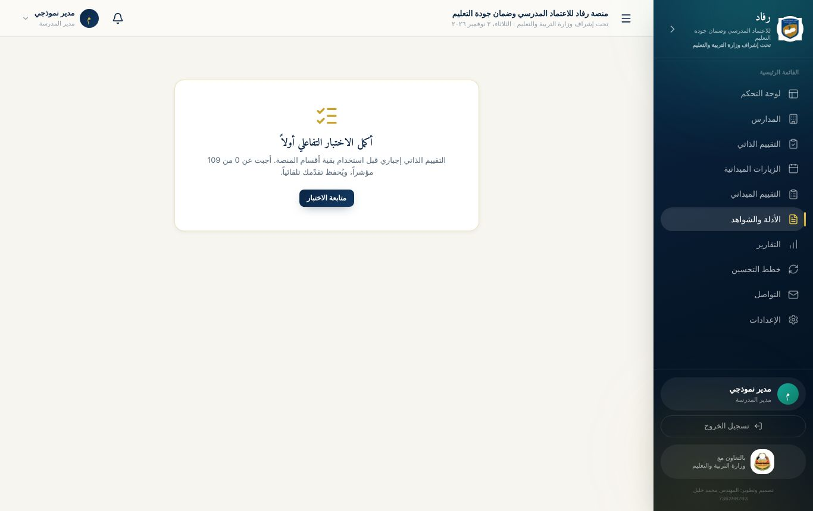
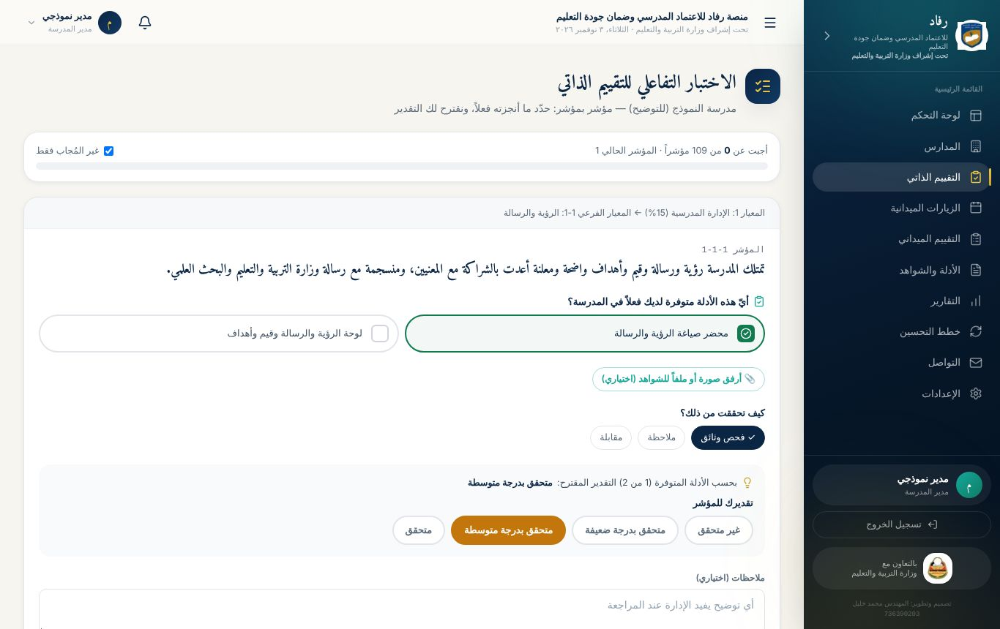
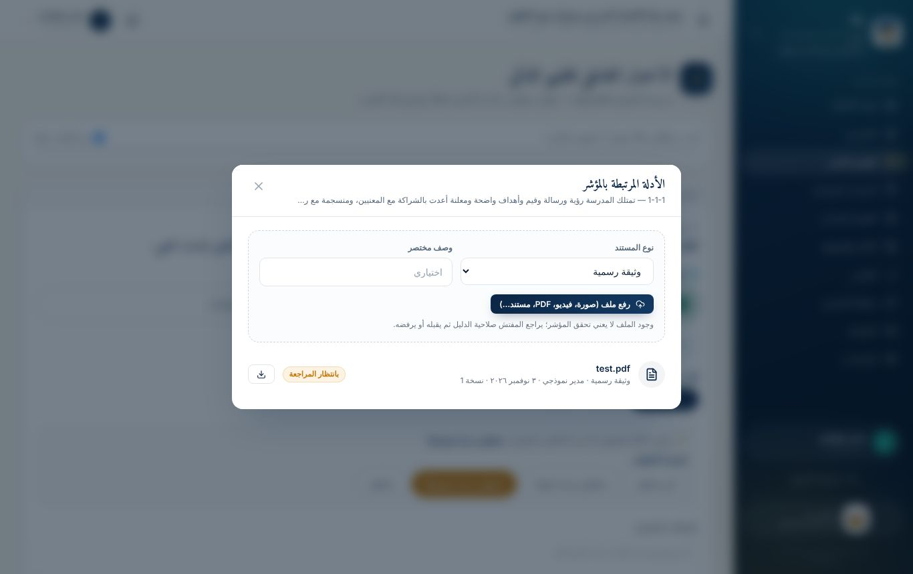
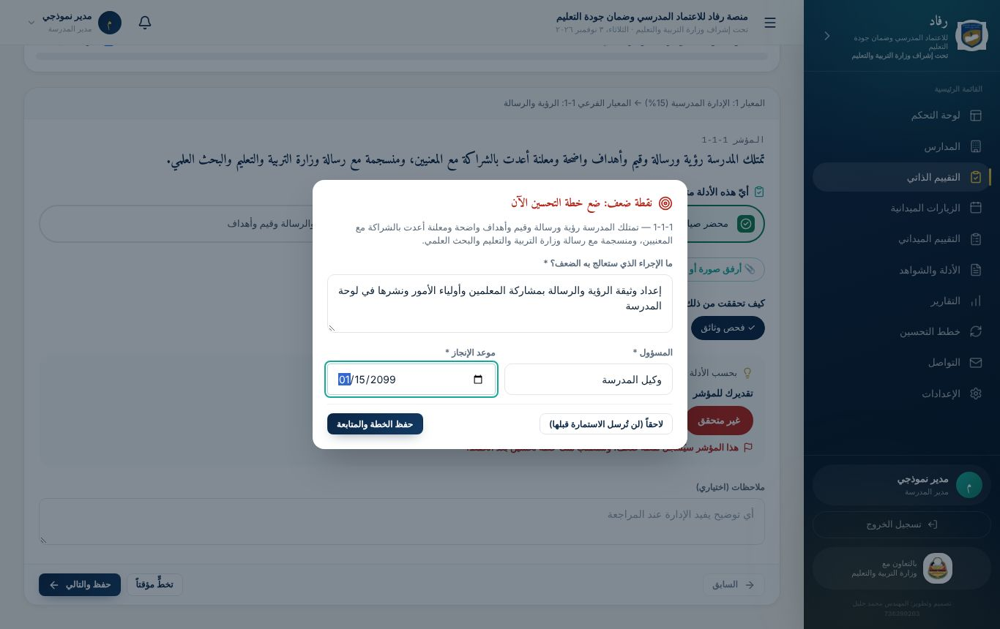
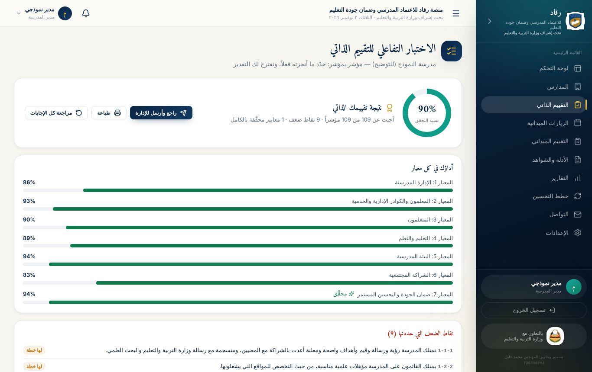
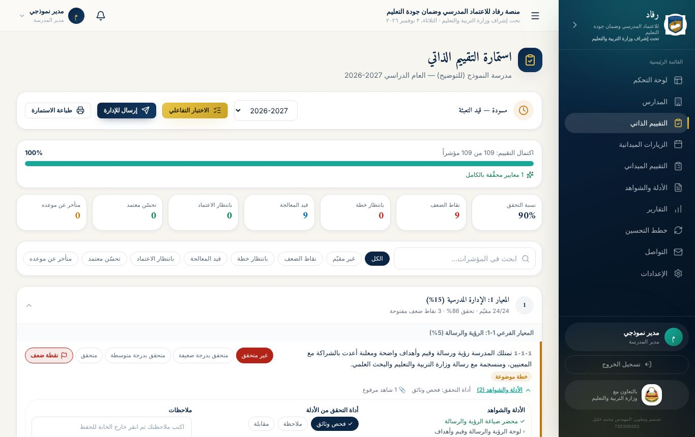
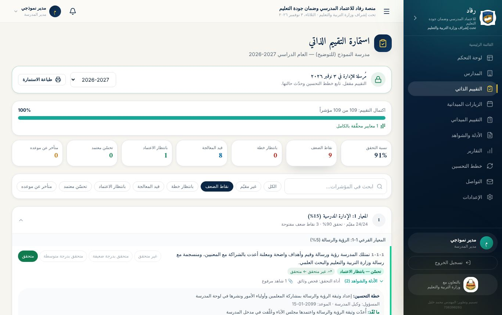
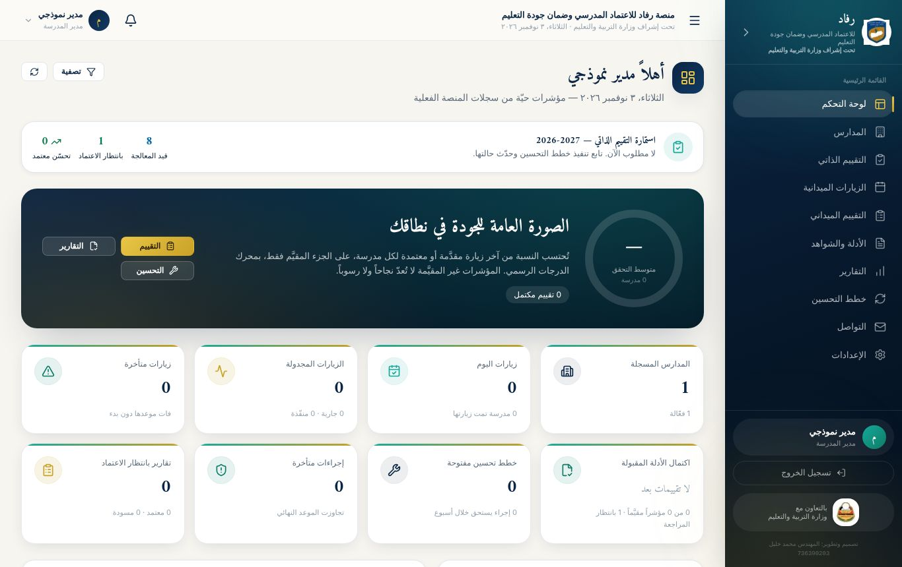
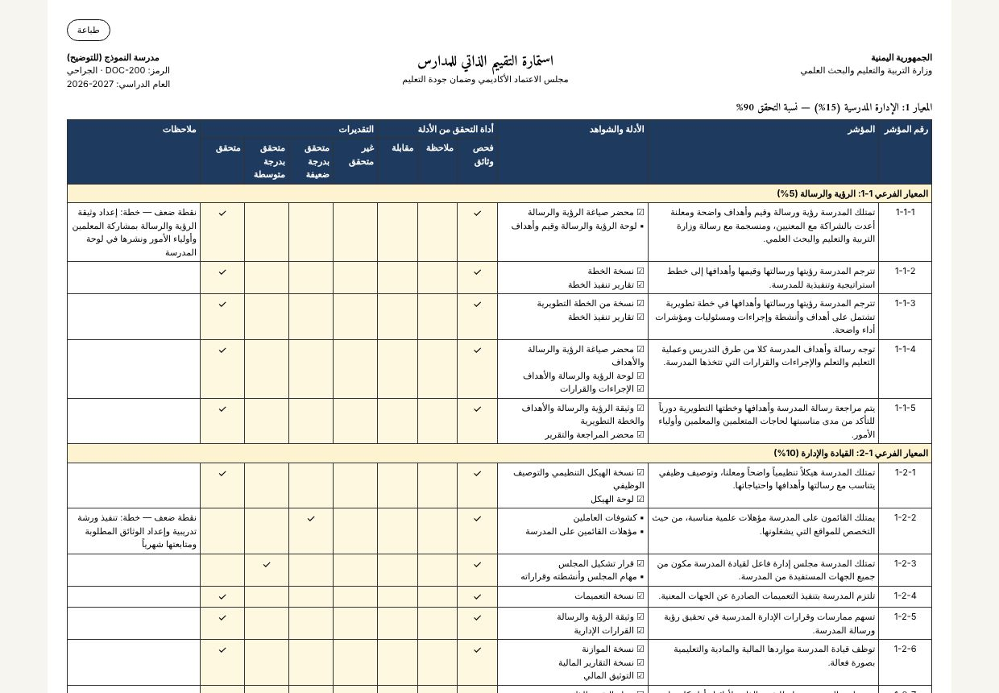

# الفصل الثالث: دليل مدير المدرسة ومنسق الجودة بالمدرسة

هذا الفصل موجّه لمدير المدرسة ومنسق الجودة بالمدرسة فيها، ويشرح الدورة كاملة من أول دخول حتى اعتماد التحسّن.

> **نطاقك:** ترى **مدرستك وبياناتك فقط**، ولا تصل إلى مدرسة أخرى أو حساب مدير آخر، ولا تعدّل بيانات أي شخص غيرك. السجل الرئيسي للمدرسة (الاسم والرمز والموقع وبيانات الاتصال الرسمية) يعدّله مدير النظام وحده.

## 1. الاختبار التفاعلي (إجباري)

بعد تغيير كلمة المرور المؤقتة **يُوجَّه مدير المدرسة ومنسق الجودة بالمدرسة مباشرة إلى الاختبار التفاعلي**، وتبقى بقية الأقسام مغلقة حتى يُجاب عن **كل مؤشرات العام الدراسي الحالي**. تبقى متاحة دائماً: الإعدادات، والتواصل، وطباعة الاستمارة.

### كيف يعمل الاختبار؟

يعرض الاختبار **مؤشراً واحداً في كل شاشة**، مع مساره في الاستمارة (المعيار ← المعيار الفرعي)، وشريط تقدّم يبيّن عدد ما أُجيب عنه من 109. لكل مؤشر:

1. **«أيّ هذه الأدلة متوفرة لديك فعلاً في المدرسة؟»**: اضغط على كل دليل متوفر عندك، فيصير أخضر.
2. **«كيف تحققت من ذلك؟»**: اختر فحص وثائق، أو ملاحظة، أو مقابلة، أو أكثر من واحدة.
3. **التقدير المقترح**: يقترحه النظام تلقائياً من نسبة الأدلة المتوفرة:

| الأدلة المتوفرة | التقدير المقترح |
|---|---|
| كلها | متحقق |
| النصف فأكثر | متحقق بدرجة متوسطة |
| بعضها (أقل من النصف) | متحقق بدرجة ضعيفة |
| لا شيء | غير متحقق |

4. يمكنك **تعديل التقدير** بالضغط على مستوى آخر، أو العودة إلى المقترح.
5. **الملاحظات** (اختياري): أي توضيح يفيد الإدارة عند المراجعة.
6. **📎 أرفق صورة أو ملفاً للشواهد** (اختياري): ارفع الشاهد بأي صيغة شائعة: صورة، أو فيديو قصير، أو تسجيل صوتي، أو PDF، أو Word، أو Excel، أو PowerPoint، أو ملف مضغوط. الحد الأقصى على استضافة Vercel نحو 4 ميجابايت للملف.
7. اضغط **«حفظ والتالي»**.

### خطة التحسين الفورية

إذا كان التقدير **غير متحقق** أو **متحقق بدرجة ضعيفة**، يُسجَّل المؤشر **نقطة ضعف**. بعد الحفظ تظهر نافذة **«نقطة ضعف: ضع خطة التحسين الآن»**، وفيها:

- **الإجراء** الذي ستعالج به الضعف (10 أحرف على الأقل).
- **المسؤول عن التنفيذ**، مثل: وكيل المدرسة.
- **موعد الإنجاز**.

يمكنك اختيار «لاحقاً»، لكن **لن تُرسل الاستمارة قبل وضع خطة لكل نقطة ضعف**.

### شاشة النتيجة

بعد الإجابة عن كل المؤشرات تظهر **نتيجة تقييمك الذاتي**:

- **نسبة التحقق** الكلية.
- **أداؤك في كل معيار** بشريط ملوّن، مع علامة «محقَّق» على المعايير المكتملة.
- **نقاط الضعف** التي حددتها، وحالة خطة كل منها.
- **أزرار:** «راجع وأرسل للإدارة»، و«طباعة»، و«مراجعة كل الإجابات».

## 2. استمارة التقييم الذاتي

من القائمة: **التقييم الذاتي**. هنا ترى الاستمارة كاملة بشكلها الرسمي، وتديرها:

- **شريط الحالة:**
  - **الحالة:** مسودة أو مُرسلة.
  - **العام الدراسي**، مع إمكانية اختيار عام آخر.
  - **الأزرار:** الاختبار التفاعلي، وإرسال للإدارة، وطباعة الاستمارة.
- **بطاقات الملخص:** نسبة التحقق، ونقاط الضعف، وما بانتظار خطة، وما قيد المعالجة، وما بانتظار الاعتماد، وما تحسّن واعتُمد، وما تأخر عن موعده. اضغط أي بطاقة لتصفية المؤشرات حسبها.
- **المقارنة بالعام السابق:** نسبة التحقق وعدد نقاط الضعف هذا العام مقابل العام الماضي.
- **البحث والتصفية:** الكل، وغير مقيّم، ونقاط الضعف، وبانتظار خطة، وقيد المعالجة، وبانتظار الاعتماد، وتحسّن معتمد، ومتأخر.
- **المعايير:** كل معيار في بطاقة قابلة للفتح، تعرض نسبته وعدد نقاط الضعف المفتوحة فيه.

لكل مؤشر في الاستمارة:

- **أزرار التقدير:** تبقى متاحة قبل الإرسال، بشرط أن يكون المؤشر قد أُجيب عنه في الاختبار التفاعلي.
- **زر «ضعف»:** لوضع إشارة ضعف يدوية أو إلغائها.
- **«الأدلة والشواهد»:**
  - قائمة الأدلة، وعلى المتوفر منها ✓.
  - أداة التحقق.
  - خانة الملاحظات، وتُحفظ عند الخروج منها.
  - زر **«رفع الشواهد»**، وبجانبه عدد الشواهد المرفوعة.
- **«تاريخ المؤشر»:** كل خطوة مرّ بها المؤشر، ومن قام بها، ومتى.

## 3. إرسال الاستمارة للإدارة

حين تكتمل الاستمارة يصبح زر **«إرسال للإدارة»** فعّالاً. وإن لم يكن فعّالاً يظهر بجانبه سبب ذلك:

- مؤشرات لم تُقيَّم بعد.
- مؤشرات ضعيفة بلا خطة تحسين.

بعد الإرسال:

- **يُقفل التقييم المباشر** حتى يبقى تاريخ المؤشرات صادقاً. إن احتجت تعديلاً، اطلب من الإدارة **إعادة فتح الاستمارة**.
- **تستمر في متابعة خطط التحسين** وتحديث حالتها.
- **تُشعَر الإدارة** بأن الاستمارة وصلت.

## 4. متابعة خطط التحسين حتى الاعتماد

لكل نقطة ضعف أزرار تظهر حسب مرحلتها:

| الزر | متى يظهر | ماذا يفعل |
|---|---|---|
| **وضع خطة التحسين / تعديل الخطة** | ضعيف، أو خطة موضوعة، أو قيد التنفيذ | يحفظ الإجراء والمسؤول والموعد ومؤشر النجاح |
| **بدأنا التنفيذ** | خطة موضوعة | ينقل المؤشر إلى «قيد التنفيذ» (أزرق) |
| **تمّت المعالجة وتحسّن** | خطة موضوعة أو قيد التنفيذ | تكتب ما نُفّذ فعلاً وأين الشواهد، وتختار التقدير الجديد، ويجب أن يكون أعلى من الحالي. ينتقل المؤشر إلى «بانتظار الاعتماد» (أخضر فاتح) |

بعد ذلك تراجع الإدارة الشواهد، ثم تفعل أحد أمرين:

- **تعتمد التحسّن:** يتحول المؤشر إلى أخضر، ويصلك إشعار «اعتُمد التحسّن».
- **تعيده إليك:** تكتب السبب، فيعود المؤشر إلى «قيد التنفيذ».

## 5. التنبيهات

تصلك إشعارات تلقائية:

- **«خطط تحسين متأخرة»:** إذا تجاوزت خطة موعدها.
- **«اقتراب موعد خطط التحسين»:** قبل الموعد بثلاثة أيام.
- **«اعتُمد التحسّن»** أو **«أُعيد مؤشر للمتابعة»:** عند قرار الإدارة.
- **تذكيرات من الإدارة:** مثل إكمال الاختبار أو الإرسال.

وفي **لوحة التحكم** بطاقة «استمارة التقييم الذاتي» تخبرك بما هو مطلوب منك الآن.

## 6. طباعة الاستمارة

زر **«طباعة الاستمارة»** يُخرج الاستمارة بجدولها الرسمي:

- **الأعمدة:** رقم المؤشر، والمؤشر، والأدلة والشواهد، وأداة التحقق، والتقديرات، والملاحظات.
- **معبّأة بإجاباتك:** يظهر ☑ على الأدلة المتوفرة، و✓ على الأداة والتقدير.
- **في آخرها** خانات توقيع: مدير المدرسة، ومنسق الجودة بالمدرسة، والتاريخ.

## 7. أقسام أخرى متاحة لمدير المدرسة

| القسم | الاستخدام |
|---|---|
| **المدارس** | ملف مدرستك: البيانات والموقع للاطلاع، وتحديث أعداد الطلاب والمعلمين والمرافق، وإضافة جهات الاتصال (مدير المدرسة)، ونقاط الضعف |
| **الزيارات الميدانية** | زيارات المفتشين لمدرستك وحالاتها |
| **التقييم الميداني** | نتائج تقييم المفتش لمدرستك، للاطلاع فقط |
| **الأدلة والشواهد** | كل الشواهد المرفوعة لمدرستك وحالة مراجعتها |
| **التقارير** | تقارير مدرستك، وتنزيلها PDF أو Excel |
| **خطط التحسين** | الإجراءات التصحيحية الناتجة عن التقييم الميداني |
| **التواصل** | المراسلات، والإعلانات، والاجتماعات، والمواد المشتركة |
