# الفصل الرابع: دليل الإشراف والمتابعة (المفتش ومشرف المحافظة ومدير النظام)

يشرح هذا الفصل أدوات المتابعة والاعتماد والتكريم. يرى **مدير النظام** كل المدارس، ويرى **مشرف المحافظة** كل المدارس اطلاعاً دون تعديل، ويرى **المفتش** المدارس التي أسندها إليه مدير النظام ومدارس زياراته فقط.

## 1. متابعة الجودة والتحسين

من القائمة: **متابعة الجودة والتحسين**. هذه هي لوحة القيادة اليومية لقسم الجودة.

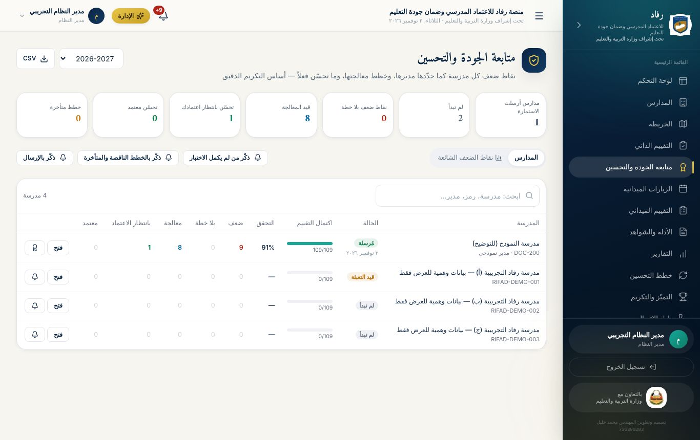

### بطاقات الأرقام (اضغط أي بطاقة للتصفية)

- **الاستمارات:** المدارس التي أرسلت الاستمارة، والمدارس التي لم تبدأ.
- **نقاط ضعف بلا خطة.**
- **قيد المعالجة.**
- **تحسّن بانتظار اعتمادك:** أهم بطاقة للمتابعة اليومية.
- **تحسّن معتمد.**
- **خطط متأخرة.**

### جدول المدارس

لكل مدرسة:

- **الحالة:** لم تبدأ، أو قيد التعبئة، أو مُرسلة.
- **التقدّم والنتيجة:** اكتمال التقييم (x/109)، ونسبة التحقق.
- **أعداد دورة التحسين:** الضعف، وبلا خطة، والمعالجة مع عدد المتأخر منها، وبانتظار الاعتماد، والمعتمد.
- **الأزرار:**
  - **فتح:** يعرض استمارة المدرسة كاملة.
  - **الجرس:** تذكير المدرسة.
  - **الشهادة:** تظهر للمدارس التي أرسلت استمارتها.

ترتيب الجدول تلقائي: ما ينتظر الاعتماد أولاً، ثم ما بلا خطة. ويمكن **تصدير الجدول CSV**، و**اختيار العام الدراسي**.

### نقاط الضعف الشائعة (لتوجيه التدريب والدعم)

تبويب **«نقاط الضعف الشائعة»** يعرض على مستوى نطاقك:

- **متوسط التحقق في كل معيار:** من التقييم الذاتي لكل المدارس.
- **أكثر المؤشرات ضعفاً:** لكل مؤشر:
  - عدد المدارس الضعيفة فيه من المدارس التي قيّمته.
  - كم منها ما زال مفتوحاً، وكم عولج واعتُمد.
  - **الأدلة الأكثر غياباً**، مأخوذة من إجابات المدراء في الاختبار التفاعلي.

هذه البيانات تحدد موضوعات **الورش التدريبية** و**زيارات الدعم الفني** بدقة.

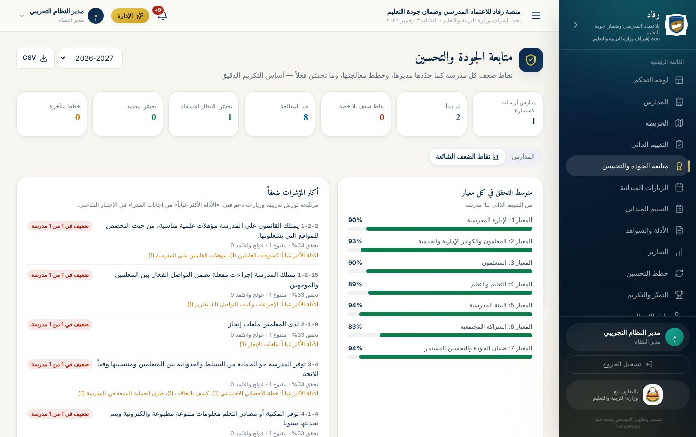

### تذكير المدراء

ثلاثة أزرار جماعية:

- **ذكّر من لم يكمل الاختبار.**
- **ذكّر بالخطط الناقصة والمتأخرة.**
- **ذكّر بالإرسال:** للمدارس التي أكملت التقييم ولم ترسل.

يصل التذكير **إشعاراً داخل المنصة** لمدير المدرسة ومنسق الجودة بالمدرسة. بعدها تظهر قائمة المدارس، وبجانب كل مدرسة زر **واتساب** برسالة جاهزة، إن كان لها رقم واتساب صالح. المدارس التي ليس لها حساب في المنصة تظهر معلَّمة، لتراسلها بالواتساب.

## 2. مراجعة استمارة مدرسة واعتماد التحسّن

افتح استمارة أي مدرسة من زر **«فتح»**، أو من **التقييم الذاتي**، ثم اختر المدرسة. ترى المؤشرات بالألوان، والخطط، وما نفّذته المدرسة، والشواهد المرفوعة.

للمؤشر الذي حالته **«تحسّن — بانتظار الاعتماد»**:

- **اعتماد التحسّن:** مع ملاحظة اختيارية، مثل «تحقق المشرف من الشواهد ميدانياً». يتحول المؤشر إلى أخضر، وتُشعَر المدرسة.
- **إعادة للمتابعة:** مع سبب إلزامي. يعود المؤشر إلى «قيد التنفيذ»، ويعود تقديره إلى ما كان عليه، وتُشعَر المدرسة.
- **سحب الاعتماد:** متاح أيضاً على مؤشر سبق اعتماده، إن ظهر ما يستدعي ذلك.

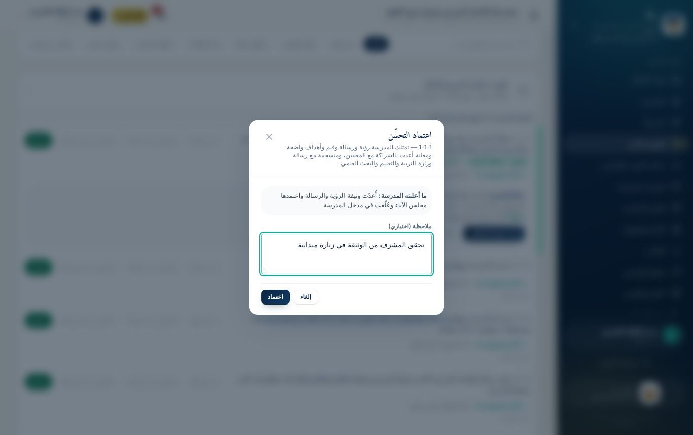

**تاريخ المؤشر** يعرض الرحلة كاملة بنقاط ملونة: تقييم ← ضعف ← خطة ← تنفيذ ← تحسّن ← اعتماد، مع الاسم والوقت والملاحظات.

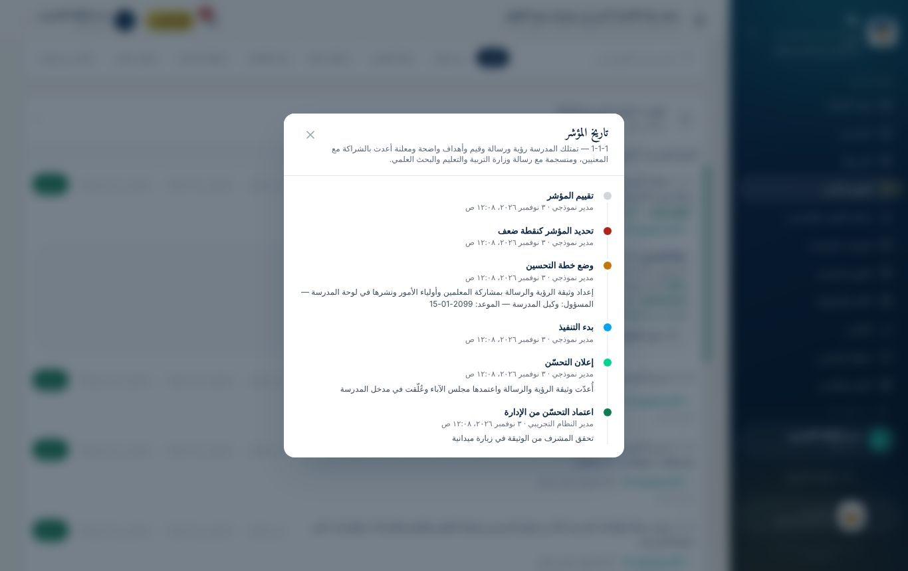

**إعادة فتح الاستمارة:** إذا احتاجت مدرسة تعديل تقييمها بعد الإرسال، اضغط **«إعادة فتح للمدرسة»** في شريط حالة استمارتها.

### نقاط الضعف في ملف المدرسة

في صفحة أي مدرسة (المدارس ← اسم المدرسة) تبويب **«التقييم الذاتي ونقاط الضعف»**. يعرض مباشرة:

- أماكن الضعف التي حددها المدير.
- خطة كل نقطة وحالتها.
- **الأدلة غير المتوفرة** لكل نقطة.

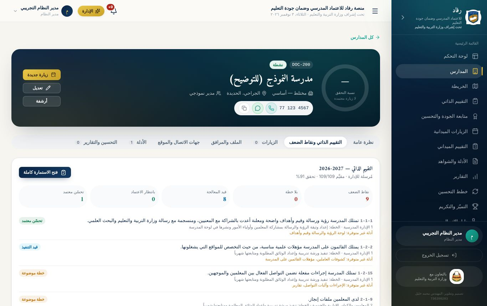

## 3. شهادات التكريم المبنية على البيانات

من **متابعة الجودة** اضغط زر الشهادة بجانب مدرسة أرسلت استمارتها. يظهر **نص مقترح من البيانات فقط**، مثل:

> «بناءً على نتائج التقييم الذاتي ومتابعة قسم الجودة والاعتماد المدرسي للعام الدراسي 2026-2027، حققت الجودة في المعيار رقم (2) «المعلمون والكوادر الإدارية والخدمية»، وعالجت مؤشراً كان نقطة ضعف وتحسّن أداؤه باعتماد الإدارة: المؤشر 1-1-1 «…».»

**شروط الاستحقاق:** أن تكون الاستمارة **مُرسلة**، وأن يوجد على الأقل أحد أمرين:

- **معيار محقَّق بالكامل:** كل مؤشراته مقيّمة، وبلا ضعف مفتوح، ونسبته 80% فأكثر.
- **تحسّن اعتمدته الإدارة.**

إن لم تستحق المدرسة شهادة، يظهر السبب.

**الإصدار والطباعة:**

- **من يصدر الشهادات:** مدير النظام. الزر **«إصدار وطباعة»** يسجّل الشهادة **برمز تحقق** فريد مثل `CERT-ZPMFJTZL`، ويطبعها بإطار رسمي.
- **التوقيع:** لا ختم ولا توقيع مطبوع؛ تبقى خانات التوقيع فارغة للتوقيع اليدوي.
- **إشعار المدرسة:** تُشعَر المدرسة بالشهادة.
- **الشهادات السابقة:** تظهر في النافذة نفسها، ويمكن إعادة طباعتها.
- **الإلغاء:** يستطيع مدير النظام إلغاء شهادة، فيظهر إلغاؤها عند التحقق منها.

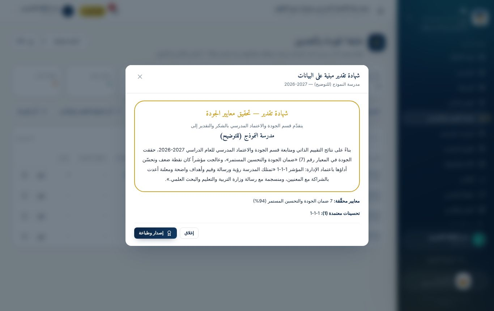

### التحقق العام من الشهادة

يستطيع أي شخص، دون حساب، فتح صفحة **`/verify`** وإدخال رمز الشهادة. تظهر له:

- **بيانات الشهادة:** النص، والعام، والمدرسة، والمديرية.
- **من أصدرها ومتى.**
- **حالتها:** سارية أو ملغاة.

الصفحة نفسها تتحقق من **التقارير المعتمدة**.

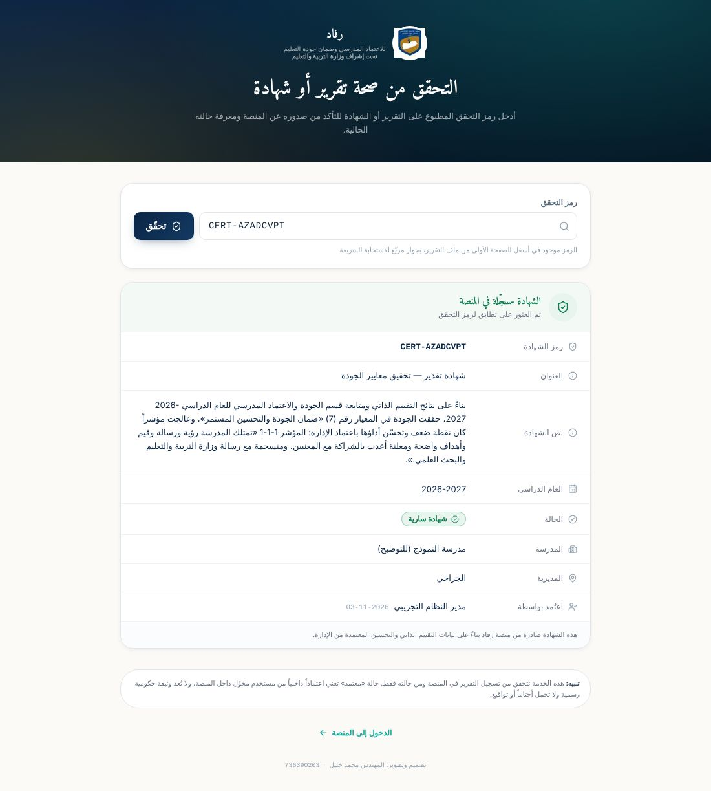

## 4. الزيارات الميدانية والتقييم الميداني

هذه الأداة **مكمّلة للتقييم الذاتي**: يُجري المفتش أثناء الزيارة تقييماً مستقلاً على الاستمارة نفسها.

### الزيارات الميدانية

من القائمة **الزيارات الميدانية** تُجدوَل الزيارات وتُتابَع حالاتها:

- مجدولة.
- جارية.
- بانتظار المراجعة.
- معتمدة.
- مؤجلة.
- ملغاة.
- متأخرة.

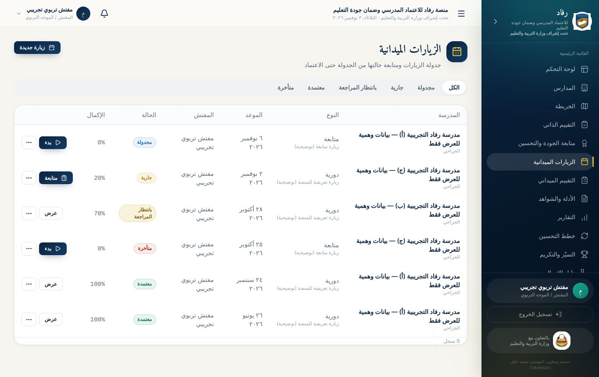

### التقييم الميداني

من القائمة **التقييم الميداني** يقيّم المفتش مؤشرات المدرسة أثناء الزيارة:

- **الحفظ تلقائي:** يُحفظ كل تغيير فوراً، مع **سجل** بمن عدّل ومتى ولماذا.
- **العمل دون إنترنت:** عند ضعف الاتصال تُحفظ الدرجات **على الجهاز** وتُرفع تلقائياً لاحقاً.
- **الشواهد:** تُرفع لكل مؤشر.
- **مسار الاعتماد:** يرسل المفتش التقييم للمراجعة، ثم يعتمده مدير النظام أو يعيده.

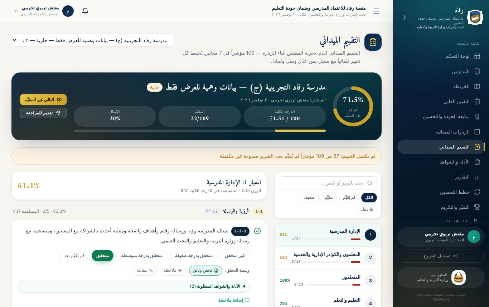

## 5. الأدلة والشواهد

قسم **الأدلة والشواهد** يجمع كل ما رُفع: من الاختبار التفاعلي، والاستمارة، والتقييم الميداني، وغيرها.

- **الحالات:** بانتظار المراجعة، أو مقبول، أو مرفوض.
- **المراجعة:** يقبل المراجع الدليل أو يرفضه مع ذكر السبب.
- **حماية الملفات:** محفوظة بشكل خاص، ولا تُفتح إلا لمن يملك الصلاحية، عبر روابط مؤقتة.
- **مكتبة الأدلة:** تحفظ النماذج المتكررة.

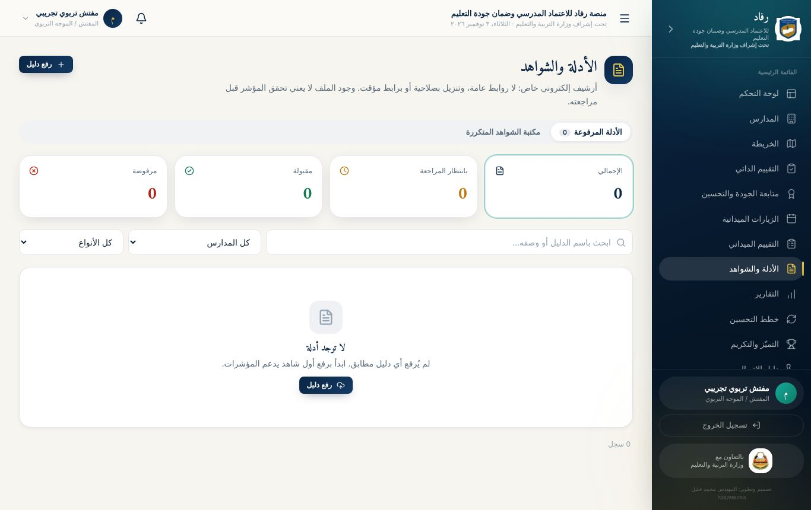

## 6. التقارير وخطط التحسين (الإجراءات التصحيحية)

**التقارير:**

- **التوليد:** تُولَّد من بيانات الزيارات والمدارس الفعلية.
- **مسار الاعتماد:** مسودة ← قيد المراجعة ← معتمد أو مرفوض.
- **التصدير:** PDF عربي، أو Excel، أو CSV.
- **رمز التحقق:** يحمله كل تقرير معتمد.

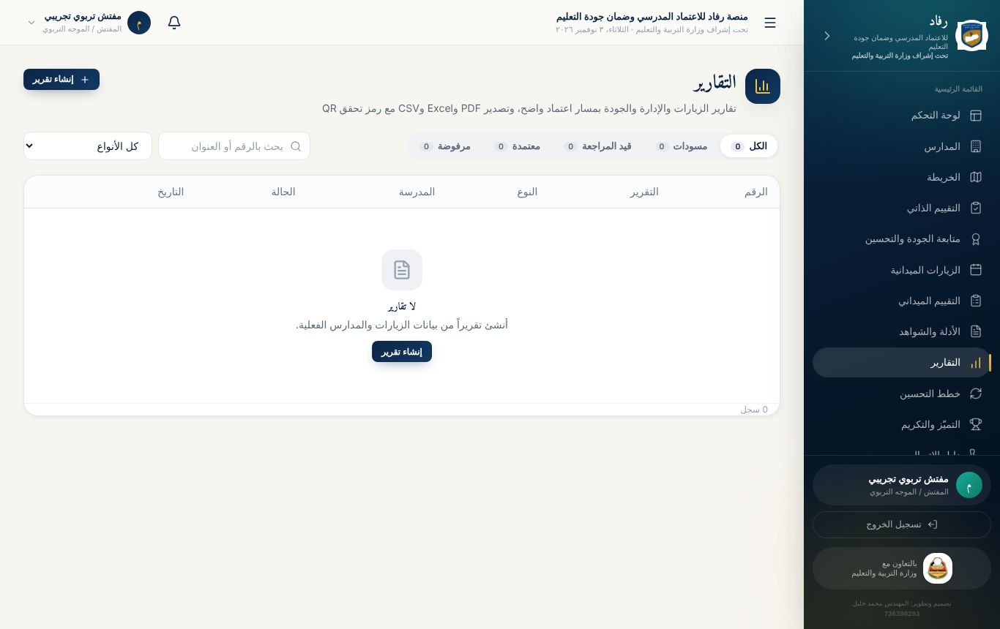

**خطط التحسين (من التقييم الميداني):**

- **متى تُطلب:** كل مؤشر قُيّم 0 أو 1 في آخر تقييم ميداني يتطلب **إجراءً تصحيحياً**.
- **محتوى الإجراء:** المشكلة، والسبب، والأولوية، والإجراء، والمسؤول، والموعد.
- **مسار الإجراء:** جديد ← قيد التنفيذ ← يحتاج تحقق ← مغلق بعد التحقق، أو مرفوض التحقق.

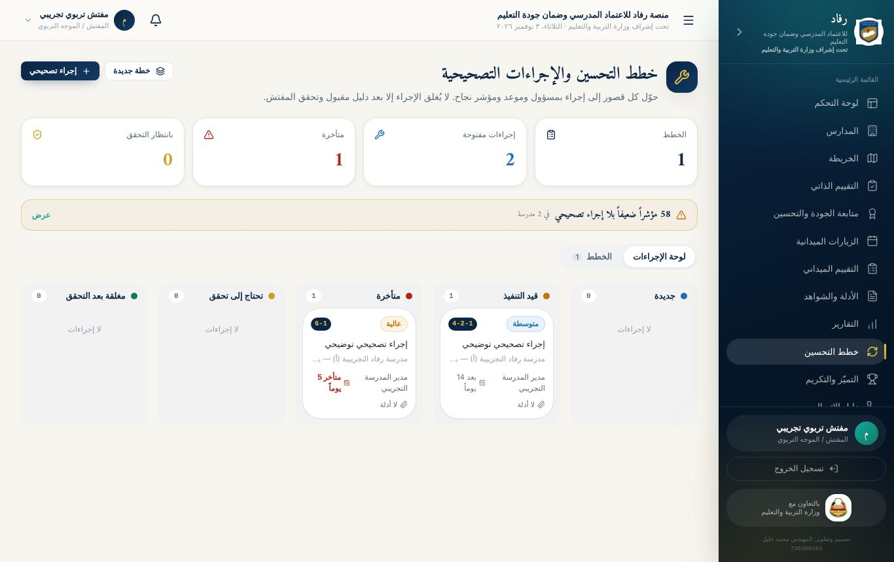

## 7. الخريطة والتميّز ودليل الاتصال

- **الخريطة:** مواقع المدارس على خريطة OpenStreetMap، ولون كل نقطة حسب نسبة التحقق.
- **التميّز والتكريم:** ترتيب المدارس من آخر تقييم ميداني مكتمل بنسبة 70% فأكثر، في أربع فئات:
  - متميّز (90% فأكثر).
  - متقدّم (75% فأكثر).
  - مقبول (60% فأكثر).
  - بحاجة إلى دعم.

  ويظهر أيضاً مقدار التحسّن عن الزيارة السابقة.
- **دليل الاتصال:**
  - **المحتوى:** كل المدارس في نطاقك، مع مديرها، وأزرار **اتصال** و**واتساب** و**توجيه** إلى موقع المدرسة.
  - **التصدير:** CSV، أو ملف **جهات اتصال (VCF)** يُستورد في الهاتف مباشرة.

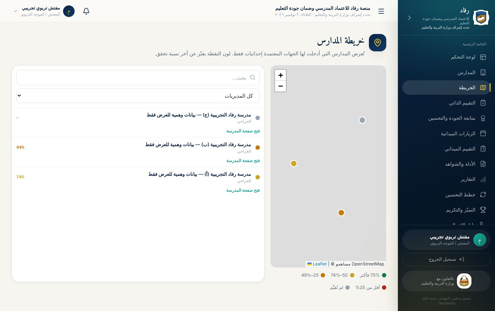

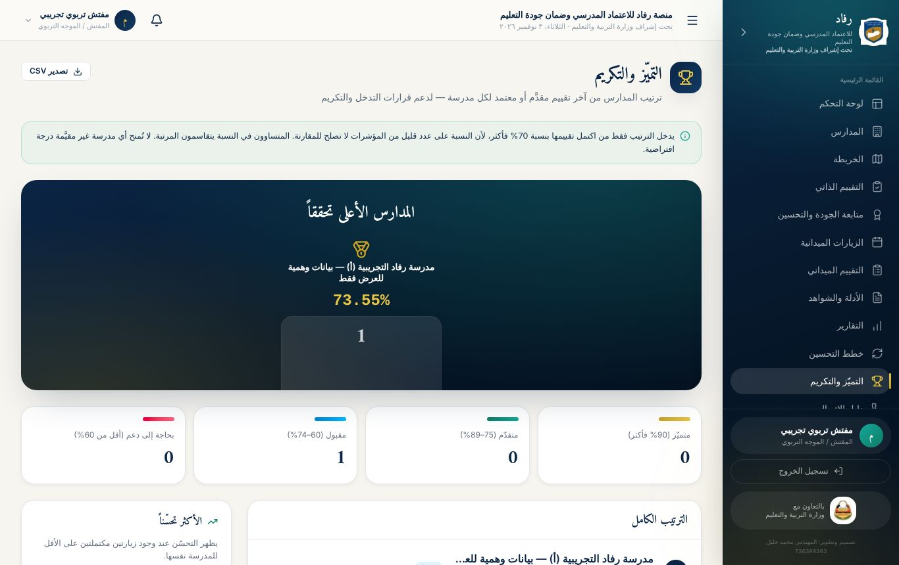

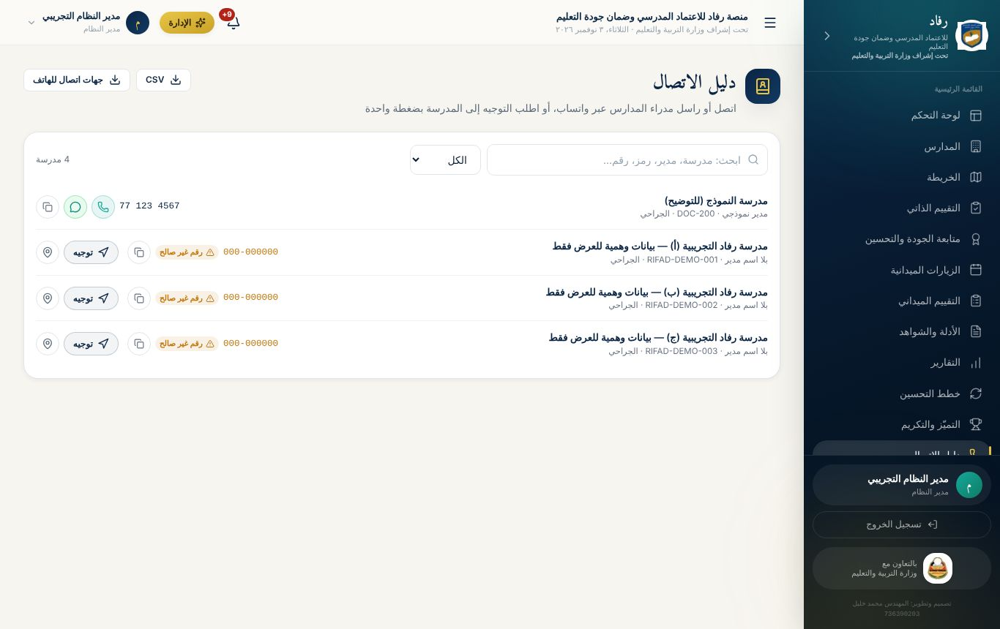

## 8. مشرف المحافظة: الاطلاع والمتابعة

حساب **مشرف المحافظة** لقيادات التربية والتعليم في المحافظة، ليطّلعوا على عمل المدارس **دون أي تعديل**. يحمله حالياً **أ. عمر بحر** (مدير مكتب التربية والتعليم والبحث العلمي بالمحافظة)، و**أ. فهمي المقطري** (مدير إدارة الجودة والاعتماد المدرسي بالمحافظة). ينشئه مدير النظام وحده.

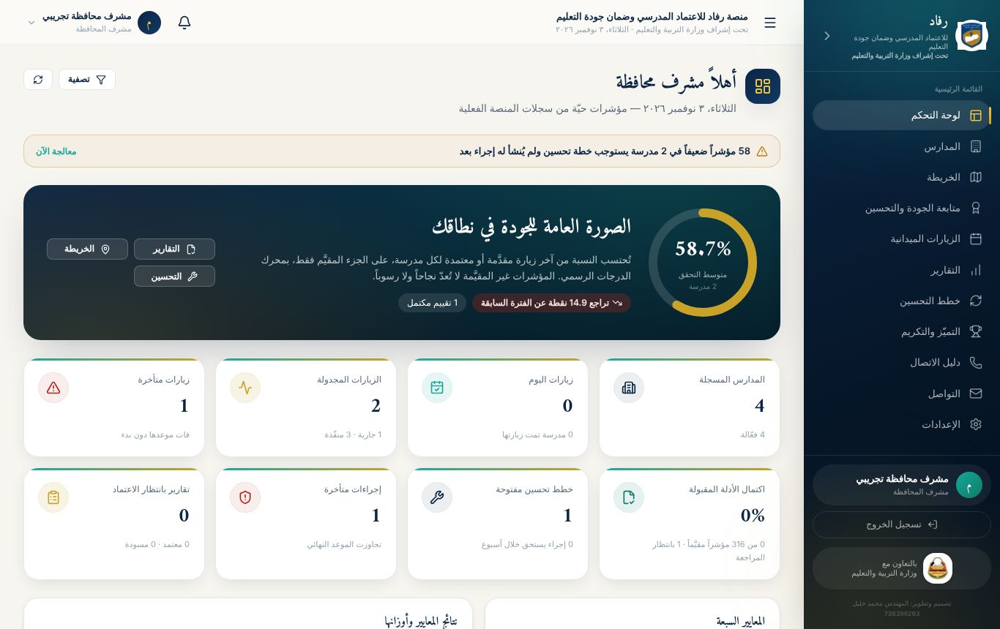

- **يرى:** لوحة التحكم، ومتابعة الجودة والتحسين ونقاط الضعف الشائعة، والمدارس والخريطة، والزيارات، والتقارير وتنزيلها، وخطط التحسين، والتميّز والتكريم، ودليل الاتصال، والإعلانات.
- **لا يستطيع:** أي إضافة أو تعديل أو اعتماد أو حذف أو تذكير. لا تظهر له هذه الأزرار، و**يرفض الخادم** أي طلب تعديل من حسابه برسالة «حسابك للاطلاع والمتابعة فقط ولا يملك صلاحية التعديل».
- **إن لاحظ ما يستدعي تدخلاً** يبلّغ مدير النظام، فهو من يوجّه المفتشين ويعتمد ويعيد.
