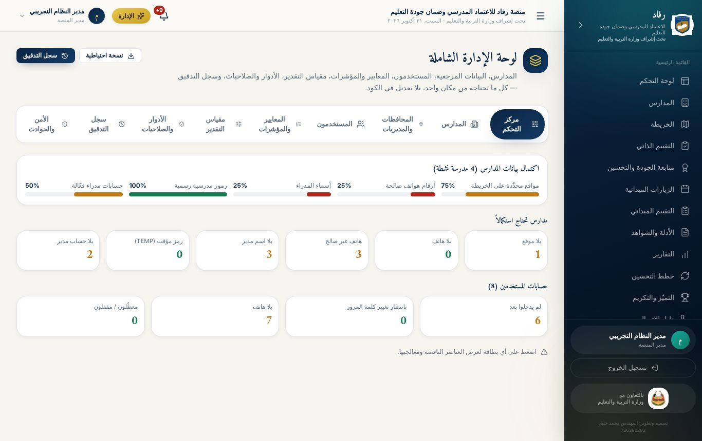
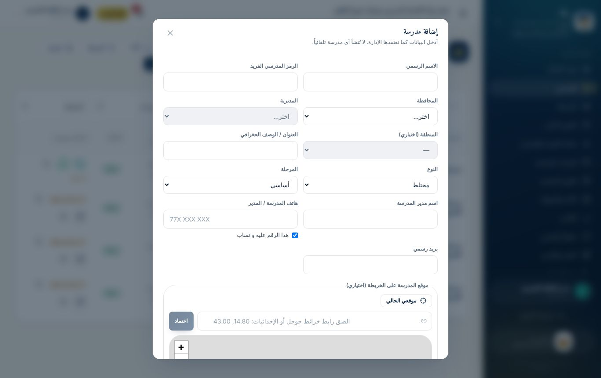
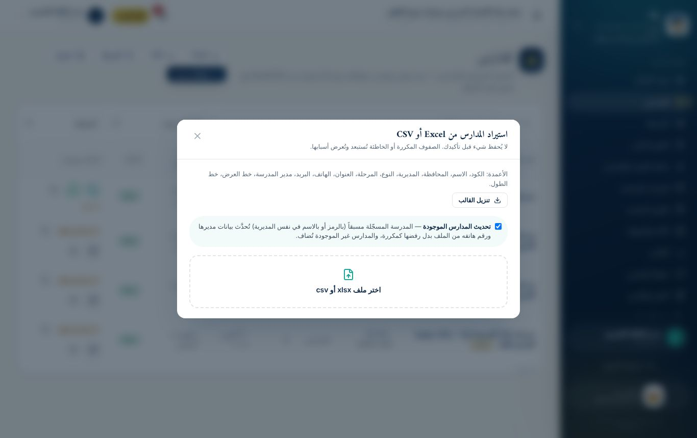
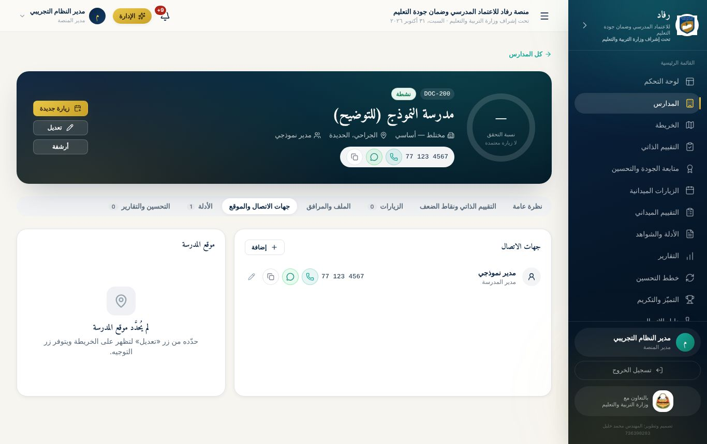
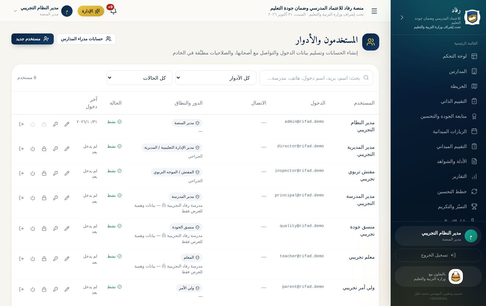
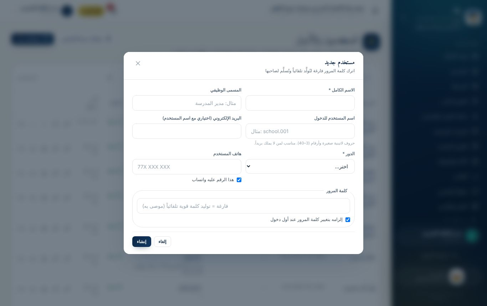
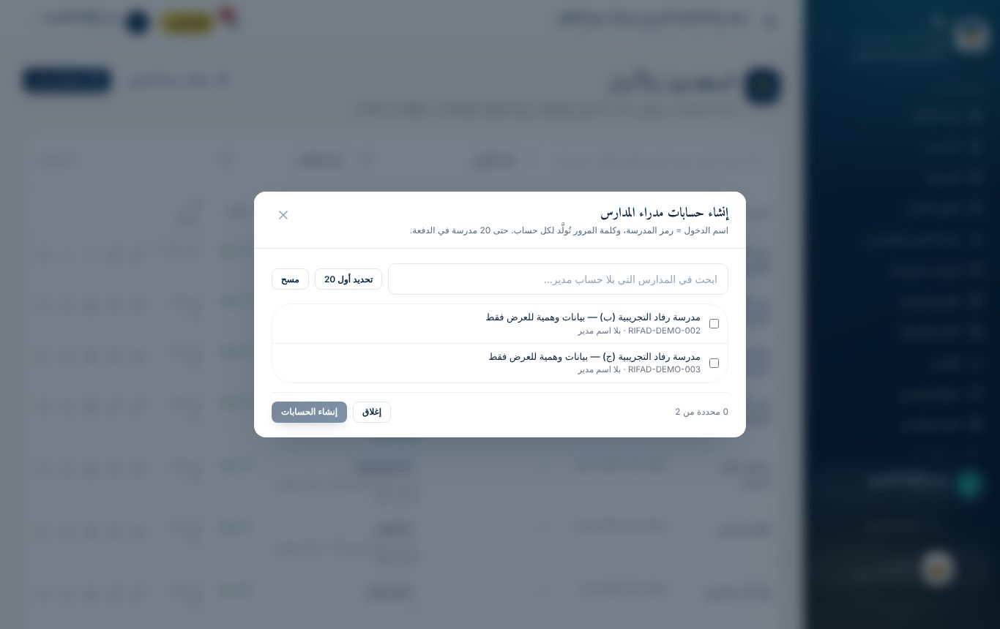
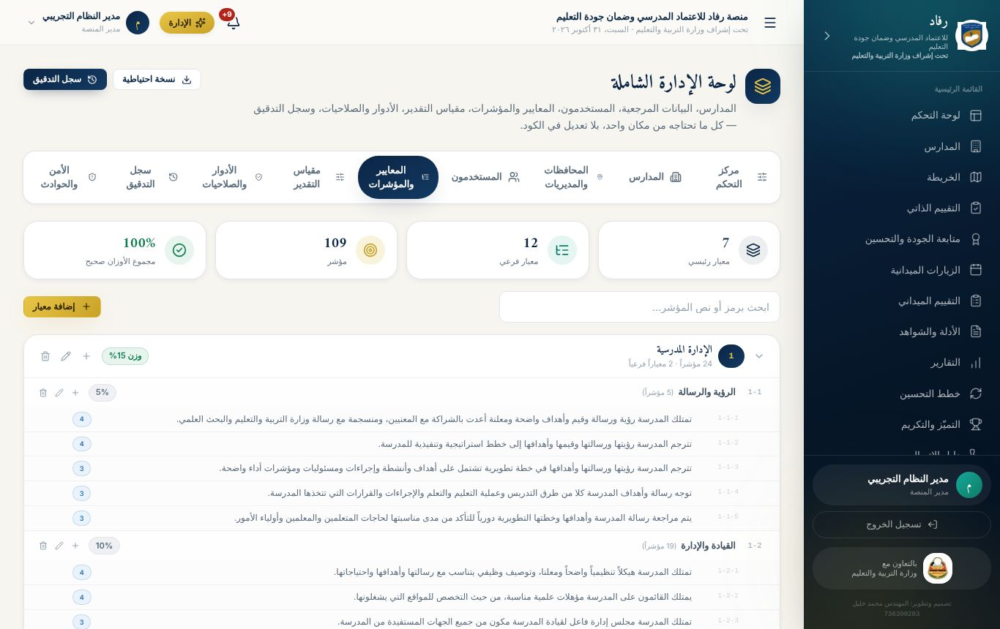

# الفصل الخامس: دليل مدير النظام

مدير النظام يدير **كل شيء من داخل المنصة**، دون تعديل الكود أو قاعدة البيانات يدوياً. الأدوات موزعة على صفحات: **الإدارة**، و**المستخدمون والأدوار**، و**المدارس**.

## 1. لوحة الإدارة الشاملة

من زر **«الإدارة»** في الشريط العلوي، أو من الرابط `/admin`. في أعلاها زران:

- **«نسخة احتياطية»:** ينزّل نسخة كاملة من قاعدة البيانات.
- **«سجل التدقيق».**

| التبويب | الوظيفة |
|---|---|
| **مركز التحكم** | اكتمال بيانات المدارس والحسابات، وقوائم ما ينقص لمعالجته سريعاً |
| **المدارس** | إضافة المدارس وتعديلها وأرشفتها وحذفها |
| **المحافظات والمديريات** | إضافة المحافظات والمديريات والمناطق وتعديلها وحذفها. لا يُسمح بحذف ما ترتبط به مدارس |
| **المستخدمون** | إدارة سريعة للحسابات |
| **المعايير والمؤشرات** | محتوى الاستمارة كاملاً |
| **مقياس التقدير** | مستويات التقدير وأوصافها ودرجاتها |
| **الأدوار والصلاحيات** | إنشاء أدوار جديدة بصلاحيات مخصّصة |
| **سجل التدقيق** | كل إجراء حسّاس: من فعله، ومتى، وما الذي تغيّر |
| **الأمن والحوادث** | محاولات الدخول المشبوهة، وإيقاف الحسابات، وتسجيل الحوادث الأمنية ومعالجتها |

### مركز التحكم

يعرض **نسبة اكتمال بيانات المدارس**: المواقع على الخريطة، والهواتف الصالحة، وأسماء المدراء، والرموز الرسمية، وحسابات المدراء. وتحتها بطاقات لما ينقص:

- **بيانات المدارس:** مدارس بلا موقع، أو بلا هاتف، أو برقم غير صالح، أو بلا اسم مدير، أو برمز مؤقت (TEMP)، أو بلا حساب مدير.
- **الحسابات:** مستخدمون لم يدخلوا بعد، أو بانتظار تغيير كلمة المرور، أو بلا هاتف، أو معطّلون.

اضغط أي بطاقة لتظهر القائمة، ومعها أزرار معالجة سريعة، مثل **«حدّد الموقع»** و**«فتح المدرسة»**.

## 2. المدارس

### إضافة مدرسة من داخل الموقع

**المدارس ← إضافة مدرسة**. الحقول:

- **الأساسية:** الاسم، والرمز، والمحافظة، والمديرية، والمنطقة، والعنوان، والنوع، والمرحلة.
- **المدير:** اسم مدير المدرسة، و**هاتف المدرسة أو المدير** مع خانة **«هذا الرقم عليه واتساب»**.
- **الموقع على الخريطة**، بثلاث طرق:
  1. النقر على الخريطة، ثم سحب الدبوس لضبطه.
  2. زر **«موقعي الحالي»** (GPS) وأنت عند المدرسة.
  3. لصق **رابط خرائط جوجل**، ولو كان مختصراً، أو **الإحداثيات** مثل `14.80, 43.00`.

**ما تفعله المنصة تلقائياً:**

- **الأرقام:** توحّد كتابة الأرقام. الجوال اليمني 9 خانات يبدأ بالرقم 7. والرقم الخاطئ يُنبَّه إليه، مع خيار حفظه كما هو.
- **الإحداثيات:** ترفض ما يقع خارج اليمن، وتصحّح قلب خطّي العرض والطول.
- **التكرار:** تنبّه إن وُجدت مدرسة أخرى على بعد أمتار قليلة من الموقع نفسه.

### استيراد المدارس من Excel

**المدارس ← استيراد**:

1. **القالب (اختياري):** نزّل القالب، أو ارفع كشفك كما هو. المنصة تكتشف صف العناوين وتطابق الأعمدة بأسمائها:
   - رقم المدرسة.
   - المدرسة.
   - المحافظة.
   - المديرية.
   - النوع.
   - المرحلة.
   - العنوان.
   - مدير المدرسة.
   - التلفون.
2. **وضع التحديث:** اترك خانة **«تحديث المدارس الموجودة»** مفعّلة، وهي مفعّلة تلقائياً. المدرسة المسجّلة مسبقاً، بالرمز أو بالاسم في المديرية نفسها، تُحدَّث **بيانات مديرها ورقم هاتفه** بدل رفضها كمكررة. والخلية الفارغة في الكشف لا تمحو بياناً موجوداً.
3. **المعاينة:** تعرض عدد المدارس الجديدة، وعدد التي ستُحدَّث، والأخطاء، والتنبيهات. لا يُحفظ شيء قبل الضغط على **«تأكيد»**.
4. **المدرسة بلا رقم:** تُحفظ برمز مؤقت `TEMP-001`، ويمكن تعديله لاحقاً.

### ملف المدرسة

صفحة كل مدرسة فيها تبويبات:

| التبويب | المحتوى |
|---|---|
| **نظرة عامة** | ملخص المدرسة |
| **التقييم الذاتي ونقاط الضعف** | أماكن الضعف التي حددها المدير وحالة معالجتها |
| **الزيارات** | زيارات المفتشين للمدرسة |
| **الملف والمرافق** | بيانات المدرسة ومرافقها |
| **جهات الاتصال والموقع** | الوكيل، ومنسق الجودة، ورئيس مجلس الآباء وغيرهم، ولكل منهم هاتف وأزرار اتصال وواتساب. ومعها الخريطة وزر **«توجيه»** يفتح الملاحة في خرائط جوجل |
| **الأدلة** | الشواهد المرفوعة للمدرسة |
| **التحسين والتقارير** | خطط التحسين وتقارير المدرسة |

## 3. المستخدمون والحسابات

من القائمة: **المستخدمون والأدوار**.

- **البحث والتصفية:** بالاسم، أو البريد، أو اسم الدخول، أو الهاتف، أو المدرسة. وبالدور، وبالحالة: نشط، أو معطّل، أو مقفل، أو لم يدخل بعد، أو بانتظار تغيير كلمة المرور.
- **إجراءات كل مستخدم:**
  - تعديل.
  - **إعادة تعيين كلمة المرور:** تُولَّد كلمة مؤقتة جديدة، وتُنهى جلسات المستخدم.
  - قفل الحساب وفتحه.
  - تعطيل الحساب وتفعيله.
  - إنهاء كل الجلسات.

### إنشاء مستخدم

**«مستخدم جديد»**:

- **الهوية:** الاسم، والمسمى الوظيفي.
- **الدخول:** **اسم المستخدم**، لمن لا يملك بريداً، و/أو البريد.
- **الدور والنطاق:** الدور، والمدرسة لأدوار المدرسة، أو المديرية لمدير الإدارة والمفتش.
- **التواصل:** الهاتف مع خانة الواتساب.
- **كلمة المرور:** اتركها فارغة لتُولَّد **كلمة قوية تلقائياً**، وهو الموصى به. وخانة **«إلزامه بتغيير كلمة المرور عند أول دخول»** مفعّلة افتراضياً.

### بطاقة بيانات الدخول

بعد الإنشاء أو إعادة التعيين تظهر **بيانات الدخول مرة واحدة فقط**:

- **نسخ:** اسم الدخول، أو كلمة المرور، أو الرسالة كاملة.
- **إرسال عبر واتساب:** برسالة جاهزة لرقم المستخدم.
- **طباعة:** ورقة تسلَّم لصاحبها.

كلمة المرور **لا تُخزَّن نصاً** ولا تُسجَّل في أي مكان.

### إنشاء حسابات مدراء المدارس دفعة واحدة

زر **«حسابات مدراء المدارس»**:

1. تظهر المدارس النشطة التي ليس لها حساب مدير فعّال.
2. اختر حتى **20 مدرسة في الدفعة**، ثم اضغط **«إنشاء الحسابات»**.
3. يُنشأ لكل مدرسة حساب:
   - **اسم الدخول** = رمز المدرسة.
   - **الاسم والهاتف** من بيانات المدرسة.
   - **كلمة المرور** مؤقتة مولَّدة، مع إلزام بتغييرها.
4. يظهر جدول بيانات الدخول، ومعه زر **«تنزيل CSV»**، وأزرار **اتصال** و**واتساب** لكل مدير.

> **احفظ ملف كلمات المرور أو أرسلها فوراً، ثم أتلف الملف بعد التسليم.** لا يمكن عرض كلمات المرور لاحقاً، لكن يمكنك إعادة تعيين أي كلمة.

## 4. محتوى الاستمارة: المعايير والمؤشرات

**الإدارة ← المعايير والمؤشرات**:

- **ما يمكن تعديله:** إضافة **معيار**، أو **معيار فرعي**، أو **مؤشر**، وتعديلها وحذفها.
- **بيانات كل عنصر:** الرمز، والنص، والوزن، و**الأدلة والشواهد** (سطر لكل دليل)، وأدوات التحقق.
- **مراجعة الأوزان:** يظهر مجموعها، ويجب أن يساوي 100%.
- **أثر التعديل:** يظهر **مباشرة** في الاستمارة، والاختبار التفاعلي، والتقييم الميداني، والطباعة.

**مقياس التقدير:** تعديل نصوص المستويات ودرجاتها. الدرجتان 0 و1 تُعدّان «ضعفاً» في دورة التحسين.

## 5. الأدوار والصلاحيات

الأدوار الجاهزة:

- مدير النظام.
- مدير الإدارة / المديرية.
- المفتش / الموجه التربوي.
- مدير المدرسة.
- منسق الجودة.
- المعلم.
- ولي الأمر.

يمكن إنشاء **دور جديد** واختيار صلاحياته من قائمة مصنّفة: المدارس والزيارات، والتقييم، والأدلة، والتقارير، والتواصل، والإدارة. كل الصلاحيات **تُفحص في الخادم**، فإخفاء الأزرار وحده ليس الحماية. انظر فصل الصلاحيات للمصفوفة الكاملة.

## 6. النسخ الاحتياطي وسجل التدقيق

- **نسخة احتياطية:** زر في أعلى لوحة الإدارة.
  - على Vercel أو Turso ينزّل ملف `.sql` كاملاً يمكن استعادته.
  - على خادم عادي ينزّل ملف قاعدة البيانات نفسه.
- **سجل التدقيق:** يسجّل كل إنشاء وتعديل وحذف واعتماد ودخول وتصدير، باسم المنفّذ ووقته، ولا يمكن تعديله من المستخدمين.
