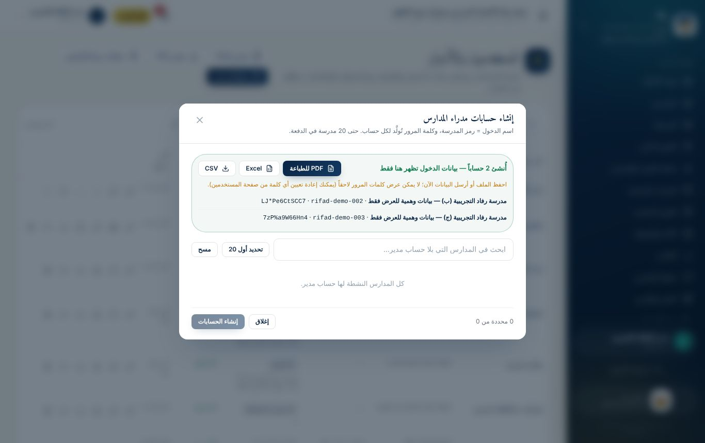
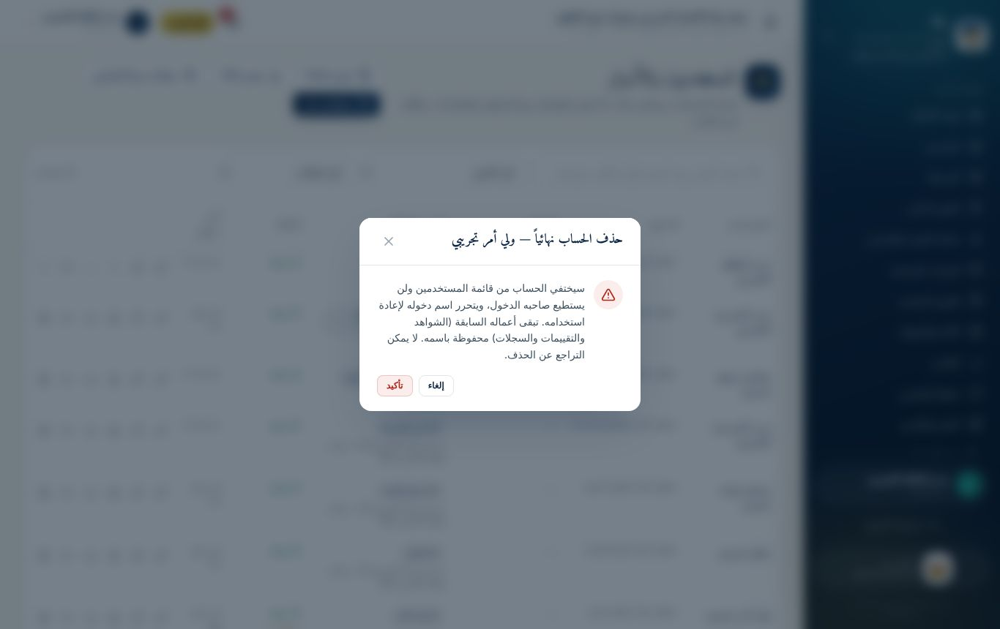

# دليل المدرّب

هذا الدليل لرئيسة المنصة ولكل من يقدّم الدورة. يشرح كيف تُحضَّر الدورة، وكيف تُجهَّز حسابات التدريب، وكيف تُدار الجلسات، وما يجب فعله بعد انتهائها.

## 1. دور المدرّب

المدرّب في هذه الدورة **يُري ثم يُطبِّق**، ولا يكتفي بالشرح النظري:

1. **يعرض الخطوة** على شاشة العرض من حسابه التدريبي.
2. **يطبّقها المتدربون** على حساباتهم في اللحظة نفسها.
3. **يتجوّل بينهم** ليتأكد أن كل متدرب وصل إلى النتيجة نفسها.
4. **يختم كل جزء بتمرين** ينفّذه المتدرب وحده، دون توجيه.

> **قاعدة ذهبية:** لا تنتقل إلى الخطوة التالية قبل أن يصل 80% من المتدربين على الأقل إلى النتيجة المطلوبة.

## 2. الفئات المستهدفة ومساراتها

| المسار | الفئة | المدة المقترحة | الوحدات |
|------|------------------------------------------------------------|--------------------------------|-----------------------------|
| **أ** | المعلمون | جلسة واحدة (3 ساعات) | الأساسيات + المعلم + الملفات |
| **ب** | مدراء المدارس ومنسقو الجودة | يومان (4 ساعات يومياً) | الأساسيات + المدرسة + الملفات |
| **ج** | الإشراف والمتابعة: المفتشون والموجّهون التربويون وموظفو قسم الجودة | يوم واحد (5 ساعات) | الأساسيات + الإشراف + الملفات |
| **د** | رئاسة المنصة ومدراء النظام | يوم واحد (5 ساعات)، بعد المسار ج | الإدارة والنظام |

- **عدد المتدربين المناسب:** من 10 إلى 20 متدرباً في القاعة الواحدة.
- **الترتيب المقترح:** نفّذ المسار **د** أولاً لفريق رئاسة المنصة، ثم المسار **ج** للمشرفين، ثم **ب** للمدارس، وأخيراً **أ** للمعلمين. بهذا يكون المشرفون جاهزين لمتابعة المدارس فور تدريبها.

## 3. التجهيزات المطلوبة

### القاعة والأجهزة

- [ ] جهاز عرض (بروجكتر) أو شاشة كبيرة، متصل بجهاز المدرّب.
- [ ] جهاز لكل متدرب أو لكل متدربَين: كمبيوتر أو جوال ذكي بمتصفح حديث (Chrome أو Edge أو Safari).
- [ ] اتصال إنترنت يكفي الجميع. جرّبه قبل الدورة بيوم.
- [ ] شاحن ومشترك كهرباء.
- [ ] نسخ مطبوعة من **الكتيّب الخاص بالفئة**، و**البطاقة المرجعية السريعة**، و**الاختبار القبلي والبعدي**.

### الملفات التي يحتاجها المدرّب

- [ ] **العرض التقديمي للدورة** (ملف PowerPoint المرفق بالحقيبة).
- [ ] **ملف بيانات الدخول التدريبية** المطبوع (انظر الفقرة التالية).
- [ ] **صورة أو ملف PDF صغير** على جهاز كل متدرب، لتمرين رفع الشواهد.

## 4. تجهيز بيئة التدريب على المنصة

يتدرّب الجميع على **المنصة الفعلية نفسها**، لكن على **مدارس وحسابات تدريبية** منفصلة تماماً عن بيانات المدارس الحقيقية.

> **تنبيه مهم:** لا تدرّب أحداً على حساب مدرسة حقيقية. أي تقييم يحفظه المتدرب يُسجَّل في تاريخ المؤشرات ولا يُمحى، ويظهر في إحصاءات المتابعة.

### الخطوة 1: إنشاء مدارس التدريب

من حساب مدير النظام: **المدارس ← إضافة مدرسة**. أنشئ مدرسة تدريبية لكل متدرب أو لكل اثنين:

| الحقل | القيمة المقترحة |
|------------------|-------------------------------------|
| الاسم | مدرسة التدريب (1)، مدرسة التدريب (2)… |
| الرمز | `TRAIN-01`، `TRAIN-02`… |
| المحافظة والمديرية | مديريتك |
| اسم المدير | اسم المتدرب، أو «مدير تدريبي» |

> **لتوفير الوقت:** جهّز كشف Excel بمدارس التدريب، وارفعه من **المدارس ← استيراد** دفعة واحدة.

### الخطوة 2: إنشاء حسابات مدراء التدريب دفعة واحدة

1. **المستخدمون والأدوار ← حسابات مدراء المدارس**.
2. حدّد مدارس التدريب فقط. اكتب `TRAIN` في البحث لتظهر وحدها.
3. اضغط **«إنشاء الحسابات»**.
4. اضغط **«PDF للطباعة»** واطبع الورقة. قصّها بطاقات، وسلّم كل متدرب بطاقته.

### الخطوة 3: حسابات المعلمين والمنسقين والمشرفين

من **«مستخدم جديد»** أنشئ لكل متدرب حساباً بدوره الحقيقي:

- **معلم** أو **منسق جودة:** اختر مدرسة التدريب نفسها.
- **مفتش** أو **مدير إدارة:** اختر المديرية.
- اترك كلمة المرور فارغة لتُولَّد تلقائياً، ثم اطبع بطاقة كل حساب من زر **«طباعة»** أو نزّلها بزر **«تنزيل ملف»**.

### الخطوة 4: جرّب كل شيء بنفسك قبل الدورة

- [ ] ادخل بحساب تدريبي من كل دور، وتأكد أنه يطلب تغيير كلمة المرور.
- [ ] نفّذ كل تمرين في الوحدة التي ستدرّبها، وسجّل الوقت الذي استغرقه.
- [ ] ارفع ملفاً تجريبياً، وتأكد أن الرفع يعمل على شبكة القاعة.

### الخطوة 5: بعد انتهاء الدورة

- **احذف حسابات التدريب:** من **المستخدمون والأدوار** اضغط زر الحذف 🗑 بجانب كل حساب تدريبي، ثم **«تأكيد»**. يختفي الحساب ويتحرر اسم دخوله.
- **أرشف مدارس التدريب:** من لوحة **الإدارة ← المدارس**. المدرسة المؤرشفة لا تدخل في إحصاءات المتابعة ولا في التقارير.
- **أنشئ الحسابات الحقيقية:** بعد التدريب يتسلّم كل مدير حساب مدرسته الحقيقية، بالطريقة نفسها التي تدرّب عليها.

## 5. أساليب التدريب المستخدمة

| الأسلوب | متى يُستخدم | مثال |
|---------------|-------------------------------|----------------------------------------------------|
| **العرض العملي** | عند تقديم كل شاشة جديدة | المدرّب يجري سؤالاً من الاختبار التفاعلي أمام الجميع |
| **التطبيق الموجّه** | مباشرة بعد العرض | كل متدرب يجيب السؤال نفسه على حسابه |
| **التمرين الفردي** | في نهاية كل جزء | «ضع خطة تحسين لنقطة ضعف، ثم ابدأ تنفيذها» |
| **العمل الثنائي** | في المهام التي يشترك فيها دوران | مدير يعلن تحسّناً، ومفتش يعتمده أو يعيده |
| **دراسة الحالة** | في جلسات الإشراف | تحليل «نقاط الضعف الشائعة» واقتراح ورشة دعم |
| **النقاش** | في ختام كل جلسة | «ما الخطوة التي ستنفّذها أولاً في مدرستك؟» |

## 6. نصائح لإدارة الجلسة

- **ابدأ بالفائدة لا بالأزرار:** اشرح لماذا وُجدت المنصة قبل كيف تُستخدم.
- **اعرض على شاشة كبيرة بتكبير واضح:** اضغط `Ctrl` و`+` في المتصفح لتكبير الصفحة.
- **اطلب من المتدرب أن يقرأ رسائل المنصة بصوت عالٍ:** المنصة تشرح أسباب منع أي إجراء، مثل سبب تعطّل زر الإرسال.
- **اجمع الأسئلة المتكررة** في لوحة جانبية، وأجب عنها في ختام الجلسة.
- **لا تحلّ المشكلة بيدك على جهاز المتدرب:** وجّهه بالكلام ليتعلّم الطريق بنفسه.
- **راقب الوقت:** خطة الجلسات تحدد زمن كل جزء. إن تأخرت، قدّم التمارين الإضافية واجباً منزلياً.

## 7. الأخطاء الشائعة عند المتدربين وكيف تعالجها

| الخطأ | المعالجة |
|----------------------------------------------|-----------------------------------------------------------------|
| ينسى كلمة المرور الجديدة بعد تغييرها | أعد تعيين كلمة مروره من **المستخدمون**، وسلّمه الكلمة المؤقتة الجديدة |
| يُقفل حسابه بعد محاولات دخول خاطئة | انتظر 15 دقيقة، أو افتح الحساب من **المستخدمون ← فتح الحساب** |
| يكتب كلمة المرور بلغة لوحة مفاتيح عربية | نبّهه إلى تحويل لغة لوحة المفاتيح إلى الإنجليزية |
| يتجاهل نافذة خطة التحسين فيضغط «لاحقاً» دائماً | ذكّره أن الاستمارة لن تُرسل قبل وضع خطة لكل نقطة ضعف |
| يحاول رفع ملف كبير جداً، مثل فيديو طويل | اشرح حدّ الحجم، وطرق تصغير الملف (الوحدة السادسة) |
| يسأل لماذا لا يرى قسماً معيناً | الأقسام تظهر حسب الدور. اعرض عليه مصفوفة الصلاحيات |
| يرسل الاستمارة قبل المراجعة | بعد الإرسال يُقفل التقييم. تُعاد فتحها من الإدارة فقط |

## 8. تقويم الدورة

1. **الاختبار القبلي:** في بداية أول جلسة، 10 دقائق. لا يُعلَن للمتدرب كدرجة، بل لقياس نقطة البداية.
2. **ملاحظة الأداء:** يملأ المدرّب **بطاقة ملاحظة الأداء** أثناء التمارين.
3. **الاختبار البعدي:** في نهاية آخر جلسة، بالأسئلة نفسها.
4. **استمارة تقييم الدورة:** يملؤها المتدرب في الدقائق الأخيرة.
5. **مؤشر النجاح:** أن يصل 80% من المتدربين إلى 80% فأكثر في الاختبار البعدي، وأن ينجزوا التمارين الأساسية في بطاقة الأداء.

## 9. المتابعة بعد الدورة

- **الأسبوع الأول:** راقب من **مركز التحكم** عدد الحسابات التي «لم تدخل بعد» و«بانتظار تغيير كلمة المرور»، وتواصل مع أصحابها.
- **الأسبوع الثاني:** راقب من **متابعة الجودة والتحسين** المدارس التي «لم تبدأ» الاختبار التفاعلي، واستخدم أزرار **التذكير**.
- **بعد أسبوعين:** نفّذ **جلسة متابعة** قصيرة (ساعة واحدة) للإجابة عن أسئلة التطبيق الفعلي.
- **حدّث الحقيبة:** أضف إلى فصل الأسئلة الشائعة ما يتكرر من أسئلة الميدان.
