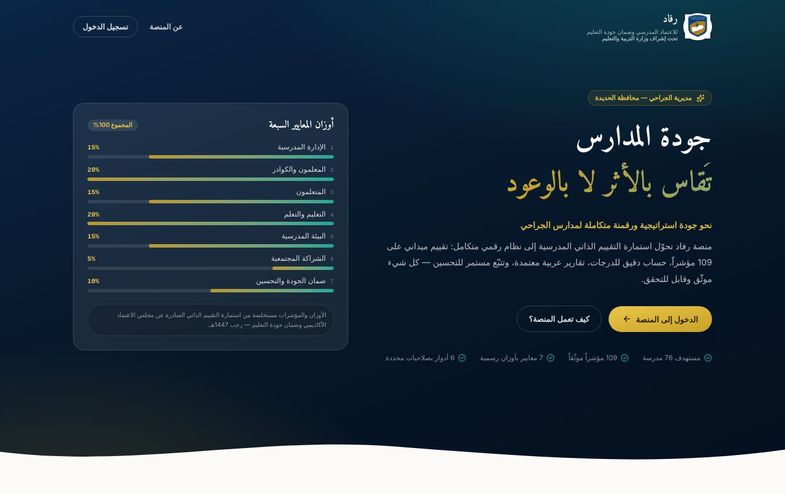
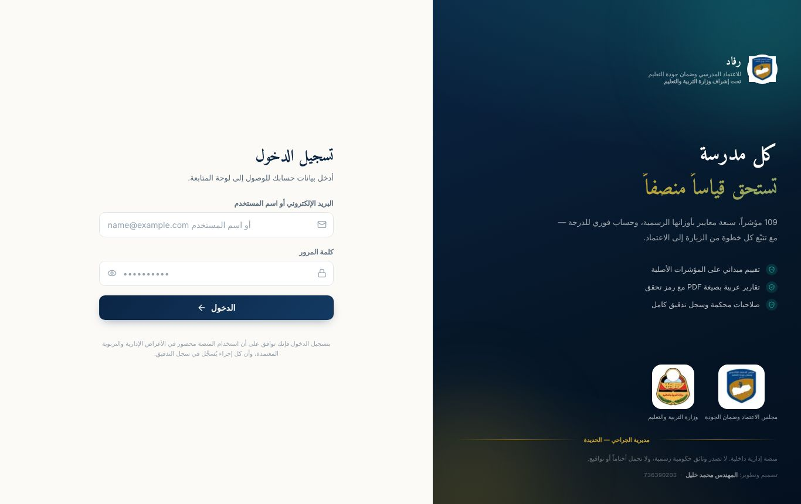
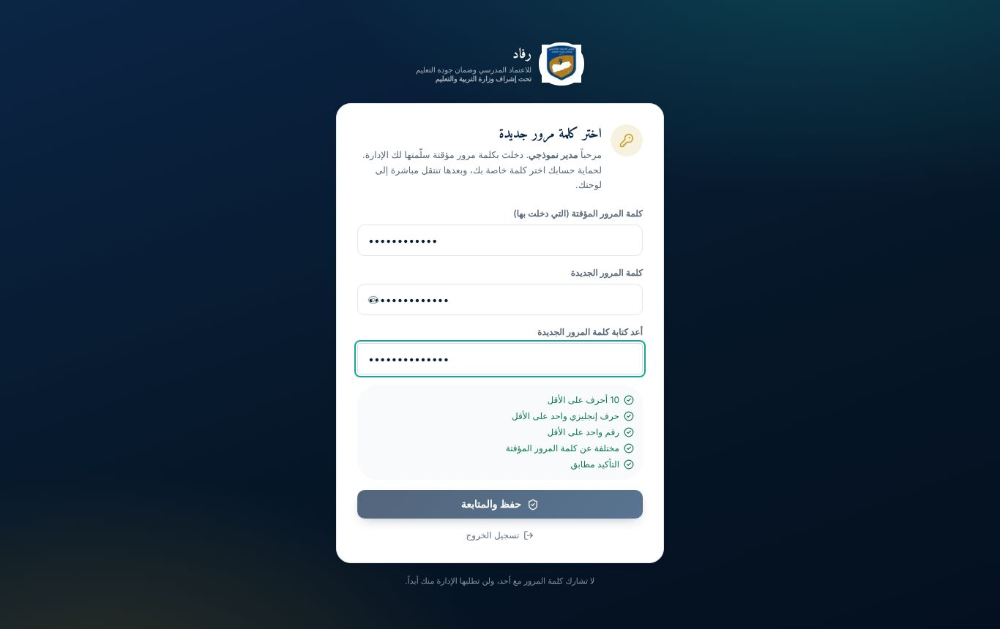
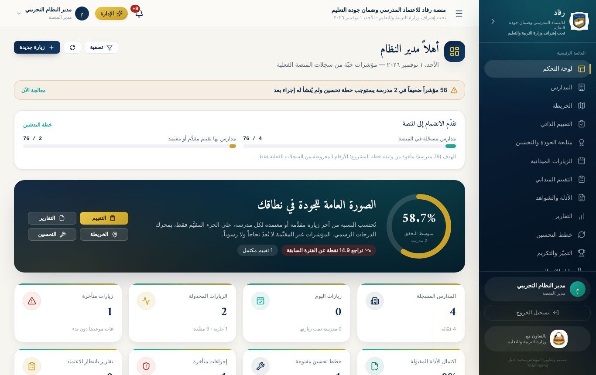
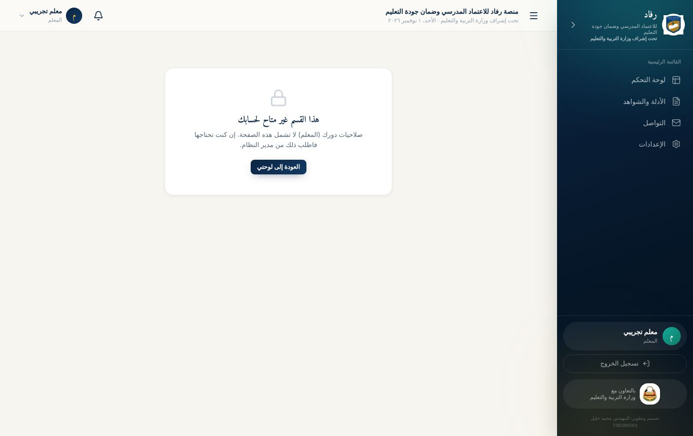
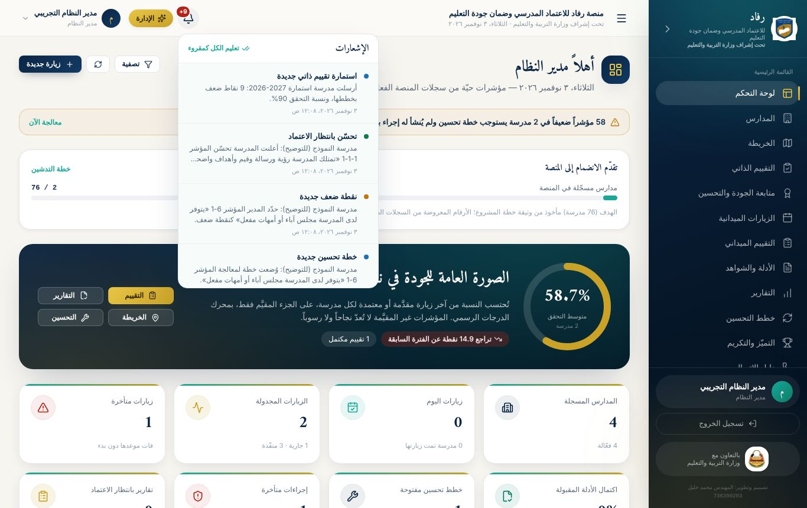
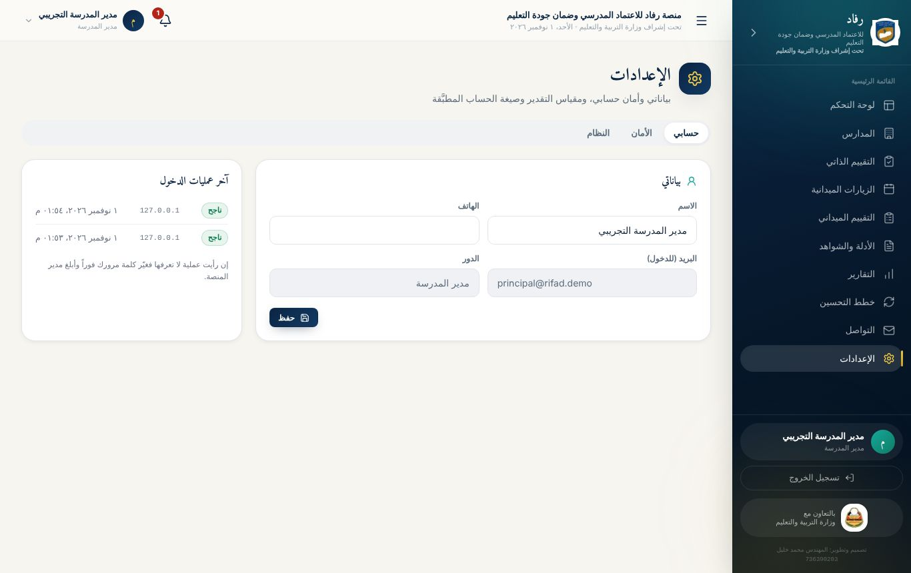
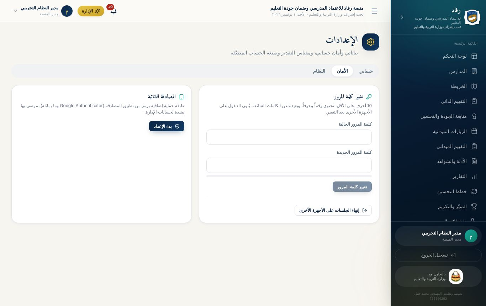
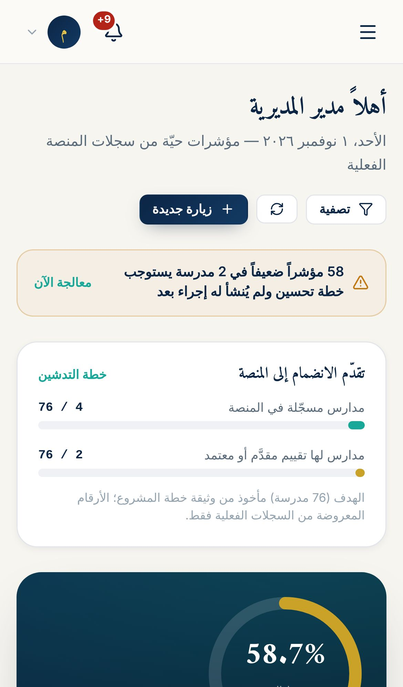
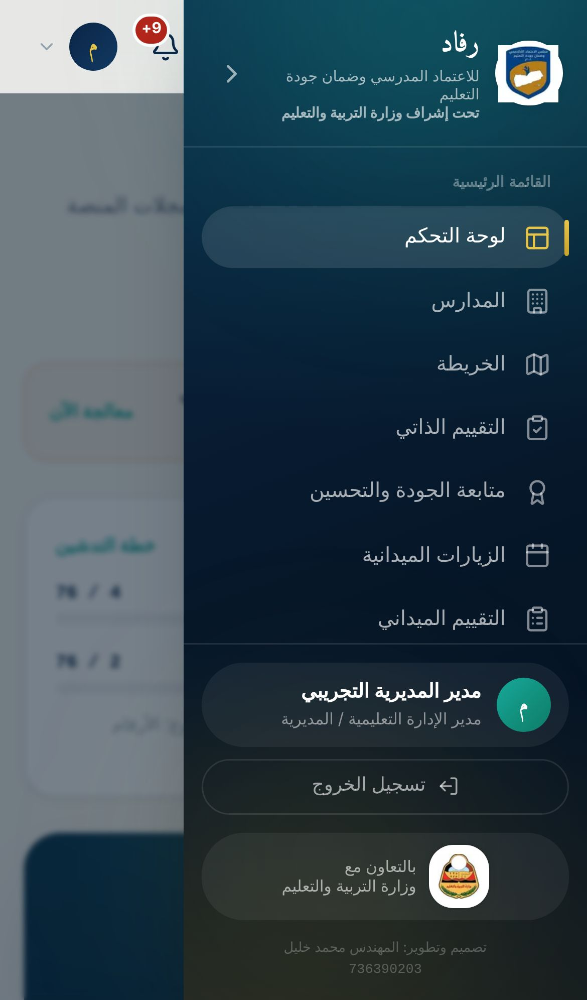

# الوحدة الأولى: أساسيات المنصة (لجميع المتدربين)

**مدة الوحدة:** 45 دقيقة · **الشرائح:** 1–14

**بعد هذه الوحدة يستطيع المتدرب أن:**

- يشرح فكرة منصة رفاد ودورة الجودة فيها بكلماته.
- يدخل المنصة، ويغيّر كلمة المرور المؤقتة.
- يتنقّل في الواجهة، ويقرأ الإشعارات، ويعدّل بيانات حسابه ويحميه.
- يستخدم المنصة من الجوال.

## 1. ما هي منصة رفاد؟

**منصة رفاد للاعتماد المدرسي وضمان جودة التعليم** نظام إلكتروني يعمل من المتصفح على الكمبيوتر والجوال، **تحت إشراف وزارة التربية والتعليم**. لا يحتاج تثبيت أي برنامج.

تحوّل المنصة **استمارة التقييم الذاتي للمدارس** من ورقة إلى دورة رقمية متكاملة:

1. **مدير المدرسة يقيّم مدرسته** مؤشراً مؤشراً، من خلال اختبار تفاعلي إجباري.
2. **تُرصد نقاط الضعف تلقائياً**، ويضع المدير **خطة تحسين** لكل نقطة.
3. **تنفّذ المدرسة الخطة**، ثم تعلن التحسّن وترفق الشواهد.
4. **تعتمد الإدارة التحسّن** بعد التحقق، أو تعيده للمدرسة مع ذكر السبب.
5. **يُبنى التكريم على بيانات حقيقية:** شهادات تقدير موثّقة برمز تحقق.

## 2. من يستخدم المنصة؟

| المستخدم | ماذا يفعل في المنصة |
|--------------------------------------|----------------------------------------------------------------------|
| **مدير النظام** (رئاسة المنصة وقسم الجودة) | يدير كل شيء: المدارس، والحسابات، ومحتوى الاستمارة، والصلاحيات، ويتابع كل المدارس |
| **المفتش / الموجّه التربوي** | يتابع مدارسه، وينفّذ الزيارات والتقييم الميداني، ويعتمد التحسينات أو يعيدها، ويصدر الشهادات |
| **مدير المدرسة** | يجري الاختبار التفاعلي، ويعبّئ الاستمارة، ويضع خطط التحسين، ويرفع الشواهد |
| **منسق الجودة في المدرسة** | يعمل مع المدير على الاستمارة والخطط، ويراجع الشواهد المرفوعة |
| **المعلم** | يرفع ملفات إنجازه وشواهده، ويتواصل مع الإدارة، ويشارك المواد التعليمية |
| **ولي الأمر** | يطّلع على إعلانات المدرسة وموادها، ويتواصل معها |

## 3. المفاهيم الأساسية

### بنية الاستمارة

الاستمارة **هرمية**، كما في نسختها الورقية الرسمية:

- **7 معايير رئيسية**، لكل منها وزن من 100%:

| رقم المعيار | المعيار | الوزن |
|:---------:|-----------------------------------|:---:|
| 1 | الإدارة المدرسية | 15% |
| 2 | المعلمون والكوادر الإدارية والخدمية | 20% |
| 3 | المتعلمون | 15% |
| 4 | التعليم والتعلم | 20% |
| 5 | البيئة المدرسية | 15% |
| 6 | الشراكة المجتمعية | 5% |
| 7 | ضمان الجودة والتحسين المستمر | 10% |

- **معايير فرعية** داخل كل معيار.
- **109 مؤشرات**. لكل مؤشر:
  - **الأدلة والشواهد** المطلوبة، مثل «محضر صياغة الرؤية والرسالة».
  - **أداة التحقق:** فحص وثائق، أو ملاحظة، أو مقابلة.
  - **التقدير** من أربعة مستويات.
  - **الملاحظات.**

### مقياس التقدير

| التقدير | الدرجة | معناه في المنصة |
|------------------|:----:|------------------------|
| غير متحقق | 0 | **نقطة ضعف** تتطلب خطة تحسين |
| متحقق بدرجة ضعيفة | 1 | **نقطة ضعف** تتطلب خطة تحسين |
| متحقق بدرجة متوسطة | 2 | مقبول |
| متحقق | 3 | محقَّق |

### دورة حياة نقطة الضعف بالألوان

| الحالة | اللون | من يغيّرها |
|------------------------|-----------|----------------------------------------------|
| ضعيف — يحتاج خطة | 🔴 أحمر | تلقائياً عند التقدير الضعيف أو وضع إشارة الضعف |
| خطة موضوعة | 🟠 برتقالي | المدرسة حين تحفظ الخطة |
| قيد التنفيذ | 🔵 أزرق | المدرسة بزر «بدأنا التنفيذ» |
| تحسّن — بانتظار الاعتماد | 🟢 أخضر فاتح | المدرسة بزر «تمّت المعالجة وتحسّن» |
| تحسّن معتمد | 🟢 أخضر | الإدارة بزر «اعتماد التحسّن» |

تُسجَّل كل خطوة في **تاريخ المؤشر**، ولا يمكن حذفها أو تعديلها. لذلك ترى الإدارة القصة كاملة دائماً.

### المعيار «المحقَّق» والتكريم

يُعدّ المعيار **محقَّقاً بالكامل** إذا اجتمعت ثلاثة شروط:

1. قُيّمت كل مؤشراته.
2. لا توجد فيه نقطة ضعف مفتوحة.
3. نسبة تحققه 80% فأكثر.

المعايير المحقَّقة والتحسينات المعتمدة هي وحدها ما تُبنى عليه **شهادات التكريم**.

### العام الدراسي

كل استمارة مرتبطة بمدرسة وعام دراسي، مثل `2026-2027`. يبدأ العام الجديد تلقائياً في شهر أغسطس، فتبدأ المدارس استمارة جديدة، وتظهر لها **مقارنة بالعام السابق**.

## 4. الدخول إلى المنصة

1. افتح رابط المنصة في المتصفح. يفضَّل Chrome أو Edge أو Safari.
2. اضغط **«الدخول إلى المنصة»**.
3. في خانة الدخول اكتب **البريد الإلكتروني** أو **اسم المستخدم** كما في بطاقتك:
   - مدراء المدارس: اسم الدخول غالباً **رمز المدرسة**، مثل `school-001`.
   - بقية المستخدمين: البريد أو اسم المستخدم الذي سلّمته لك الإدارة.
4. اكتب كلمة المرور، ثم اضغط **«الدخول»**.

> **انتبه:**
>
> - اكتب كلمة المرور بلوحة المفاتيح **الإنجليزية**، وانتبه للأحرف الكبيرة والصغيرة.
> - بعد **5 محاولات خاطئة** يُقفل الحساب مؤقتاً **15 دقيقة**.
> - إذا فعّلت المصادقة الثنائية، يُطلب منك رمز من تطبيق المصادقة على هاتفك.

## 5. تغيير كلمة المرور المؤقتة (أول دخول)

كل حساب جديد يأتي بـ**كلمة مرور مؤقتة**. عند أول دخول تظهر صفحة **«اختر كلمة مرور جديدة»**، ولا تفتح أي صفحة أخرى قبل إكمالها:

1. اكتب **كلمة المرور المؤقتة** المكتوبة في بطاقتك.
2. اكتب **كلمة مرور جديدة**، ثم أعد كتابتها للتأكيد.
3. راقب الشروط وهي تتحول إلى اللون الأخضر:
   - 10 أحرف على الأقل.
   - حرف إنجليزي واحد على الأقل.
   - رقم واحد على الأقل.
   - مختلفة عن الكلمة المؤقتة.
   - التأكيد مطابق.
4. اضغط **«حفظ والمتابعة»**.

> **نصيحة:** اختر كلمة يسهل عليك تذكّرها ويصعب على غيرك تخمينها، مثل جملة قصيرة مع أرقام: `Madrasati2026Noor`. لا تكتبها على ورقة تتركها بجانب الجهاز.

## 6. واجهة المنصة

| الجزء | مكانه | ماذا فيه |
|----------------|-------------------|--------------------------------------------------------|
| **القائمة الجانبية** | يمين الشاشة | أقسام المنصة المتاحة **لدورك فقط**. على الجوال تُفتح من زر ☰ |
| **الشريط العلوي** | أعلى الصفحة | اسم المنصة والتاريخ، وجرس **الإشعارات**، وقائمة حسابك |
| **لوحة التحكم** | أول صفحة بعد الدخول | ملخص ما يهمك الآن، ويختلف حسب دورك |
| **أسفل القائمة** | تحت الأقسام | اسمك ودورك، وزر **«تسجيل الخروج»** |

> **تختلف القائمة من دور لآخر.** المعلم مثلاً يرى: لوحة التحكم، والأدلة والشواهد، والتواصل، والإعدادات فقط. وإذا فتح أحد رابطاً لا يخص دوره، تظهر رسالة **«هذا القسم غير متاح لحسابك»** مع زر العودة.

## 7. الإشعارات

الجرس 🔔 أعلى الصفحة يحمل رقماً أحمر بعدد الإشعارات غير المقروءة. اضغطه لتظهر القائمة، ثم اضغط أي إشعار ليفتح الصفحة المعنية.

**أمثلة على الإشعارات:**

- **لمدير المدرسة:** نقطة ضعف تحتاج خطة، وخطة اقترب موعدها أو تأخرت، واعتماد تحسّن أو إعادته، وتذكير من الإدارة.
- **للإدارة:** استمارة وصلت من مدرسة، وتحسّن بانتظار الاعتماد.
- **للمعلم:** نتيجة مراجعة ملف رفعه، ورسالة جديدة.
- **للجميع:** إعلان أو تعميم جديد.

اضغط **«تعليم الكل كمقروء»** لتفريغ العداد.

## 8. الإعدادات: حسابي والأمان

من القائمة: **الإعدادات**. فيها ثلاثة تبويبات:

| التبويب | ماذا تفعل فيه |
|-------|----------------------------------------------------------------------|
| **حسابي** | تعديل اسمك ورقم هاتفك، ومراجعة **آخر عمليات الدخول** إلى حسابك |
| **الأمان** | تغيير كلمة المرور، وتفعيل **المصادقة الثنائية**، و**إنهاء الجلسات على الأجهزة الأخرى** |
| **النظام** | الاطلاع على مقياس التقدير وصيغة حساب النتائج. التعديل فيه لمدير النظام فقط |

### تفعيل المصادقة الثنائية (موصى به للإدارة ومدراء المدارس)

1. ثبّت على هاتفك تطبيق مصادقة، مثل **Google Authenticator** أو **Microsoft Authenticator**.
2. من **الإعدادات ← الأمان**، في بطاقة «المصادقة الثنائية»، اضغط **«بدء الإعداد»**.
3. امسح **رمز QR** الظاهر بالتطبيق، أو أدخل المفتاح يدوياً إن تعذّر المسح.
4. اكتب في خانة «الرمز الظاهر في التطبيق» الأرقام الستة، ثم اضغط **«تفعيل»**.
5. تظهر عبارة **«مفعَّلة على حسابك»**.

من الآن يطلب منك الدخول رمزاً جديداً من التطبيق في كل مرة. حتى لو عرف أحد كلمة مرورك، لن يدخل دون هاتفك.

### متى أستخدم «إنهاء الجلسات على الأجهزة الأخرى»؟

إذا دخلت من جهاز عام أو جهاز زميل ونسيت تسجيل الخروج، أو شككت أن أحداً يعرف كلمة مرورك. اضغط الزر، ثم **غيّر كلمة المرور فوراً**.

## 9. المنصة على الجوال

المنصة تعمل على الجوال بالكامل، وتُثبَّت كتطبيق:

1. افتح رابط المنصة في متصفح الجوال.
2. من قائمة المتصفح اختر **«إضافة إلى الشاشة الرئيسية»**.
3. تظهر أيقونة رفاد على شاشة الجوال، وتفتح المنصة كتطبيق مستقل.

| لوحة التحكم على الجوال | القائمة على الجوال |
|:--------------------:|:----------------:|
|  |  |

> عند ضعف الإنترنت أثناء **التقييم الميداني**، تُحفظ الدرجات على الجهاز وتُرفع تلقائياً عند عودة الاتصال.

## 10. تسجيل الخروج

اضغط **«تسجيل الخروج»** أسفل القائمة الجانبية. افعل ذلك دائماً على الأجهزة المشتركة، لأن الجلسة تبقى مفتوحة على الجهاز أياماً إن لم تخرج منها.

## تطبيقات عملية: الوحدة الأولى

> نفّذ كل تطبيق على حسابك التدريبي، ثم ضع علامة ✓ عند نجاحه.

**التطبيق 1-1: أول دخول**

1. ادخل بالبيانات المكتوبة في بطاقتك التدريبية.
2. غيّر كلمة المرور المؤقتة إلى كلمة تحقق كل الشروط.
3. سجّل الخروج، ثم ادخل من جديد بكلمتك الجديدة.

- [ ] **نجحت إذا:** دخلت مباشرة إلى لوحة التحكم دون طلب تغيير كلمة المرور.

**التطبيق 1-2: استكشاف الواجهة**

1. اكتب أسماء الأقسام الظاهرة في قائمتك الجانبية.
2. افتح كل قسم منها، واكتب في سطر واحد ماذا يعرض.
3. افتح الإشعارات، واضغط أحدها إن وُجد.

- [ ] **نجحت إذا:** قارنت قائمتك بقائمة زميل له دور مختلف، وعرفت سبب الاختلاف.

**التطبيق 1-3: حماية الحساب**

1. من **الإعدادات ← حسابي** أضف رقم هاتفك.
2. راجع **آخر عمليات الدخول**: هل كلها منك؟
3. (اختياري) فعّل المصادقة الثنائية بتطبيق على هاتفك.

- [ ] **نجحت إذا:** ظهر رقمك محفوظاً، وتعرّفت على عمليات دخولك.

**التطبيق 1-4: المنصة على الجوال**

1. افتح المنصة من جوالك، وأضفها إلى الشاشة الرئيسية.
2. ادخل، وافتح القائمة بزر ☰.

- [ ] **نجحت إذا:** فتحت المنصة من أيقونتها على الجوال.
