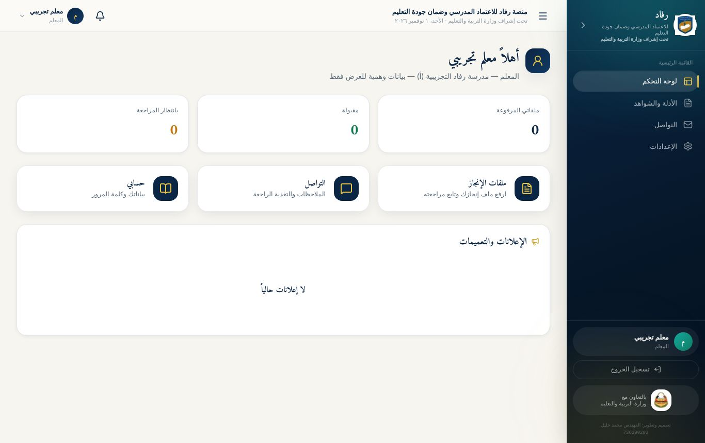
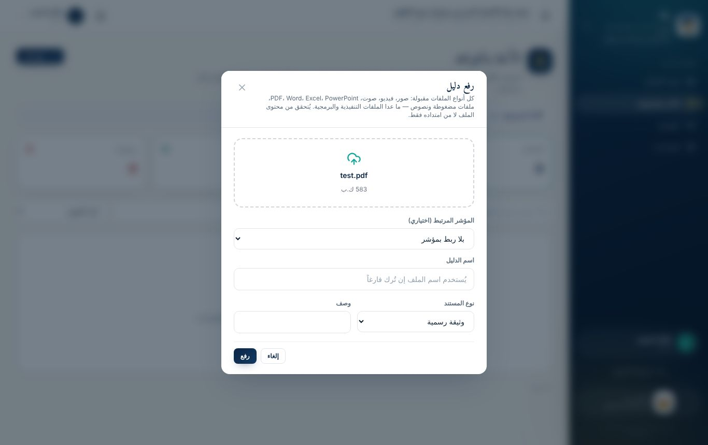
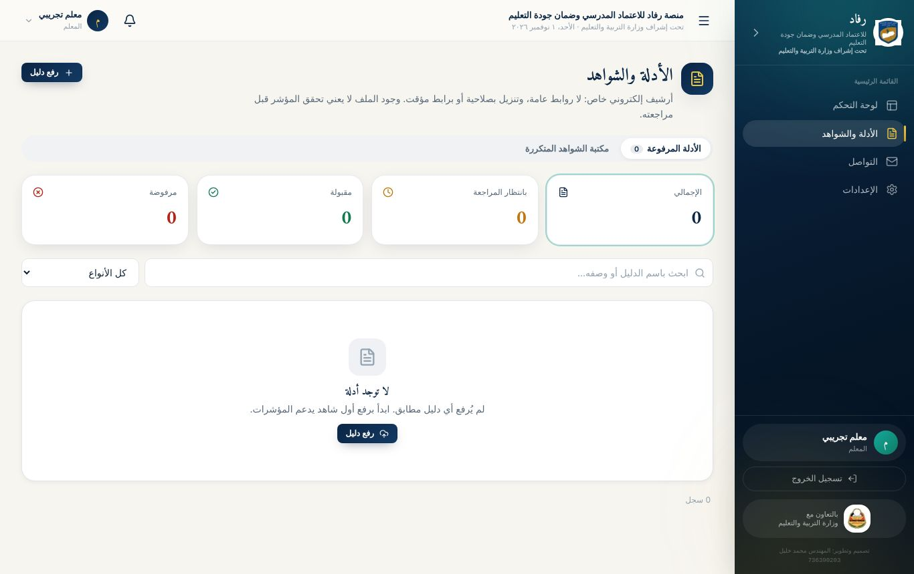
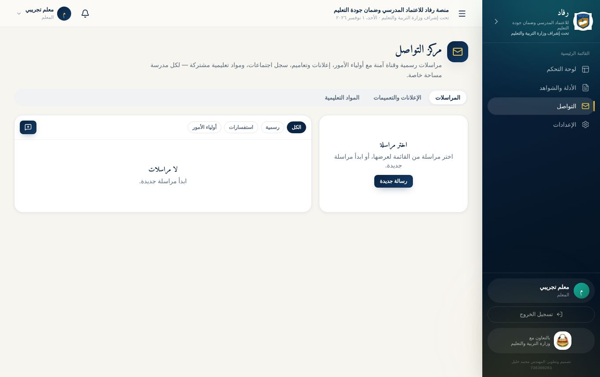

# الوحدة الثانية: المعلم

**مدة الوحدة:** 75 دقيقة · **الشرائح:** 15–20

**بعد هذه الوحدة يستطيع المعلم أن:**

- يقرأ لوحته ويعرف حالة ملفاته.
- يرفع ملف إنجاز أو شاهداً بأي صيغة مسموحة، ويربطه بمؤشر.
- يتابع مراجعة ملفه، ويرفع نسخة جديدة إذا رُفض.
- يستخدم مركز التواصل: المراسلات، والإعلانات، والمواد التعليمية.

## 1. ماذا يرى المعلم في المنصة؟

قائمة المعلم مختصرة ومركّزة على عمله:

| القسم | الاستخدام |
|---------------|------------------------------------------------------------|
| **لوحة التحكم** | عدد ملفاته المرفوعة والمقبولة وما ينتظر المراجعة، والإعلانات |
| **الأدلة والشواهد** | رفع ملفات الإنجاز ومتابعتها |
| **التواصل** | المراسلات مع إدارة المدرسة، والإعلانات، والمواد التعليمية |
| **الإعدادات** | بياناته وأمان حسابه |

> **خصوصية المعلم:** يرى المعلم **ما رفعه بنفسه فقط** من ملفات. ولا يرى استمارة التقييم الذاتي ولا تقارير المتابعة.

## 2. لوحة المعلم

- **ثلاث بطاقات أرقام:**
  - **ملفاتي المرفوعة:** كل ما رفعته.
  - **مقبولة:** ما قبله المراجِع.
  - **بانتظار المراجعة:** ما لم يُراجَع بعد.
- **ثلاث بطاقات انتقال سريع:**
  - **ملفات الإنجاز:** تفتح صفحة الأدلة والشواهد.
  - **التواصل:** الملاحظات والتغذية الراجعة.
  - **حسابي:** بياناتك وكلمة المرور.
- **الإعلانات والتعميمات:** آخر ما نشرته الإدارة أو مدير المدرسة.

## 3. رفع ملف إنجاز أو شاهد

### قبل الرفع: جهّز ملفك

- **أي صيغة شائعة مقبولة:** صورة، فيديو قصير، تسجيل صوتي، PDF، Word، Excel، PowerPoint، ملف مضغوط. التفاصيل في الوحدة السادسة.
- **سمِّ الملف تسمية واضحة**، مثل: «خطة درس الرياضيات — الصف السادس — أكتوبر».
- **صوّر الوثائق الورقية بوضوح:** صورة مستقيمة، بإضاءة جيدة، دون ظلال.
- **انتبه للحجم:** الحد الأقصى على الاستضافة الحالية **نحو 4 ميجابايت للملف الواحد**.

### خطوات الرفع

1. من القائمة: **الأدلة والشواهد**.
2. اضغط **«رفع دليل»** أعلى الصفحة.
3. اضغط مربع **«اسحب الملف هنا أو اضغط للاختيار»**، واختر الملف من جهازك. على الكمبيوتر يمكنك سحب الملف وإفلاته في المربع.
4. **المؤشر المرتبط (اختياري):** اختر المؤشر الذي يثبته ملفك، أو اتركه «بلا ربط بمؤشر».
5. **اسم الدليل:** اكتب اسماً واضحاً، أو اتركه فارغاً ليُستخدم اسم الملف.
6. **نوع المستند:** اختر من القائمة:
   - وثيقة رسمية.
   - خطة.
   - تقرير.
   - محضر.
   - سجل.
   - كشف.
   - صورة ميدانية.
   - نموذج.
   - شهادة.
   - أخرى.
7. **وصف (اختياري):** سطر يوضح محتوى الملف، مثل «نماذج من أوراق عمل الطلاب».
8. اضغط **«رفع»**، وانتظر حتى يكتمل شريط التقدّم.

> **لماذا رُفض ملفي فوراً قبل المراجعة؟** المنصة تفحص **محتوى** الملف لا اسمه فقط. ترفض الملفات التنفيذية والبرمجية، والملف الذي لا يطابق محتواه امتداده، والملف الأكبر من الحد المسموح. تظهر رسالة تشرح السبب.

## 4. متابعة ملفاتك

### بطاقات الحالة

أعلى الصفحة أربع بطاقات: **الإجمالي**، و**بانتظار المراجعة**، و**مقبولة**، و**مرفوضة**. اضغط أي بطاقة لتظهر ملفاتها فقط.

### البحث والتصفية

- **مربع البحث:** باسم الدليل أو وصفه.
- **قائمة الأنواع:** لعرض نوع مستند واحد.

### بطاقة كل ملف

| ما يظهر | معناه |
|---------------|-------------------------------------------------------|
| **الاسم والحالة** | بانتظار المراجعة 🟠، أو مقبول 🟢، أو مرفوض 🔴 |
| **مدى الصلاحية** | يضيفه المراجِع: صالح كدليل، أو صالح جزئياً، أو غير صالح |
| **نسخة 2، 3…** | إن رفعت نسخاً جديدة من الملف نفسه |
| **السطر الرمادي** | المدرسة، ونوع المستند، والحجم، واسم من رفعه، والتاريخ |
| **رمز المؤشر** | إن ربطته بمؤشر |
| **ملاحظة المراجعة** | ما كتبه المراجِع، وهي إلزامية عند الرفض |

### أزرار كل ملف

| الزر | وظيفته |
|----------------|------------------------------------------------------|
| 👁 **معاينة** | يعرض الملف داخل الصفحة: صور، وPDF، وفيديو، وصوت، ونصوص |
| ⬇ **تنزيل** | ينزّل الملف إلى جهازك |
| 📋 **نسخ رابط مؤقت** | رابط صالح **5 دقائق** فقط، لمشاركة الملف مع من له صلاحية |
| 🕘 **سجل النسخ** | كل نسخ الملف السابقة، ويمكن تنزيل أي نسخة |
| 🔄 **رفع نسخة جديدة** | يستبدل الملف بنسخة محدّثة |

## 5. إذا رُفض ملفك

1. اقرأ **ملاحظة المراجعة** تحت الملف لتعرف السبب.
2. صحّح الملف، مثل صورة أوضح أو وثيقة مكتملة.
3. اضغط 🔄 **«رفع نسخة جديدة»** على الملف نفسه، **لا ترفع ملفاً جديداً منفصلاً**.
4. اختر الملف المصحّح، ثم **«رفع»**.

**النتيجة:** تُحفظ النسخة القديمة في **سجل النسخ**، وتعود حالة الملف إلى **«بانتظار المراجعة»**، ويظهر بجانبه **«نسخة 2»**.

> **من يراجع ملفات المعلم؟** منسق الجودة في المدرسة، أو المفتش، أو مدير النظام. تصلك نتيجة المراجعة في الإشعارات.

## 6. مركز التواصل

من القائمة: **التواصل**. للمعلم فيه ثلاثة تبويبات:

### المراسلات

مراسلات خاصة بين المشاركين فيها فقط، مسجّلة بحالة القراءة والرد.

1. اضغط **«رسالة جديدة»**.
2. **المدرسة:** اختر مدرستك.
3. **المستلمون:** اختر من تريد مراسلته من القائمة.
4. اكتب **العنوان** و**الرسالة**، ثم **«إرسال»**.
5. تظهر الرسالة في قائمة المراسلات يميناً. اضغطها لترى الردود، واكتب ردك في الخانة أسفلها.

> علامة ✓✓ بجانب رسالتك تعني أنها **قُرئت**. مرّر المؤشر عليها لتعرف من قرأها.

### الإعلانات والتعميمات

يقرأ فيها المعلم ما ينشره مدير النظام ومدير المدرسة. يظهر الإعلان الجديد أيضاً في لوحة التحكم وفي الإشعارات.

### المواد التعليمية

مساحة لمشاركة الملفات التعليمية مع المدرسة أو مع أولياء الأمور:

1. اضغط **«مادة جديدة»**.
2. اختر الملف. أي نوع مقبول: صورة، أو فيديو، أو صوت، أو مستند.
3. **العنوان:** مثل «ملخص الوحدة الثالثة — علوم الصف الخامس».
4. **وصف (اختياري).**
5. **المتاحة لـ:**
   - **مجتمع المدرسة:** يُشعَر بها مستخدمو المدرسة من الإدارة والمعلمين.
   - **أولياء الأمور:** يُشعَر بها أولياء أمور طلاب المدرسة.
6. اضغط **«نشر»**. يظهر زر **«تنزيل»** على المادة لكل من يراها.

## 7. أسئلة المعلمين الشائعة

**هل يرى زملائي ملفاتي؟**
لا. يرى ملفاتك من له صلاحية على مدرستك فقط: إدارة المدرسة ومنسق الجودة والمفتش ومدير النظام.

**رفعت ملفاً خاطئاً، كيف أحذفه؟**
الحذف مقصور على مدير النظام حفاظاً على الأرشيف. ارفع **نسخة جديدة** صحيحة على الملف نفسه، أو راسل منسق الجودة.

**ظهرت رسالة «حجم الملف أكبر مما تسمح به الاستضافة».**
صغّر الملف: صوّر بدقة أقل، أو قصّ الفيديو، أو حوّل الصور إلى PDF مضغوط. انظر الوحدة السادسة.

## تطبيقات عملية: الوحدة الثانية

**التطبيق 2-1: رفع أول ملف إنجاز**

1. صوّر ورقة عمل أو خطة درس بجوالك، أو استخدم ملف PDF على جهازك.
2. ارفعها من **الأدلة والشواهد ← رفع دليل**، واربطها بمؤشر، واختر نوع المستند «خطة».

- [ ] **نجحت إذا:** ظهر الملف في القائمة بحالة «بانتظار المراجعة»، وزاد رقم «ملفاتي المرفوعة» في لوحتك.

**التطبيق 2-2: المعاينة والتنزيل**

1. اضغط 👁 لمعاينة ملفك، ثم أغلق المعاينة.
2. اضغط ⬇ لتنزيله، وافتحه من جهازك.

- [ ] **نجحت إذا:** فتحت الملف المنزَّل على جهازك.

**التطبيق 2-3: الرفض ثم النسخة الجديدة (عمل ثنائي مع المدرّب)**

1. يرفض المدرّب ملفك بملاحظة.
2. اقرأ الملاحظة، ثم ارفع **نسخة جديدة** على الملف نفسه.

- [ ] **نجحت إذا:** ظهر «نسخة 2» بجانب الملف، وعادت حالته إلى «بانتظار المراجعة».

**التطبيق 2-4: التواصل**

1. أرسل رسالة إلى إدارة مدرستك التدريبية بعنوان «طلب ملاحظات على خطة الدرس».
2. ارفع مادة تعليمية قصيرة للجمهور «أولياء الأمور».

- [ ] **نجحت إذا:** ظهرت رسالتك في المراسلات، وظهرت المادة في تبويب المواد التعليمية.
