# الوحدة الثالثة: مدير المدرسة ومديرة قسم الجودة

**مدة الوحدة:** يومان تدريبيان · **الشرائح:** 19–31

**بعد هذه الوحدة يستطيع مدير المدرسة ومديرة قسم الجودة أن:**

- يُكمل الاختبار التفاعلي الإجباري لكل المؤشرات، بالأدلة المتوفرة فعلاً.
- يضع خطة تحسين دقيقة لكل نقطة ضعف، ويتابعها حتى اعتمادها.
- يقرأ الاستمارة وبطاقاتها، ويرسلها للإدارة، ويطبعها بشكلها الرسمي.
- يرفع الشواهد بأي صيغة، ويراجع شواهد المعلمين (مديرة قسم الجودة).
- يستخدم التواصل وملف المدرسة والتقارير.

## 1. الصورة الكاملة: رحلة المدرسة في المنصة

> **أول دخول** ← **تغيير كلمة المرور** ← **الاختبار التفاعلي** (109 مؤشرات) ← **خطة تحسين لكل نقطة ضعف** ← **مراجعة الاستمارة** ← **الإرسال للإدارة** ← **تنفيذ الخطط** ← **إعلان التحسّن مع الشواهد** ← **اعتماد الإدارة** ← **التكريم**

| من يفعل ماذا في المدرسة؟ | مدير المدرسة | مديرة قسم الجودة |
|-----------------------------------------|:----------:|:---------:|
| الاختبار التفاعلي وتقييم المؤشرات | ✓ | ✓ |
| وضع خطط التحسين ومتابعتها | ✓ | ✓ |
| إرسال الاستمارة للإدارة | ✓ | ✓ |
| رفع الشواهد | ✓ | ✓ |
| **مراجعة الشواهد** (قبول أو رفض) | — | ✓ |
| **نشر إعلان** لمجتمع المدرسة | ✓ | — |
| تسجيل الاجتماعات ومشاركة المواد التعليمية | ✓ | ✓ |
| إضافة جهات اتصال المدرسة | ✓ | — |

> المدير والمنسق يعملان على **الاستمارة نفسها**. ما يحفظه أحدهما يراه الآخر فوراً. اتفقا مسبقاً على توزيع المعايير بينكما.

## 2. الاختبار التفاعلي (إجباري)

بعد تغيير كلمة المرور **تُوجَّه مباشرة إلى الاختبار التفاعلي**. تبقى بقية الأقسام مغلقة حتى تجيب عن **كل مؤشرات العام الدراسي الحالي**. تبقى متاحة دائماً: **الإعدادات**، و**التواصل**، و**طباعة الاستمارة**.

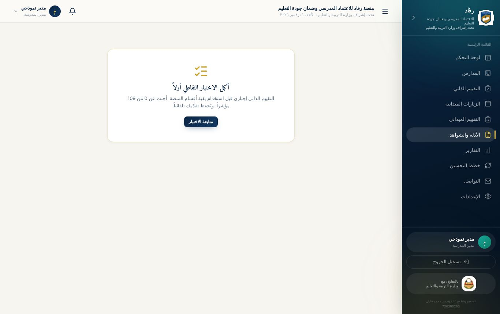

> **تقدّمك محفوظ دائماً.** أجب عن بعض المؤشرات اليوم وأكمل غداً؛ تبدأ من حيث توقفت.

### شاشة السؤال

يعرض الاختبار **مؤشراً واحداً في كل شاشة**:

- **أعلى الشاشة:** مسار المؤشر في الاستمارة (المعيار ← المعيار الفرعي)، و**شريط التقدّم**: كم أجبت من 109.
- **نص المؤشر** ورمزه، مثل `1-1-1`.

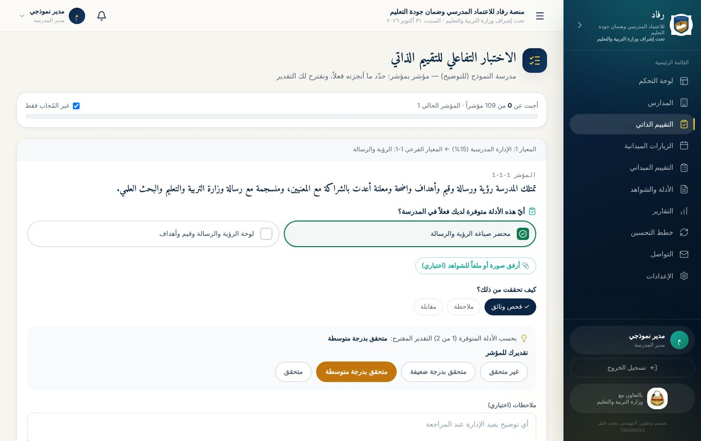

### خطوات الإجابة عن مؤشر

1. **«أيّ هذه الأدلة متوفرة لديك فعلاً في المدرسة؟»**
   اضغط على كل دليل **موجود فعلاً** عندك، فيصير أخضر. لا تختر دليلاً غير موجود.
2. **«كيف تحققت من ذلك؟»**
   اختر أداة أو أكثر: **فحص وثائق**، أو **ملاحظة**، أو **مقابلة**.
3. **التقدير المقترح:** يقترحه النظام تلقائياً من نسبة الأدلة المتوفرة:

| الأدلة المتوفرة | التقدير المقترح |
|--------------------|------------------|
| كلها | متحقق |
| النصف فأكثر | متحقق بدرجة متوسطة |
| بعضها (أقل من النصف) | متحقق بدرجة ضعيفة |
| لا شيء | غير متحقق |

4. **تعديل التقدير:** يمكنك اختيار مستوى آخر إن كان لديك مبرر، أو العودة إلى المقترح.
5. **الملاحظات (اختياري):** توضيح يفيد الإدارة عند المراجعة.
6. **📎 أرفق صورة أو ملفاً للشواهد (اختياري):** ارفع الشاهد مباشرة لهذا المؤشر. أي صيغة مسموحة.
7. اضغط **«حفظ والتالي»**. للرجوع إلى المؤشر السابق اضغط **«السابق»**.

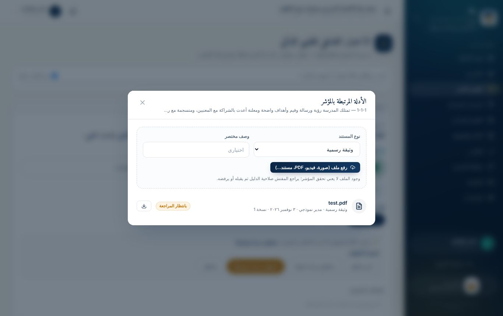

> **الصدق أولاً:** الهدف من الاختبار معرفة الواقع لا تجميله. نقطة الضعف المكتشفة اليوم تصبح غداً **تحسّناً معتمداً** يُكرَّم عليه في الشهادة.

### خطة التحسين الفورية

إذا كان التقدير **غير متحقق** أو **متحقق بدرجة ضعيفة**، يُسجَّل المؤشر **نقطة ضعف**. بعد الحفظ تظهر نافذة **«نقطة ضعف: ضع خطة التحسين الآن»**:

| الحقل | مثال جيد | مثال ضعيف |
|---------------------------|----------------------------------------------------------------------|------------|
| **الإجراء** (10 أحرف على الأقل) | إعداد وثيقة الرؤية والرسالة بمشاركة المعلمين ومجلس الآباء، ونشرها في لوحة المدرسة | تحسين الرؤية |
| **المسؤول عن التنفيذ** | وكيل المدرسة | الجميع |
| **موعد الإنجاز** | تاريخ محدد واقعي | — |

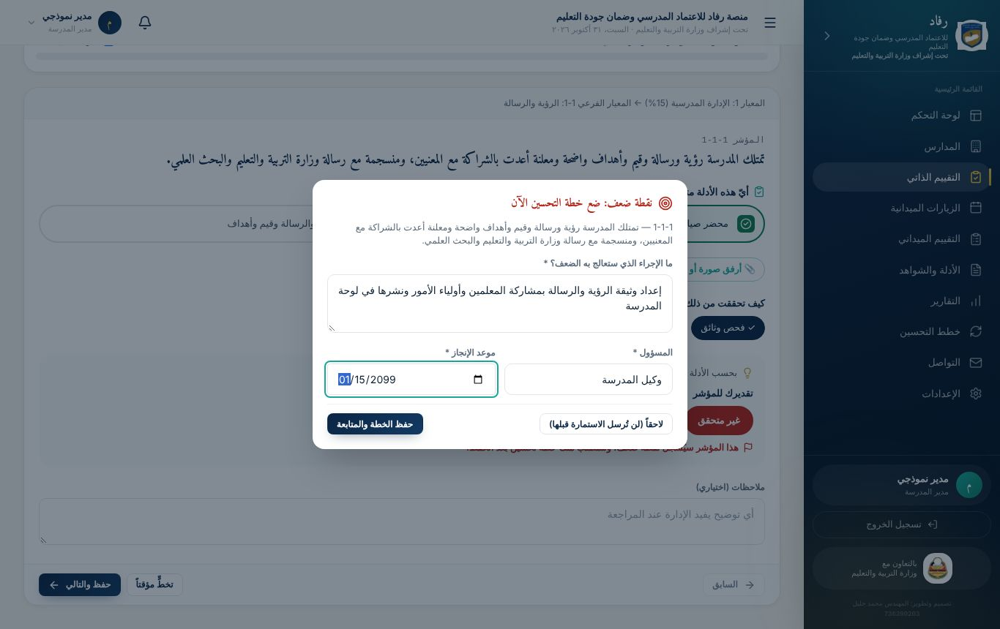

يمكنك اختيار **«لاحقاً»**، لكن **لن تُرسل الاستمارة قبل وضع خطة لكل نقطة ضعف**.

> **الخطة الجيدة:** إجراء محدد يمكن رؤيته، ومسؤول باسمه أو وظيفته، وموعد واقعي.

### شاشة النتيجة

بعد آخر مؤشر تظهر **نتيجة تقييمك الذاتي**:

- **نسبة التحقق الكلية.**
- **أداؤك في كل معيار** بشريط ملوّن، وعلامة «محقَّق» على المعايير المكتملة.
- **نقاط الضعف** التي حددتها، وحالة خطة كل منها.
- **الأزرار:** «راجع وأرسل للإدارة»، و«طباعة»، و**«مراجعة كل الإجابات»**.

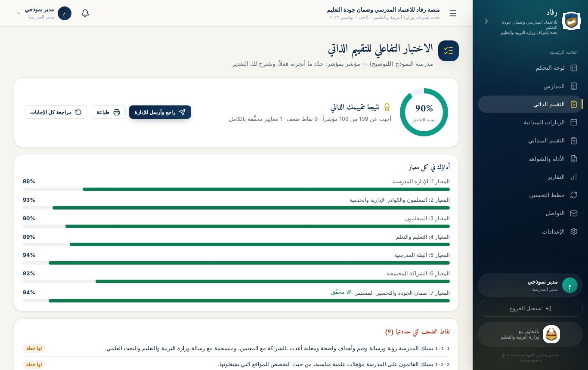

## 3. استمارة التقييم الذاتي

من القائمة: **التقييم الذاتي**. هنا ترى الاستمارة كاملة بشكلها الرسمي وتديرها.

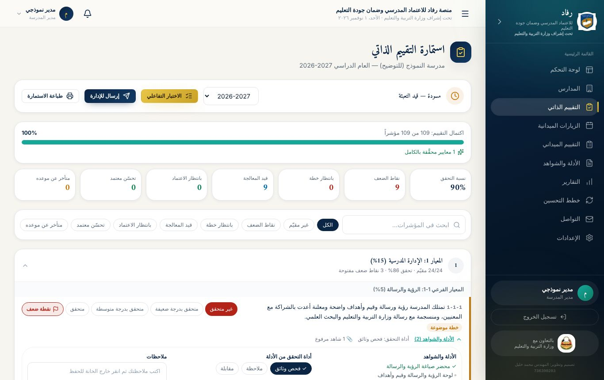

### أجزاء الصفحة

1. **شريط الحالة:**
   - **الحالة:** مسودة أو مُرسلة.
   - **العام الدراسي**، مع إمكانية اختيار عام سابق للاطلاع.
   - **الأزرار:** الاختبار التفاعلي، و**إرسال للإدارة**، و**طباعة الاستمارة**.
2. **بطاقات الملخص:** نسبة التحقق، ونقاط الضعف، و**بانتظار خطة**، وقيد المعالجة، وبانتظار الاعتماد، وتحسّن معتمد، و**تجاوز موعد الخطة**. **اضغط أي بطاقة** لتظهر مؤشراتها فقط.
3. **المقارنة بالعام السابق:** نسبة التحقق وعدد نقاط الضعف، هذا العام مقابل الماضي.
4. **البحث والتصفية:** بالكلمة، أو بالحالة.
5. **المعايير:** كل معيار في بطاقة تُفتح بالضغط، وتعرض نسبته وعدد نقاط الضعف المفتوحة فيه.

### لكل مؤشر في الاستمارة

| العنصر | وظيفته |
|-----------------|----------------------------------------------------------------------|
| **أزرار التقدير** | تعديل التقدير قبل الإرسال، للمؤشرات التي أُجيب عنها في الاختبار التفاعلي |
| **زر «ضعف»** | وضع **إشارة ضعف يدوية** على مؤشر تراه يحتاج معالجة، حتى لو كان تقديره متوسطاً. واضغطه مرة أخرى لإلغائها |
| **«الأدلة والشواهد»** | الأدلة المطلوبة وعلى المتوفر منها ✓، وأداة التحقق، وخانة الملاحظات التي تُحفظ عند الخروج منها |
| **«رفع الشواهد»** | يفتح نافذة شواهد المؤشر: ترفع ملفاً جديداً أو تعرض المرفوع. بجانبه عدد الشواهد المرفوعة |
| **«تاريخ المؤشر»** | كل خطوة مرّ بها المؤشر، ومن قام بها، ومتى، بنقاط ملوّنة |

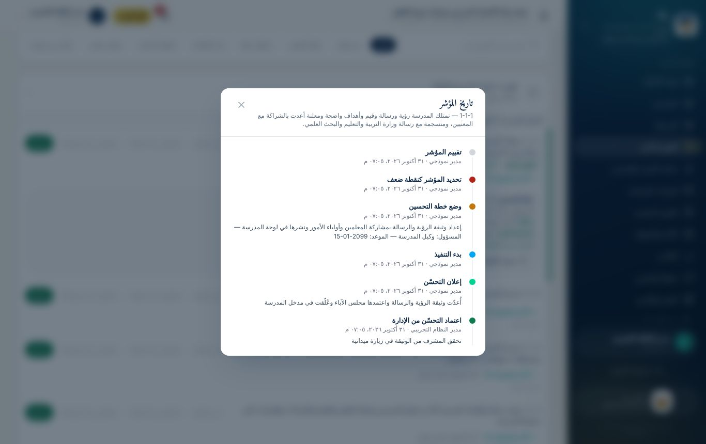

## 4. دورة خطط التحسين حتى الاعتماد

لكل نقطة ضعف أزرار تظهر حسب مرحلتها:

| الزر | متى يظهر | ماذا تكتب | ماذا يحدث |
|------------------------------|-----------------------------------|----------------------------------------------------------------------|----------------------------------------------------|
| **وضع خطة التحسين** أو **تعديل الخطة** | ضعيف، أو خطة موضوعة، أو قيد التنفيذ | **الإجراء المطلوب لمعالجة الضعف**، و**المسؤول عن التنفيذ**، و**موعد الإنجاز**، و**كيف نعرف أن الضعف عولج؟ (مؤشر النجاح)** | يتحول المؤشر إلى 🟠 خطة موضوعة |
| **بدأنا التنفيذ** | خطة موضوعة | — | يتحول المؤشر إلى 🔵 قيد التنفيذ |
| **تمّت المعالجة وتحسّن** | خطة موضوعة، أو قيد التنفيذ | **ما الذي نُفّذ فعلياً؟** (وأين الشواهد)، و**التقدير بعد المعالجة**، ويجب أن يكون أعلى من الحالي. ثم **«إرسال للاعتماد»** | يتحول المؤشر إلى 🟢 بانتظار الاعتماد، وتُشعَر الإدارة |

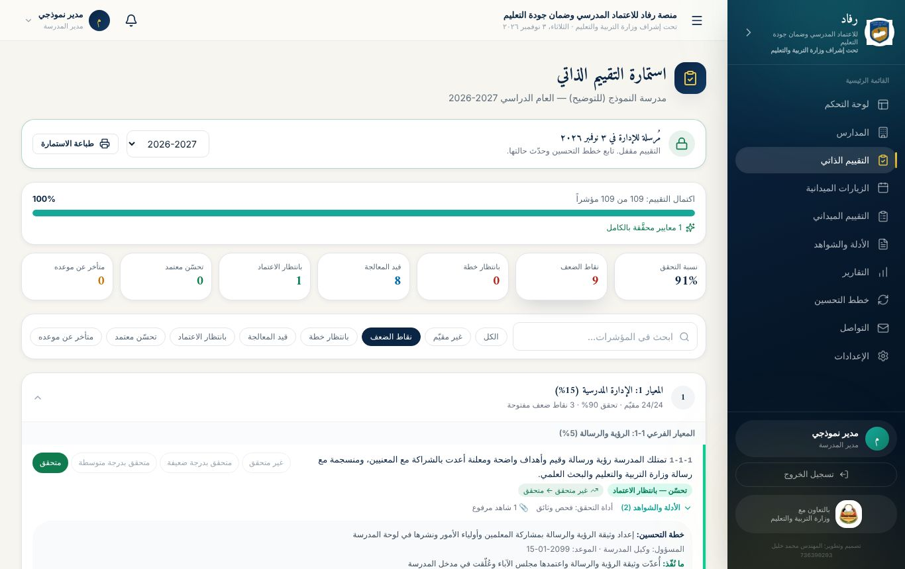

### ماذا يحدث بعد إعلان التحسّن؟

تراجع الإدارة ما كتبته والشواهد المرفوعة، ثم:

- **تعتمد التحسّن:** يتحول المؤشر إلى 🟢 **تحسّن معتمد**، ويصلك إشعار «اعتُمد التحسّن». هذا التحسّن يدخل في **شهادة التكريم**.
- **تعيده للمتابعة:** مع **سبب مكتوب**. يعود المؤشر إلى 🔵 قيد التنفيذ، ويعود تقديره إلى ما كان عليه. اقرأ السبب، وأكمل المطلوب، ثم أعلن التحسّن من جديد.

> **قبل أن تضغط «تمّت المعالجة وتحسّن»:** ارفع الشواهد أولاً من زر «رفع الشواهد» على المؤشر نفسه. الإعلان بلا شواهد يُعاد غالباً.

### التنبيهات التي تصلك

| الإشعار | متى |
|-----------------------|----------------------------------------------|
| **اقتراب موعد خطط التحسين** | قبل موعد الخطة بثلاثة أيام |
| **خطط تحسين متأخرة** | إذا تجاوزت خطة موعدها |
| **اعتُمد التحسّن** | عند اعتماد الإدارة |
| **أُعيد مؤشر للمتابعة** | عند إعادة الإدارة، مع السبب |
| **تذكير من الإدارة** | مثل إكمال الاختبار أو الإرسال أو الخطط الناقصة |

وفي **لوحة التحكم** بطاقة «استمارة التقييم الذاتي» تخبرك بالمطلوب منك الآن.

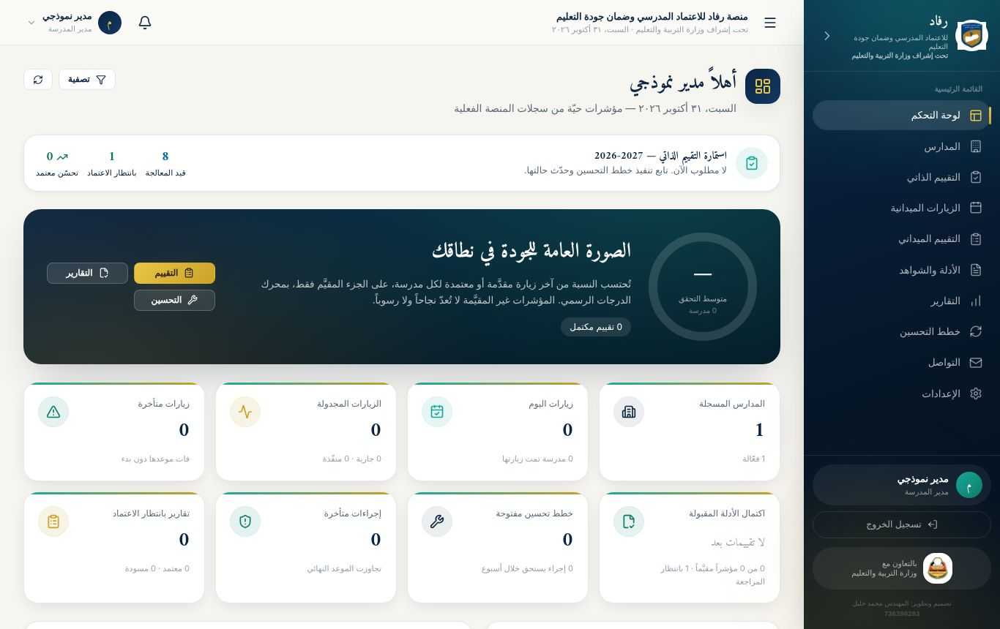

## 5. إرسال الاستمارة للإدارة

يصبح زر **«إرسال للإدارة»** فعّالاً حين تكتمل الاستمارة. إن لم يكن فعّالاً، **يظهر بجانبه السبب**:

- مؤشرات لم تُقيَّم بعد.
- نقاط ضعف بلا خطة تحسين. اضغط بطاقة **«بانتظار خطة»** لتصل إليها مباشرة.

**بعد الإرسال:**

- **يُقفل التقييم المباشر** حتى يبقى تاريخ المؤشرات صادقاً. إن احتجت تعديلاً، اطلب من الإدارة **«إعادة فتح للمدرسة»**.
- **تستمر في متابعة خطط التحسين** وإعلان التحسّن كالمعتاد.
- **تُشعَر الإدارة** بوصول استمارتك.

> **قائمة المراجعة قبل الإرسال:**
>
> - [ ] كل المؤشرات مقيّمة بصدق، بالأدلة المتوفرة فعلاً.
> - [ ] لكل نقطة ضعف خطة واضحة: إجراء ومسؤول وموعد.
> - [ ] الشواهد الأساسية مرفوعة على مؤشراتها.
> - [ ] راجعت الاستمارة مع مديرة قسم الجودة أو مدير المدرسة.

## 6. طباعة الاستمارة

زر **«طباعة الاستمارة»** يُخرج الاستمارة بجدولها الرسمي، معبّأة بإجاباتك:

- **الأعمدة:** رقم المؤشر، والمؤشر، والأدلة والشواهد، وأداة التحقق، والتقديرات، والملاحظات.
- **العلامات:** ☑ على الأدلة المتوفرة، و✓ على الأداة والتقدير.
- **في آخرها:** خانات توقيع مدير المدرسة ومديرة قسم الجودة والتاريخ، فارغة للتوقيع باليد.

من نافذة الطباعة يمكنك اختيار الطابعة، أو **«حفظ بصيغة PDF»** للاحتفاظ بنسخة إلكترونية.

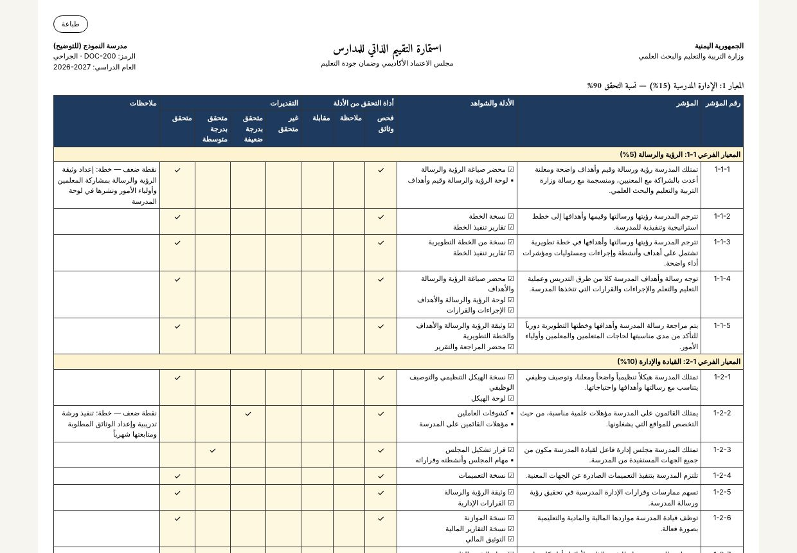

## 7. الشواهد في المدرسة

قسم **الأدلة والشواهد** يجمع كل ما رُفع لمدرستك: من الاختبار التفاعلي، ومن الاستمارة، ومن المعلمين، ومن التقييم الميداني.

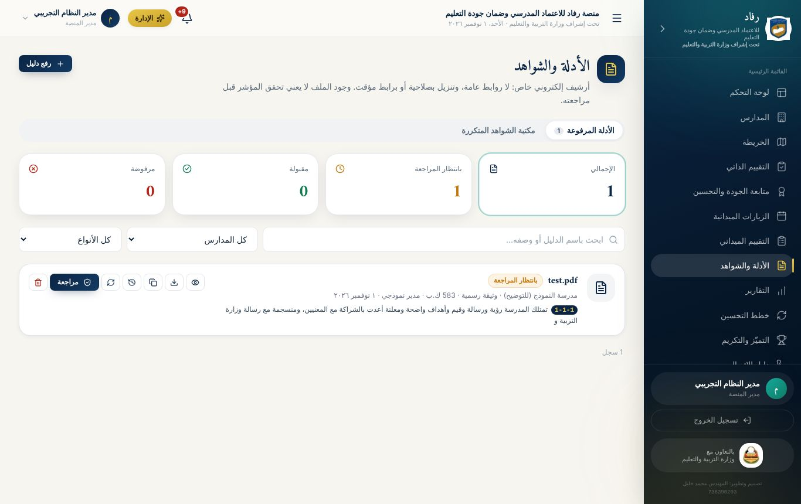

- **الرفع:** زر **«رفع دليل»**، بالخطوات نفسها المشروحة في وحدة المعلم.
- **مكتبة الشواهد المتكررة:** تبويب يعرض الشواهد التي يطلبها أكثر من مؤشر في الاستمارة، كالخطط والمحاضر العامة. يضيف عناصرها مدير النظام أو مديرة قسم الجودة بزر «عنصر جديد». وبجانب كل شاهد حالته في مدرستك: مقبول، أو بانتظار المراجعة، أو لم يُرفع. زر **«رفع»** بجانبه يرفعه مباشرة، فتعرف بنظرة واحدة **ما رُفع وما ينقص**.
- **المعاينة والتنزيل والرابط المؤقت وسجل النسخ:** كما في وحدة المعلم.

### مراجعة الشواهد (لمديرة قسم الجودة)

يرى مديرة قسم الجودة زر **«مراجعة»** على كل شاهد لم يُقبل بعد:

1. اضغط **«مراجعة»** على الشاهد.
2. اضغط **«فتح الملف للمراجعة»**، وتأكد من محتواه.
3. اختر **مدى صلاحيته كدليل:** صالح كدليل، أو صالح جزئياً، أو غير صالح.
4. اكتب **ملاحظات المراجعة**. وهي **إلزامية عند الرفض**: اكتب ما يجب تصحيحه بالتحديد.
5. اضغط **«قبول»** أو **«رفض»**. يُشعَر صاحب الشاهد بالنتيجة.
6. للشاهد المقبول زر **«إعادة المراجعة»** إن ظهر ما يستدعي تغيير القرار.

> **ملاحظة رفض جيدة:** «الصورة غير واضحة، والمطلوب صورة لمحضر الاجتماع كاملاً بالتوقيعات». **ملاحظة ضعيفة:** «غير مقبول».

## 8. التواصل في المدرسة

من القائمة: **التواصل**. لمدير المدرسة ومديرة قسم الجودة أربعة تبويبات:

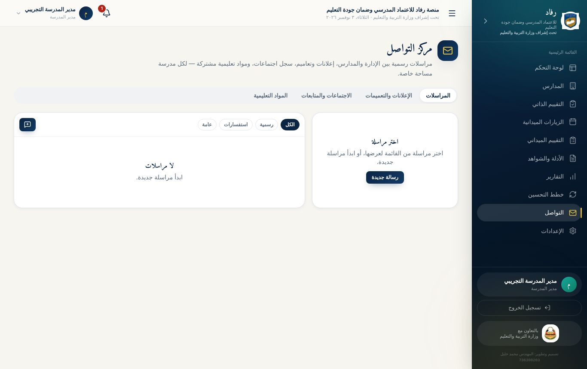

| التبويب | ما تفعله فيه |
|---------------------|----------------------------------------------------------------------|
| **المراسلات** | مراسلة المفتش أو مدير النظام أو معلمي مدرستك. اضغط «رسالة جديدة»، واختر المستلمين، واكتب العنوان والرسالة |
| **الإعلانات والتعميمات** | قراءة تعاميم الإدارة. **ومدير المدرسة** ينشر إعلاناً لمدرسته فقط |
| **الاجتماعات والمتابعات** | تسجيل محاضر الاجتماعات |
| **المواد التعليمية** | مشاركة ملفات مع مجتمع المدرسة أو أولياء الأمور |

### نشر إعلان (مدير المدرسة)

1. **الإعلانات والتعميمات ← «إعلان جديد»**.
2. اكتب **العنوان** (3 أحرف على الأقل) و**النص** (10 أحرف على الأقل).
3. **الجمهور:** اختر الفئات المستهدفة من الأزرار، مثل المعلمين أو أولياء الأمور.
4. **ينتهي في (اختياري):** تاريخ يختفي بعده الإعلان.
5. اضغط **«نشر»**، أو **«حفظ كمسودة»** لتنشره لاحقاً.

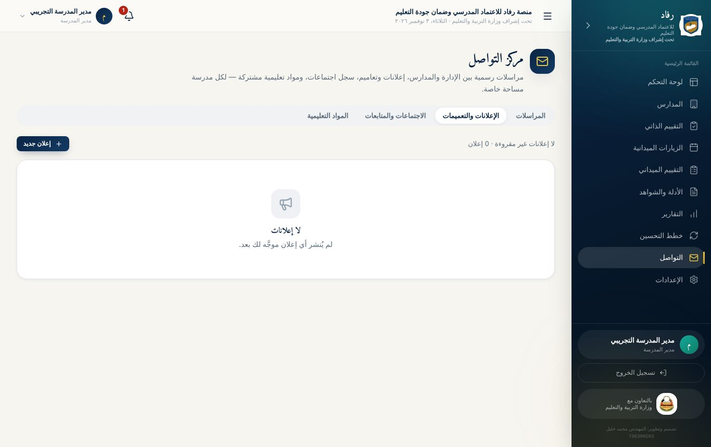

### تسجيل اجتماع

1. **الاجتماعات والمتابعات ← «اجتماع جديد»**.
2. املأ: **العنوان**، و**التاريخ**، و**الحضور**، و**المحضر**، و**القرارات**، و**المتابعة المطلوبة**.
3. احفظ. يبقى المحضر مرجعاً، ويمكن ربطه بالشواهد عند الحاجة.

## 9. ملف المدرسة والأقسام الأخرى

### ملف المدرسة

من **المدارس** اضغط اسم مدرستك. تبويبات الملف:

| التبويب | المحتوى |
|--------------------------|----------------------------------------------------------------------|
| **نظرة عامة** | ملخص المدرسة |
| **التقييم الذاتي ونقاط الضعف** | أماكن الضعف وحالة معالجتها، والأدلة غير المتوفرة لكل نقطة |
| **الزيارات** | زيارات المفتشين لمدرستك |
| **الملف والمرافق** | بيانات المدرسة ومرافقها |
| **جهات الاتصال والموقع** | الوكيل، ومنسق الجودة، ورئيس مجلس الآباء وغيرهم، مع أزرار اتصال وواتساب، والخريطة وزر «توجيه» |
| **الأدلة** | الشواهد المرفوعة للمدرسة |
| **التحسين والتقارير** | خطط التحسين وتقارير المدرسة |

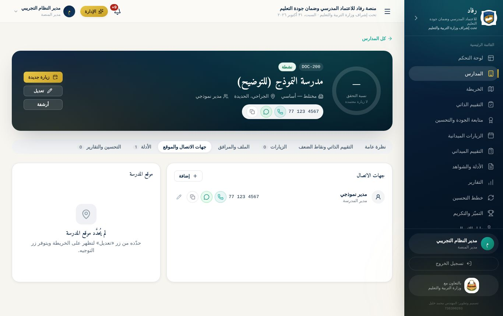

> **مهمة لمدير المدرسة:** أكمل **جهات الاتصال** بأرقام صحيحة، وعلّم الأرقام التي عليها واتساب. تستخدمها الإدارة للتواصل والتذكير.

### أقسام الاطلاع

| القسم | الاستخدام |
|------------------|----------------------------------------------------------------------|
| **الزيارات الميدانية** | مواعيد زيارات المفتشين لمدرستك وحالاتها |
| **التقييم الميداني** | نتائج تقييم المفتش لمدرستك أثناء الزيارة، للاطلاع |
| **خطط التحسين** | **الإجراءات التصحيحية** الناتجة عن التقييم الميداني. لكل إجراء: المشكلة، والسبب، والإجراء، والمسؤول، والموعد. تحدّث حالته وترفع دليل إنجازه من زر **«رفع دليل»**. مراحله: جديد ← قيد التنفيذ ← يحتاج تحقق ← مغلق بعد التحقق |
| **التقارير** | تقارير مدرستك، وتنزيلها PDF أو Excel أو CSV |

## تطبيقات عملية: الوحدة الثالثة

**التطبيق 3-1: أول عشرة مؤشرات**

1. ادخل بحساب مدير مدرستك التدريبية، وابدأ الاختبار التفاعلي.
2. أجب عن أول 10 مؤشرات: حدّد الأدلة المتوفرة، وأداة التحقق، وراجع التقدير المقترح.
3. أرفق صورة أو ملفاً لمؤشر واحد على الأقل.

- [ ] **نجحت إذا:** أظهر شريط التقدّم 10 من 109، وظهر عدد الشواهد على المؤشر الذي رفعت له.

**التطبيق 3-2: خطة تحسين جيدة**

1. اختر لمؤشر واحد تقدير «متحقق بدرجة ضعيفة».
2. في نافذة الخطة اكتب إجراءً محدداً، ومسؤولاً، وموعداً واقعياً.

- [ ] **نجحت إذا:** ظهر المؤشر في الاستمارة بلون برتقالي «خطة موضوعة».

**التطبيق 3-3: إكمال الاختبار**

1. أكمل بقية المؤشرات، وضع خطة لكل نقطة ضعف.
2. افتح شاشة النتيجة، واقرأ أداءك في كل معيار.

- [ ] **نجحت إذا:** فُتحت لك بقية أقسام المنصة بعد إكمال الاختبار.

**التطبيق 3-4: قراءة الاستمارة**

1. افتح **التقييم الذاتي**، واضغط بطاقة **«نقاط الضعف»** ثم بطاقة **«بانتظار خطة»**.
2. ضع **إشارة ضعف يدوية** على مؤشر متوسط، ثم ضع له خطة.
3. افتح **تاريخ المؤشر** لأحد المؤشرات.

- [ ] **نجحت إذا:** صارت بطاقة «بانتظار خطة» صفراً.

**التطبيق 3-5: من التنفيذ إلى الاعتماد (عمل ثنائي مع المدرّب)**

1. على نقطة ضعف: اضغط **«بدأنا التنفيذ»**.
2. ارفع شاهداً للمؤشر من **«رفع الشواهد»**.
3. اضغط **«تمّت المعالجة وتحسّن»**: اكتب ما نُفّذ، واختر تقديراً أعلى، ثم **«إرسال للاعتماد»**.
4. يعتمد المدرّب التحسّن أو يعيده.

- [ ] **نجحت إذا:** وصلك إشعار القرار، وتغيّر لون المؤشر إلى أخضر، أو عاد أزرق مع سبب الإعادة.

**التطبيق 3-6: الإرسال والطباعة**

1. راجع قائمة ما قبل الإرسال، ثم اضغط **«إرسال للإدارة»**.
2. اضغط **«طباعة الاستمارة»**، واحفظها PDF.

- [ ] **نجحت إذا:** تغيّرت حالة الاستمارة إلى «مُرسلة»، وحفظت نسخة PDF على جهازك.

**التطبيق 3-7: الشواهد والتواصل**

1. (مديرة قسم الجودة) راجع شاهداً رفعه معلم تدريبي: ارفضه بملاحظة واضحة، ثم اقبل نسخته الجديدة.
2. (مدير المدرسة) انشر إعلاناً لمدرستك عن موعد اجتماع، وسجّل محضر الاجتماع.
3. أضف جهة اتصال لوكيل المدرسة في ملف المدرسة.

- [ ] **نجحت إذا:** ظهرت نتيجة المراجعة عند المعلم، وظهر الإعلان عند المعلمين، وظهرت جهة الاتصال بأزرار الاتصال.
