# الوحدة الرابعة: الإدارة والإشراف

**لمن:** مدير الإدارة التعليمية (المديرية)، والمفتشون والموجّهون التربويون، وموظفو قسم الجودة، ومدير النظام · **مدة الوحدة:** يوم تدريبي · **الشرائح:** 32–38

**بعد هذه الوحدة يستطيع المشرف أن:**

- يقرأ لوحة متابعة الجودة يومياً، ويعرف أين يتدخل أولاً.
- يذكّر المدارس المتأخرة داخل المنصة وعبر واتساب.
- يراجع استمارة مدرسة، ويعتمد التحسّن أو يعيده بسبب واضح.
- يحلل نقاط الضعف الشائعة ليخطط للورش وزيارات الدعم.
- يصدر شهادات التكريم ويتحقق منها.
- ينفّذ الزيارات والتقييم الميداني، ويراجع الشواهد، ويولّد التقارير.

## 1. نطاق بيانات كل مشرف

| الدور | ما يراه |
|------------|----------------------------------------------------------------------|
| **مدير النظام** | كل المدارس |
| **مدير الإدارة** | مدارس مديريته فقط |
| **المفتش** | المدارس المسندة إليه وزياراته، أو مدارس مديريته إن لم تُسند إليه مدارس محددة |

### صلاحيات دورة التحسين

| العملية | من يستطيع |
|----------------------------------------------|-------------------------------------------------|
| اعتماد التحسّن، أو إعادته، أو سحب اعتماده | مدير النظام، ومدير الإدارة، والمفتش (ضمن نطاقهم) |
| إعادة فتح استمارة مُرسلة | مدير النظام، ومدير الإدارة، والمفتش |
| تذكير المدارس، والاطلاع على نقاط الضعف الشائعة | مدير النظام، ومدير الإدارة، والمفتش |
| إصدار شهادة تقدير | مدير النظام، ومدير الإدارة |
| إلغاء شهادة | مدير النظام فقط |
| مراجعة الشواهد | مدير النظام، ومدير الإدارة، والمفتش، ومنسق الجودة |
| حذف الشواهد | مدير النظام، ومدير الإدارة |

## 2. لوحة التحكم للمشرف

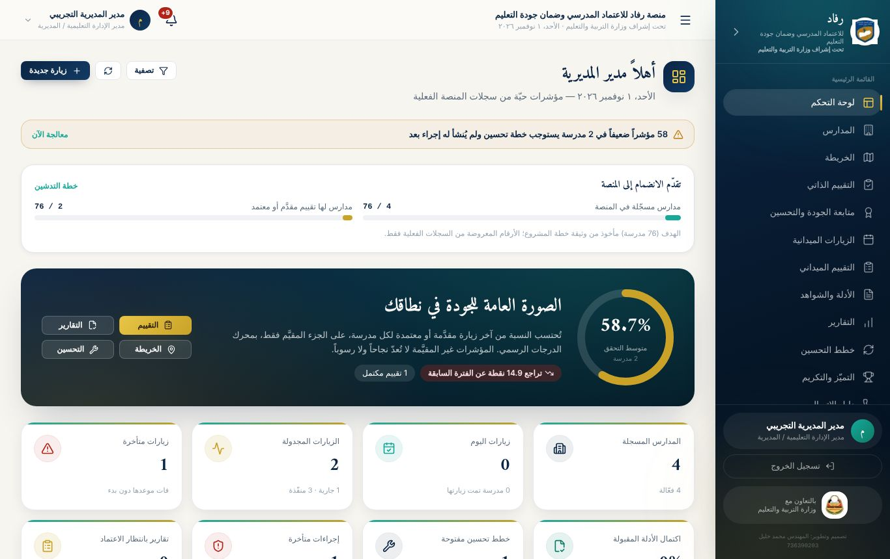

تعرض لوحة المشرف:

- **تنبيه بالمؤشرات الضعيفة** التي تستوجب خطة تحسين ولم يُنشأ لها إجراء بعد، مع رابط **«معالجة الآن»**.
- **تقدّم الانضمام إلى المنصة:** المدارس المسجّلة في المنصة، والمدارس التي لها تقييم مقدَّم أو معتمد.
- **الصورة العامة للجودة في نطاقك:** متوسط نسبة التحقق من آخر زيارة مقدَّمة أو معتمدة لكل مدرسة، والتغيّر عن الفترة السابقة، مع أزرار التقييم والتقارير والخريطة والتحسين.
- **بطاقات الأرقام:** المدارس المسجّلة، وزيارات اليوم، والزيارات المجدولة، والزيارات المتأخرة، واكتمال الأدلة المقبولة، وخطط التحسين المفتوحة، والإجراءات المتأخرة، والتقارير بانتظار الاعتماد.
- **الأزرار العلوية:** **«تصفية»** لعرض مديرية أو مدرسة أو فترة محددة، و**«زيارة جديدة»** لجدولة زيارة مباشرة.

## 3. متابعة الجودة والتحسين: لوحة القيادة اليومية

من القائمة: **متابعة الجودة والتحسين**.

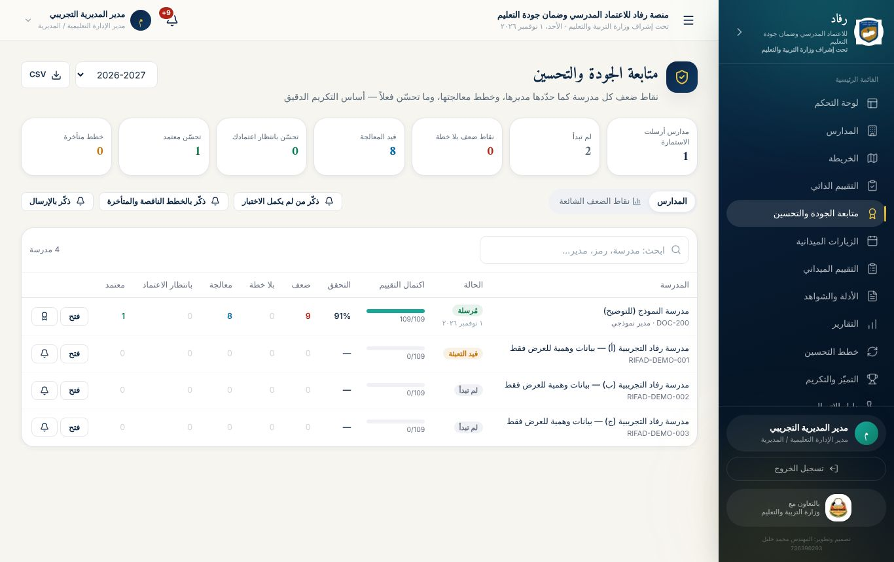

### بطاقات الأرقام

اضغط أي بطاقة لتصفية الجدول حسبها:

| البطاقة | معناها | ماذا تفعل |
|---------------------|---------------------------------|-------------------|
| **الاستمارات** | المدارس التي أرسلت، والتي لم تبدأ | ذكّر من لم يبدأ |
| **نقاط ضعف بلا خطة** | مدارس لم تضع خططها | ذكّر بالخطط الناقصة |
| **قيد المعالجة** | خطط بدأ تنفيذها | تابع المتأخر منها |
| **تحسّن بانتظار اعتمادك** | **أهم بطاقة يومياً** | راجع واعتمد أو أعد |
| **تحسّن معتمد** | ما اعتمدته الإدارة | يدخل في الشهادات |
| **خطط متأخرة** | تجاوزت موعدها | ذكّر واتصل |

### جدول المدارس

- **الحالة:** لم تبدأ، أو قيد التعبئة، أو مُرسلة.
- **التقدّم والنتيجة:** اكتمال التقييم (مثلاً 76 / 109)، ونسبة التحقق.
- **أعداد دورة التحسين:** الضعف، وبلا خطة، والمعالجة مع عدد المتأخر، وبانتظار الاعتماد، والمعتمد.
- **الأزرار:**
  - **فتح:** يعرض استمارة المدرسة كاملة.
  - 🔔 **الجرس:** تذكير المدرسة وحدها.
  - 🏅 **الشهادة:** للمدارس التي أرسلت استمارتها.
- **الترتيب تلقائي:** ما ينتظر الاعتماد أولاً، ثم ما بلا خطة.
- **العام الدراسي:** اختر العام من القائمة، و**«CSV»** لتنزيل الجدول.

### روتين المشرف اليومي المقترح (15 دقيقة)

1. افتح **متابعة الجودة والتحسين**.
2. اضغط بطاقة **«تحسّن بانتظار اعتمادك»**، وراجع ما فيها.
3. اضغط بطاقة **«خطط متأخرة»**، وذكّر أصحابها.
4. اقرأ إشعاراتك، وأجب عن المراسلات.

## 4. التذكير

ثلاثة أزرار جماعية أعلى لوحة المتابعة:

- **ذكّر من لم يكمل الاختبار.**
- **ذكّر بالخطط الناقصة والمتأخرة.**
- **ذكّر بالإرسال:** للمدارس التي أكملت التقييم ولم ترسل.

**ما يحدث عند الضغط:**

1. يصل **إشعار داخل المنصة** لمدير كل مدرسة معنية ومنسق الجودة فيها.
2. تظهر قائمة بالمدارس المذكَّرة، وبجانب كل مدرسة زر **واتساب** برسالة جاهزة، إن كان لها رقم واتساب صالح.
3. المدارس التي **ليس لها حساب** في المنصة تظهر معلَّمة، لتراسلها بالواتساب.

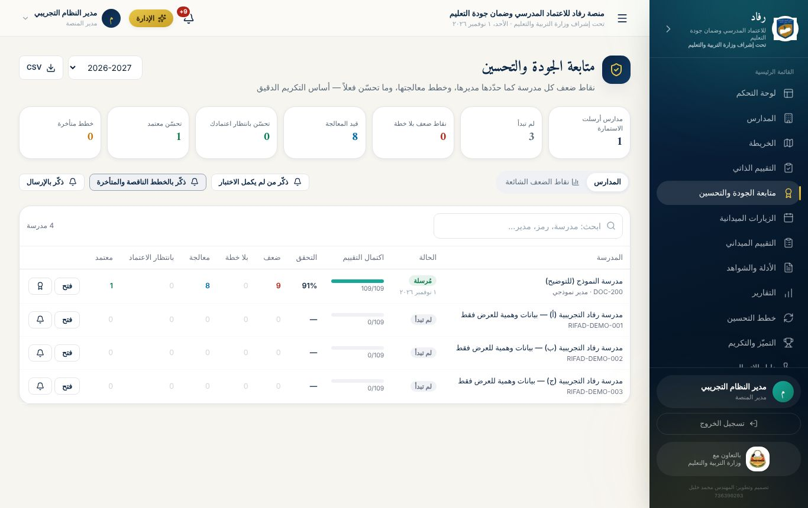

## 5. مراجعة استمارة مدرسة واعتماد التحسّن

افتح استمارة المدرسة بزر **«فتح»** في جدول المتابعة. ترى المؤشرات بألوانها، والخطط، وما نفّذته المدرسة، والشواهد المرفوعة.

للمؤشر في حالة **«تحسّن — بانتظار الاعتماد»**:

1. اقرأ **ما نُفّذ فعلياً** كما كتبته المدرسة، والتقدير الجديد.
2. افتح **الشواهد** المرفوعة على المؤشر بزر «عرض الشواهد».
3. قرّر:
   - **«اعتماد التحسّن»:** اكتب ملاحظة اختيارية، مثل «تحقق المشرف من الوثيقة في زيارة ميدانية»، ثم أكّد. يتحول المؤشر إلى أخضر، وتُشعَر المدرسة.
   - **«إعادة للمتابعة»:** اكتب **سبب الإعادة** (إلزامي)، ثم **«إعادة»**. يعود المؤشر إلى «قيد التنفيذ»، ويعود تقديره إلى ما كان عليه، وتُشعَر المدرسة بالسبب.
4. **سحب الاعتماد:** متاح على مؤشر سبق اعتماده، إن ظهر ما يستدعي ذلك.

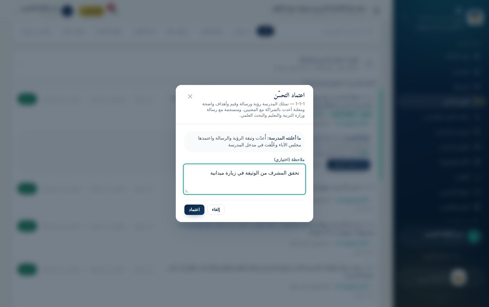

> **سبب إعادة جيد:** «الشاهد المرفوع صورة لمسودة غير موقّعة؛ المطلوب المحضر المعتمد بتوقيع مجلس الآباء». **سبب ضعيف:** «غير كافٍ».

### إعادة فتح الاستمارة

إذا احتاجت مدرسة تعديل تقييمها بعد الإرسال، اضغط **«إعادة فتح للمدرسة»** في شريط حالة استمارتها. استخدمها عند خطأ حقيقي فقط؛ لأن التعديلات تُسجَّل في تاريخ المؤشرات.

### نقاط الضعف في ملف المدرسة

في ملف أي مدرسة (المدارس ← اسم المدرسة) تبويب **«التقييم الذاتي ونقاط الضعف»**: أماكن الضعف، وخطة كل نقطة وحالتها، و**الأدلة غير المتوفرة** لكل نقطة. مفيد قبل الزيارة الميدانية.

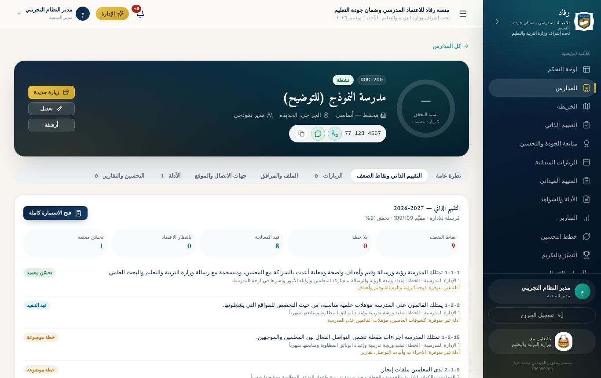

## 6. نقاط الضعف الشائعة: لتوجيه التدريب والدعم

تبويب **«نقاط الضعف الشائعة»** في لوحة المتابعة يعرض لنطاقك:

- **متوسط التحقق في كل معيار** من التقييم الذاتي لكل المدارس.
- **أكثر المؤشرات ضعفاً:** عدد المدارس الضعيفة فيه، وكم ما زال مفتوحاً، وكم عولج واعتُمد.
- **الأدلة الأكثر غياباً** في كل مؤشر، من إجابات المدراء في الاختبار التفاعلي.

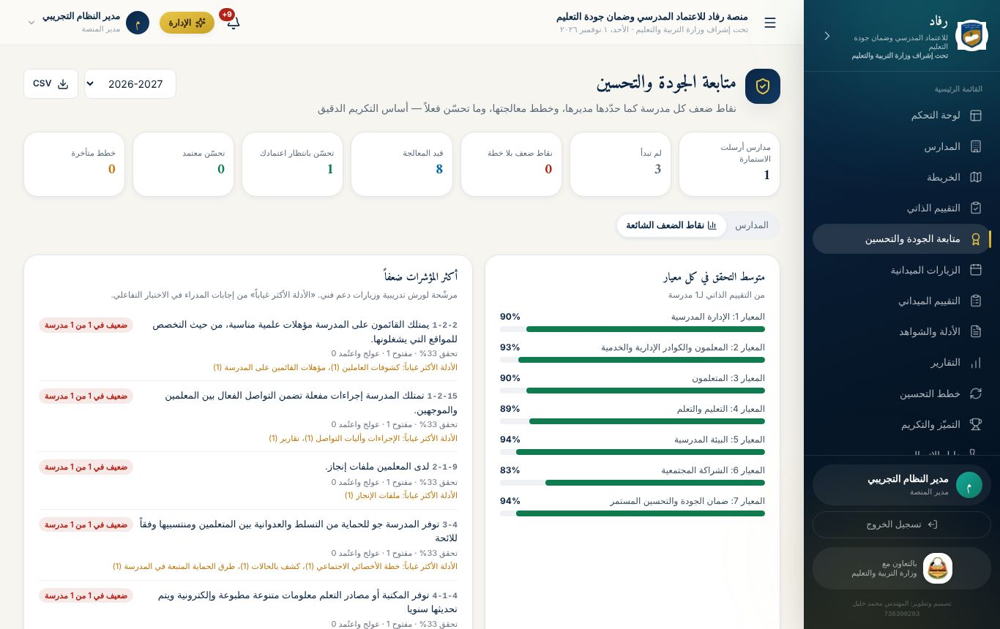

> **كيف تستخدمها؟** إذا كان دليل «محضر صياغة الرؤية والرسالة» غائباً عن 12 مدرسة، فهذا موضوع **ورشة عمل** واحدة تحل المشكلة في كل المدارس معاً، بدل 12 زيارة منفصلة.

## 7. شهادات التكريم المبنية على البيانات

1. من **متابعة الجودة** اضغط 🏅 بجانب مدرسة أرسلت استمارتها.
2. يظهر **نص مقترح مبني على البيانات فقط**، يذكر المعيار والمؤشر والعام بدقة.
3. إن لم تستحق المدرسة شهادة، **يظهر السبب**.

**شروط الاستحقاق:** أن تكون الاستمارة **مُرسلة**، وأن يوجد على الأقل:

- **معيار محقَّق بالكامل:** كل مؤشراته مقيّمة، ولا ضعف مفتوح فيه، ونسبته 80% فأكثر، **أو**
- **تحسّن اعتمدته الإدارة.**

**الإصدار والطباعة (مدير النظام ومدير الإدارة):**

- زر **«إصدار وطباعة»** يسجّل الشهادة **برمز تحقق** فريد، مثل `CERT-ZPMFJTZL`، ويطبعها بإطار رسمي.
- **لا ختم ولا توقيع مطبوع:** تبقى خانات التوقيع فارغة للتوقيع باليد.
- تُشعَر المدرسة، وتظهر **الشهادات السابقة** في النافذة نفسها لإعادة طباعتها.
- **الإلغاء:** لمدير النظام فقط، ويظهر الإلغاء عند التحقق من الشهادة.

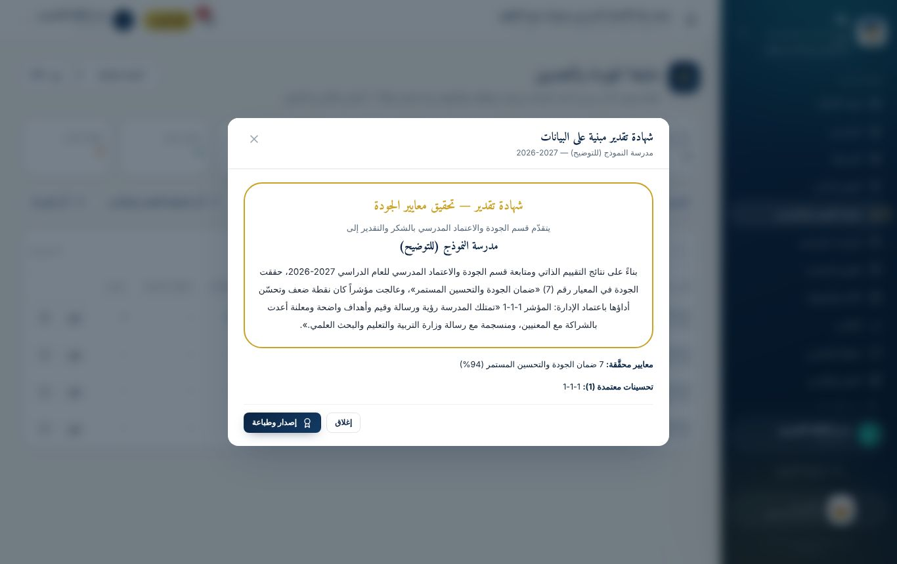

### التحقق العام من الشهادة

أي شخص، **دون حساب**، يفتح صفحة **`/verify`** على رابط المنصة ويكتب رمز الشهادة، فتظهر: بيانات الشهادة، ومن أصدرها ومتى، وحالتها (سارية أو ملغاة). الصفحة نفسها تتحقق من **التقارير المعتمدة**.

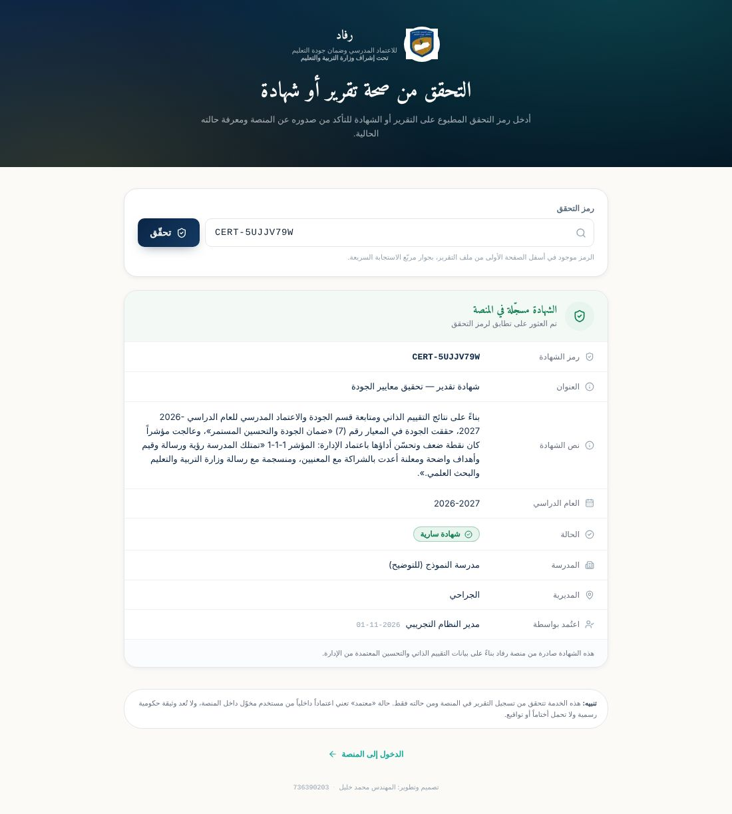

## 8. الزيارات الميدانية والتقييم الميداني

**التقييم الميداني مكمّل للتقييم الذاتي:** يقيّم المفتش أثناء الزيارة المؤشرات نفسها تقييماً مستقلاً.

### الزيارات

من **الزيارات الميدانية** تُجدوَل الزيارات وتُتابَع. حالاتها: مجدولة، وجارية، وبانتظار المراجعة، ومعتمدة، ومؤجلة، وملغاة، ومتأخرة.

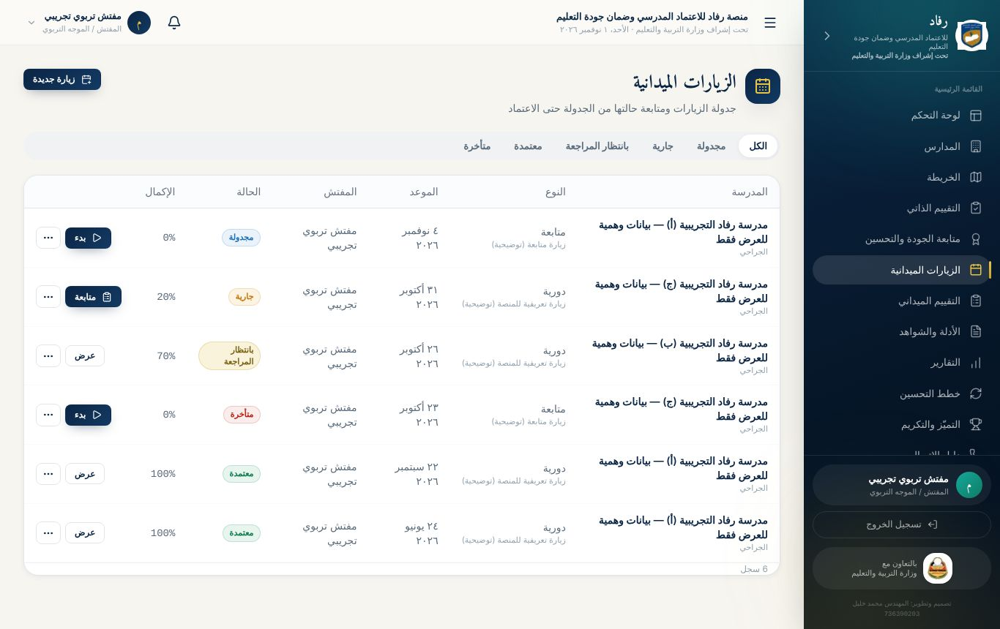

### التقييم الميداني

من **التقييم الميداني** يقيّم المفتش مؤشرات المدرسة أثناء الزيارة:

- **الحفظ تلقائي:** كل تغيير يُحفظ فوراً، مع سجل بمن عدّل ومتى ولماذا.
- **العمل دون إنترنت:** عند ضعف الاتصال تُحفظ الدرجات **على الجهاز**، وتُرفع تلقائياً عند عودته.
- **الشواهد:** تُرفع لكل مؤشر من داخل التقييم.
- **مسار الاعتماد:** يرسل المفتش التقييم للمراجعة، ثم يعتمده مدير الإدارة أو يعيده.

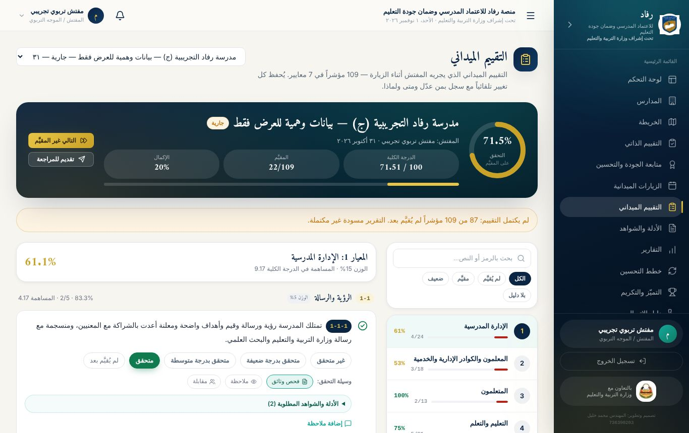

### الإجراءات التصحيحية (خطط التحسين)

كل مؤشر قُيّم 0 أو 1 في آخر تقييم ميداني يتطلب **إجراءً تصحيحياً**: المشكلة، والسبب، والأولوية، والإجراء، والمسؤول، والموعد. مساره: جديد ← قيد التنفيذ ← يحتاج تحقق ← مغلق بعد التحقق، أو مرفوض التحقق.

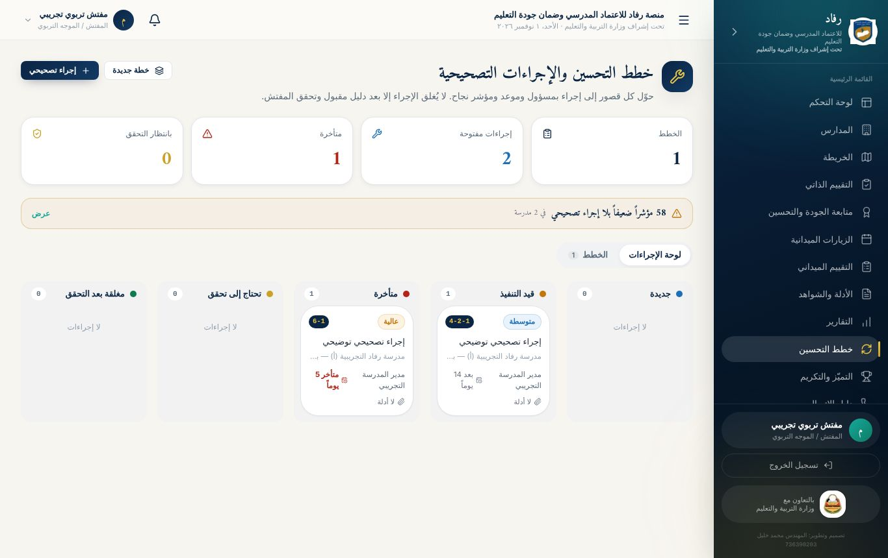

## 9. الشواهد والتقارير

### مراجعة الشواهد

في **الأدلة والشواهد** يرى المشرف شواهد كل مدارس نطاقه. اضغط بطاقة **«بانتظار المراجعة»**، ثم راجع كل شاهد: **«فتح الملف للمراجعة»**، ومدى صلاحيته، وملاحظاتك، ثم **«قبول»** أو **«رفض»**.

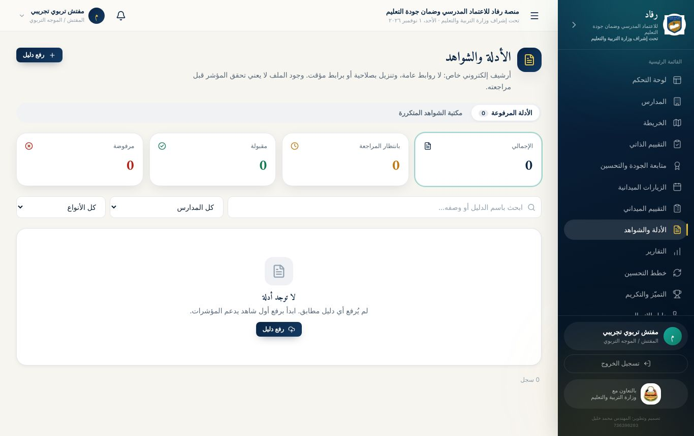

### التقارير

- **التوليد:** من بيانات الزيارات والمدارس الفعلية.
- **مسار الاعتماد:** مسودة ← قيد المراجعة ← معتمد، أو مرفوض.
- **التصدير:** PDF عربي، أو Excel، أو CSV.
- **رمز التحقق:** يحمله كل تقرير معتمد، ويُتحقق منه من صفحة `/verify`.

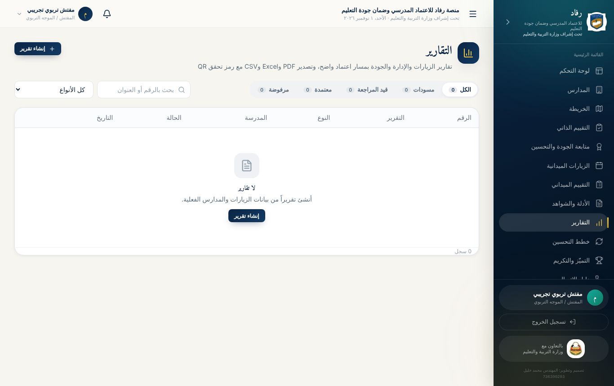

## 10. الخريطة والتميّز ودليل الاتصال

| القسم | ما يعرضه | أهم استخدام |
|----------------|----------------------------------------------------------------------|----------------------------------------------------------------------|
| **الخريطة** | مواقع المدارس، ولون كل نقطة حسب نسبة التحقق | رؤية المناطق التي تحتاج دعماً |
| **التميّز والتكريم** | ترتيب المدارس من آخر تقييم ميداني مكتمل بنسبة 70% فأكثر: متميّز (90%+)، ومتقدّم (75%+)، ومقبول (60%+)، وبحاجة إلى دعم، مع مقدار التحسّن عن الزيارة السابقة | اختيار المدارس للتكريم أو الدعم |
| **دليل الاتصال** | كل مدارس نطاقك ومدراؤها، مع أزرار اتصال وواتساب وتوجيه | التواصل السريع. وينزَّل **CSV** أو ملف جهات اتصال **VCF** يُستورد في الهاتف مباشرة |

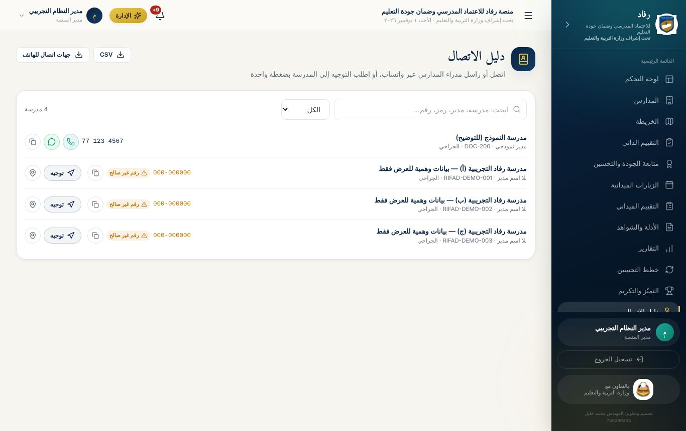

## تطبيقات عملية: الوحدة الرابعة

**التطبيق 4-1: قراءة لوحة المتابعة**

1. افتح **متابعة الجودة والتحسين**، واضغط كل بطاقة على حدة.
2. اكتب: كم مدرسة لم تبدأ؟ وكم تحسّناً ينتظر اعتمادك؟
3. نزّل الجدول بزر **CSV** وافتحه في Excel.

- [ ] **نجحت إذا:** طابقت أرقامك أرقام زميلك في المديرية نفسها.

**التطبيق 4-2: التذكير**

1. اضغط **«ذكّر من لم يكمل الاختبار»**.
2. افتح زر الواتساب بجانب إحدى المدارس، واقرأ الرسالة الجاهزة دون إرسالها.

- [ ] **نجحت إذا:** ظهر إشعار التذكير عند حساب المدير التدريبي.

**التطبيق 4-3: الاعتماد والإعادة (عمل ثنائي مع متدرب بحساب مدير مدرسة)**

1. يعلن زميلك تحسّناً على مؤشرين.
2. اعتمد الأول بملاحظة، وأعد الثاني بسبب واضح.
3. افتح **تاريخ المؤشر** لكليهما.

- [ ] **نجحت إذا:** صار الأول أخضر، وعاد الثاني أزرق، وظهرت خطواتك في التاريخ باسمك.

**التطبيق 4-4: دراسة حالة — نقاط الضعف الشائعة**

1. افتح تبويب **«نقاط الضعف الشائعة»**.
2. حدّد أكثر 3 مؤشرات ضعفاً، وأكثر دليل غائب في كل منها.
3. اقترح ورشة عمل واحدة: عنوانها، والمدارس المستهدفة، والدليل الذي ستُنتجه.

- [ ] **نجحت إذا:** قدّمت اقتراحك مبنياً على أرقام اللوحة.

**التطبيق 4-5: شهادة وتحقق**

1. افتح نافذة الشهادة لمدرسة تدريبية أرسلت استمارتها، واقرأ النص المقترح.
2. (مدير الإدارة) أصدرها واطبعها PDF.
3. افتح صفحة `/verify` واكتب رمز الشهادة.

- [ ] **نجحت إذا:** ظهرت الشهادة «سارية» ببياناتها.

**التطبيق 4-6: الزيارة والتقرير**

1. جدول زيارة لمدرسة تدريبية، ثم افتح تقييمها الميداني وقيّم 5 مؤشرات.
2. راجع شاهداً واحداً على الأقل: اقبله أو ارفضه بملاحظة.
3. افتح **التقارير**، ونزّل تقريراً بصيغة PDF وآخر بصيغة Excel.

- [ ] **نجحت إذا:** ظهرت الزيارة في القائمة بحالتها، وفتحت التقريرين على جهازك.
