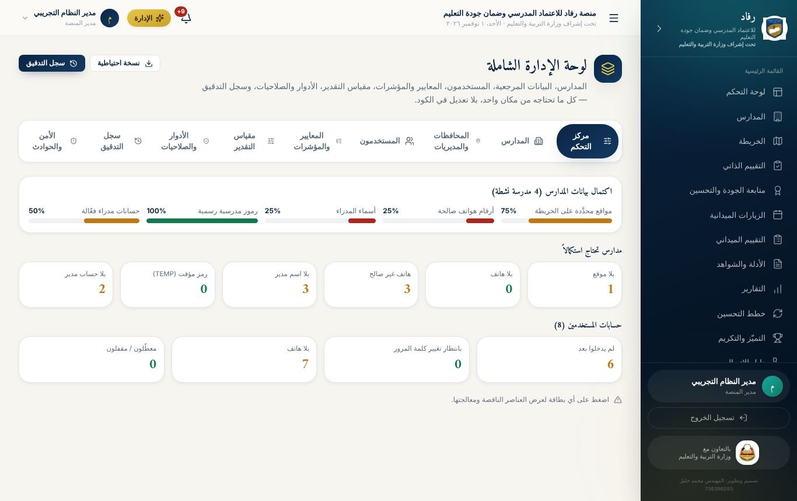
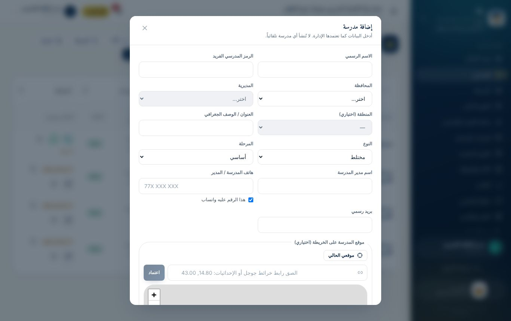
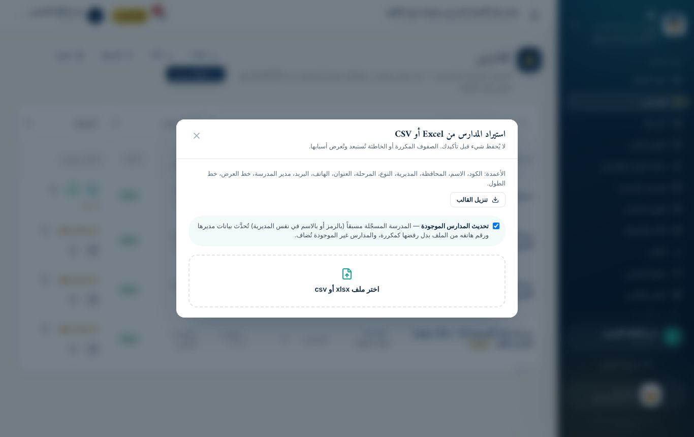
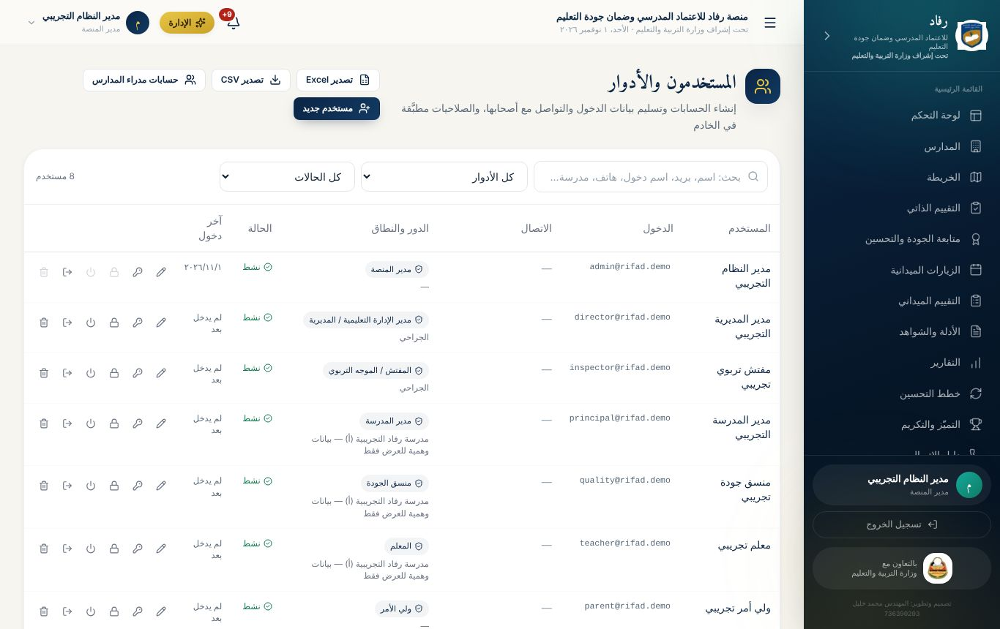
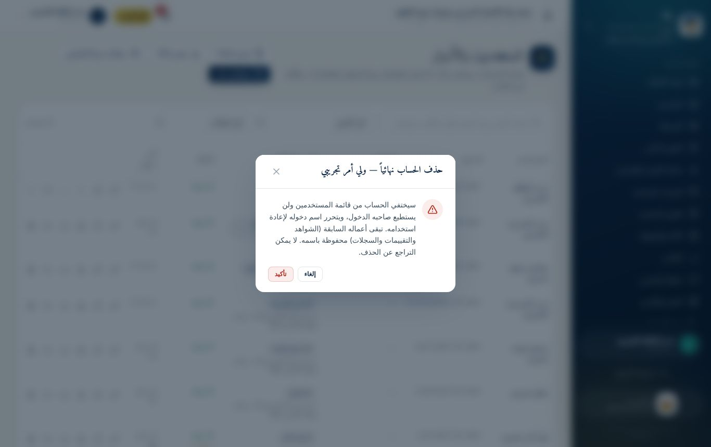
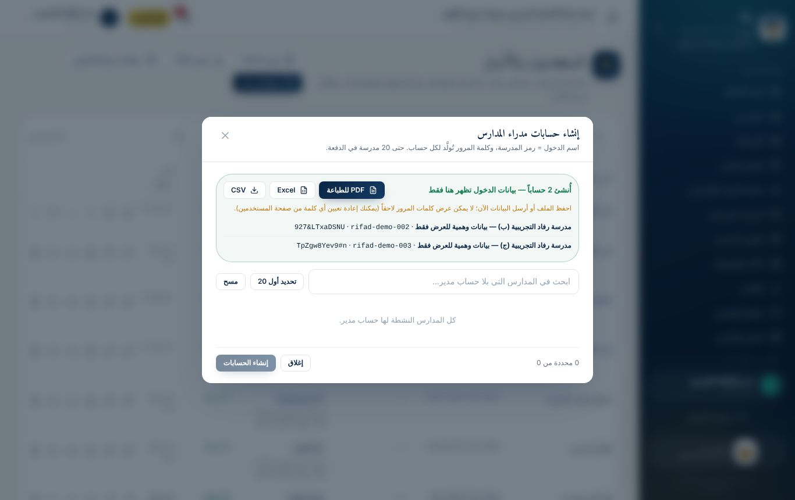
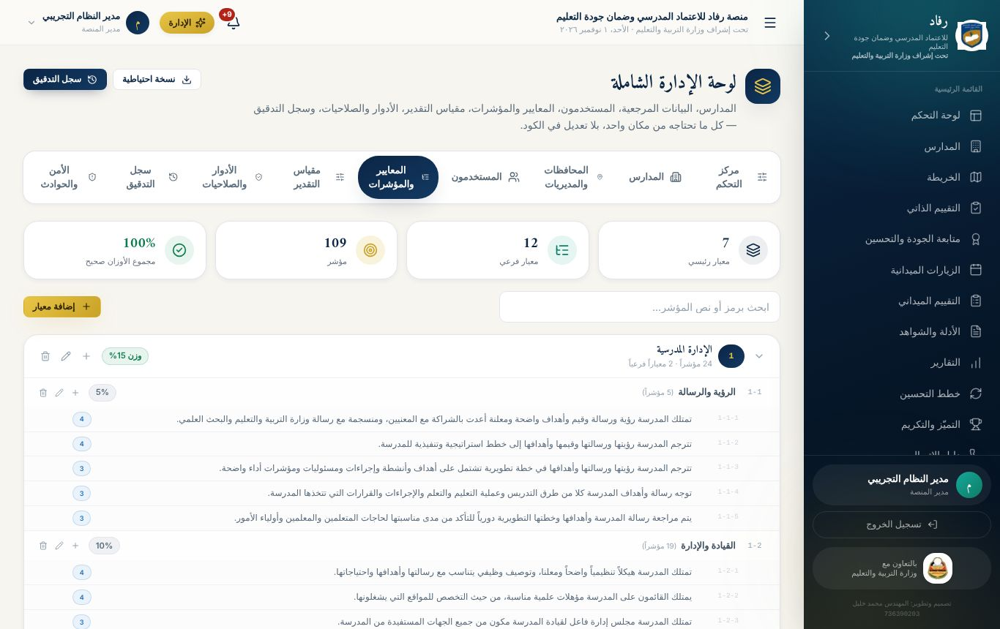
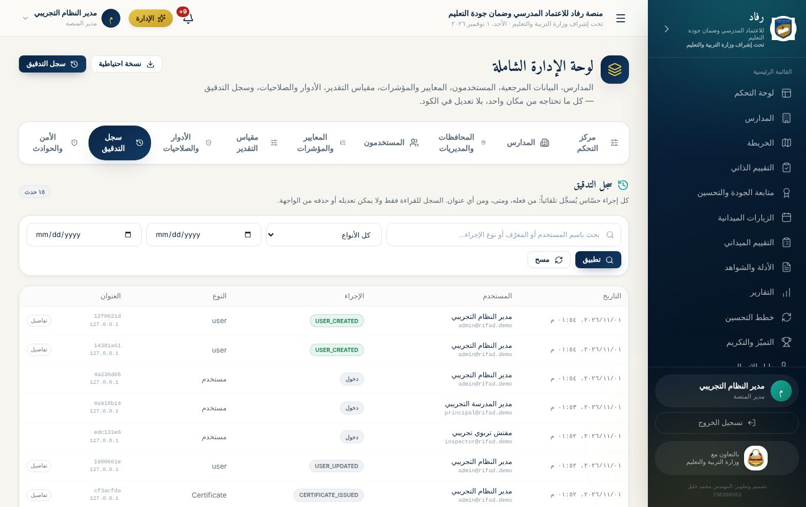

# الوحدة الخامسة: رئاسة المنصة ومدير النظام

**لمن:** رئيسة المنصة وفريقها، وكل من يحمل دور **مدير النظام** · **مدة الوحدة:** يوم تدريبي · **الشرائح:** 43–52

**بعد هذه الوحدة يستطيع مدير النظام أن:**

- يقرأ مركز التحكم ويعالج نواقص البيانات.
- يضيف المدارس ويستوردها ويحدد مواقعها.
- يدير الحسابات كاملة: الإنشاء، والإنشاء الجماعي، وتسليم بيانات الدخول بكل الصيغ، وإعادة التعيين، والقفل، والتعطيل، **والحذف**، **والتصدير**.
- يدير محتوى الاستمارة ومقياس التقدير والأدوار.
- يتتبع العمليات في سجل التدقيق، ويتعامل مع الحوادث الأمنية، ويأخذ نسخة احتياطية.
- يجهّز دورة تدريبية ثم ينظّف بياناتها.

> **مسؤولية الدور:** مدير النظام يرى كل البيانات ويغيّر كل شيء. كل ما يفعله يُسجَّل باسمه في **سجل التدقيق**. فعّل **المصادقة الثنائية** على حسابك قبل أي شيء.

## 1. لوحة الإدارة الشاملة

من زر **«الإدارة»** الذهبي في الشريط العلوي. في أعلاها زران: **«نسخة احتياطية»** و**«سجل التدقيق»**.

| التبويب | الوظيفة |
|--------------------|----------------------------------------------------------------------|
| **مركز التحكم** | اكتمال بيانات المدارس والحسابات، وقوائم النواقص لمعالجتها سريعاً |
| **المدارس** | إضافة المدارس وتعديلها وأرشفتها وحذفها |
| **المحافظات والمديريات** | إضافة المحافظات والمديريات والمناطق وتعديلها. لا يُحذف ما ترتبط به مدارس |
| **المستخدمون** | إدارة سريعة للحسابات |
| **المعايير والمؤشرات** | محتوى الاستمارة كاملاً |
| **مقياس التقدير** | مستويات التقدير وأوصافها ودرجاتها |
| **الأدوار والصلاحيات** | إنشاء أدوار بصلاحيات مخصّصة |
| **سجل التدقيق** | كل إجراء حساس: من فعله، ومتى، وما الذي تغيّر |
| **الأمن والحوادث** | محاولات الدخول المشبوهة، وتسجيل الحوادث الأمنية ومعالجتها |

### مركز التحكم

يعرض **نسبة اكتمال بيانات المدارس**: المواقع، والهواتف الصالحة، وأسماء المدراء، والرموز الرسمية، وحسابات المدراء. وتحتها بطاقات النواقص:

- **بيانات المدارس:** بلا موقع، أو بلا هاتف، أو برقم غير صالح، أو بلا اسم مدير، أو برمز مؤقت `TEMP`، أو بلا حساب مدير.
- **الحسابات:** لم يدخلوا بعد، أو بانتظار تغيير كلمة المرور، أو بلا هاتف، أو معطّلون.

اضغط أي بطاقة لتظهر القائمة مع أزرار المعالجة، مثل **«حدّد الموقع»** و**«فتح المدرسة»**.

## 2. المدارس

### إضافة مدرسة

**المدارس ← إضافة مدرسة**:

1. **الأساسية:** الاسم، والرمز، والمحافظة، والمديرية، والمنطقة، والعنوان، والنوع، والمرحلة.
2. **المدير والتواصل:** اسم مدير المدرسة، وهاتف المدرسة أو المدير، وخانة **«هذا الرقم عليه واتساب»**.
3. **الموقع على الخريطة**، بإحدى ثلاث طرق:
   - النقر على الخريطة، ثم سحب الدبوس لضبطه.
   - زر **«موقعي الحالي»** وأنت داخل المدرسة.
   - لصق **رابط خرائط جوجل**، أو **الإحداثيات** مثل `14.80, 43.00`.

**ما تفعله المنصة تلقائياً:** توحّد كتابة الأرقام، وتنبّه إلى الرقم غير الصالح (الجوال اليمني 9 خانات يبدأ بالرقم 7)، وترفض الإحداثيات خارج اليمن، وتنبّه إلى مدرسة أخرى في الموقع نفسه.

### استيراد المدارس من Excel

**المدارس ← استيراد**:

1. ارفع كشفك كما هو، أو نزّل القالب واملأه. المنصة تكتشف صف العناوين وتطابق الأعمدة: رقم المدرسة، والمدرسة، والمحافظة، والمديرية، والنوع، والمرحلة، والعنوان، ومدير المدرسة، والتلفون.
2. اترك **«تحديث المدارس الموجودة»** مفعّلة: المدرسة المسجّلة مسبقاً تُحدَّث بيانات مديرها وهاتفه بدل رفضها. والخلية الفارغة لا تمحو بياناً موجوداً.
3. راجع **المعاينة:** الجديد، وما سيُحدَّث، والأخطاء، والتنبيهات. لا يُحفظ شيء قبل **«تأكيد»**.
4. المدرسة بلا رقم تُحفظ برمز مؤقت مثل `TEMP-001`، وتعدّله لاحقاً.

### تصدير المدارس

من صفحة **المدارس** نزّل كشف المدارس بصيغة **Excel** أو **CSV**، بكل بياناتها: الرمز، والاسم، والمحافظة، والمديرية، والهاتف، والمدير، والإحداثيات، والحالة.

## 3. المستخدمون والحسابات

من القائمة: **المستخدمون والأدوار**.

### أعلى الصفحة

| الزر | وظيفته |
|--------------------|----------------------------------------------------------------------|
| **تصدير Excel** | ينزّل قائمة كل المستخدمين: الاسم، والبريد، واسم الدخول، والهاتف، والمسمى، والدور، والمدرسة ورمزها، والمديرية، والحالة، وآخر دخول، وتاريخ الإنشاء |
| **تصدير CSV** | القائمة نفسها بصيغة CSV |
| **حسابات مدراء المدارس** | إنشاء حسابات المدراء دفعة واحدة |
| **مستخدم جديد** | إنشاء حساب واحد |

> **التصدير لا يتضمن كلمات المرور أبداً.** كلمات المرور لا تُخزَّن نصاً في أي مكان.

### البحث والتصفية

بالاسم، أو البريد، أو اسم الدخول، أو الهاتف، أو المدرسة. وبالدور، وبالحالة: نشط، أو معطّل، أو مقفل، أو لم يدخل بعد، أو ينتظر تغيير كلمة المرور.

### أزرار كل مستخدم (من اليمين إلى اليسار)

| الزر | الوظيفة | الأثر |
|-------------------------|----------------------------------------------------------------------|------------------------------------|
| ✏️ **تعديل** | الاسم، والمسمى، واسم الدخول، والبريد، والدور، والمدرسة أو المديرية، والهاتف | تغيير الدور يُنهي جلسات المستخدم |
| 🔑 **إعادة تعيين كلمة المرور** | تُولَّد كلمة مؤقتة جديدة تظهر مرة واحدة | تُنهى جلساته، ويُلزم بتغييرها |
| 🔒 **قفل / فتح الحساب** | يمنع الدخول مؤقتاً | الفتح يصفّر عدّاد المحاولات الخاطئة |
| ⏻ **تعطيل / تفعيل** | يوقف الحساب مع إمكانية إعادته | يبقى الحساب في القائمة بحالة «معطّل» |
| ⎋ **إنهاء الجلسات** | يُخرجه من كل أجهزته | يدخل من جديد بكلمته نفسها |
| 🗑 **حذف الحساب** | يحذف الحساب نهائياً | انظر الفقرة التالية |

### حذف الحسابات

1. اضغط 🗑 **«حذف الحساب»** بجانب المستخدم.
2. تظهر نافذة تأكيد حمراء تشرح أثر الحذف. اضغط **«تأكيد»**.

**ماذا يحدث بعد الحذف؟**

- **يختفي الحساب** من قائمة المستخدمين، ومن مركز التحكم، ومن التصدير.
- **يُمنع صاحبه من الدخول فوراً**، وتُنهى كل جلساته.
- **يتحرر اسم الدخول والبريد**، فيمكن إنشاء حساب جديد بالاسم نفسه، مثل حساب مدير جديد للمدرسة نفسها.
- **تبقى أعماله السابقة محفوظة باسمه:** الشواهد، والتقييمات، وتاريخ المؤشرات، والزيارات. لا تتأثر بيانات المدرسة.
- **يُسجَّل الحذف في سجل التدقيق** ببيانات الحساب المحذوف.

**قواعد حماية ثابتة:**

- لا يمكنك حذف **حسابك أنت** (الزر معطّل في صفك).
- لا يمكن حذف **آخر مدير نظام نشط** في المنصة.
- **الحذف لا رجعة فيه.** إن كان الإيقاف مؤقتاً، استخدم **التعطيل** بدلاً منه.

| متى أستخدم… | الإجراء |
|----------------------------------------------------|------------------|
| موظف في إجازة طويلة، أو تحقيق إداري | **تعطيل** |
| محاولات دخول مشبوهة على الحساب | **قفل** ثم **إعادة تعيين** |
| موظف انتقل أو تقاعد، أو حساب أُنشئ بالخطأ أو للتدريب | **حذف** |

### إنشاء مستخدم

**«مستخدم جديد»**:

- **الهوية:** الاسم الكامل، والمسمى الوظيفي.
- **الدخول:** **اسم المستخدم** (حروف لاتينية صغيرة وأرقام، من 3 إلى 40)، و/أو البريد.
- **الدور والنطاق:** المدرسة لأدوار المدرسة، والمديرية لمدير الإدارة والمفتش.
- **الهاتف** مع خانة الواتساب.
- **كلمة المرور:** اتركها فارغة لتُولَّد **كلمة قوية تلقائياً** (موصى به)، وأبقِ خانة **«إلزامه بتغيير كلمة المرور عند أول دخول»** مفعّلة.

### بطاقة بيانات الدخول: كل طرق التسليم

بعد الإنشاء أو إعادة التعيين تظهر البيانات **مرة واحدة فقط**:

| الزر | الاستخدام |
|-------------------|----------------------------------------------------------------------|
| **نسخ** (بجانب كل خانة) | نسخ اسم الدخول أو كلمة المرور |
| **نسخ الرسالة كاملة** | رسالة جاهزة فيها الرابط واسم الدخول وكلمة المرور، للصقها في أي تطبيق |
| **إرسال عبر واتساب** | يفتح واتساب برسالة جاهزة لرقم المستخدم، إن كان رقمه صالحاً وعليه واتساب |
| **طباعة** | ورقة رسمية مختصرة تُسلَّم لصاحبها يداً بيد |
| **تنزيل ملف** | ملف نصي على جهازك فيه بيانات الدخول |

### حسابات مدراء المدارس دفعة واحدة

1. زر **«حسابات مدراء المدارس»**: تظهر المدارس النشطة التي ليس لها حساب مدير فعّال.
2. ابحث بالاسم أو الرمز، وحدّد حتى **20 مدرسة** في الدفعة، أو اضغط **«تحديد أول 20»**.
3. اضغط **«إنشاء الحسابات»**. لكل مدرسة:
   - **اسم الدخول** = رمز المدرسة.
   - **الاسم والهاتف** من بيانات المدرسة.
   - **كلمة مرور مؤقتة** مولَّدة، مع إلزام بتغييرها.
4. يظهر جدول بيانات الدخول، ومعه **ثلاث صيغ تنزيل**:

| الزر | الصيغة | متى تستخدمها |
|-----------|------------------------------------|-------------------------------------|
| **PDF للطباعة** | جدول رسمي بشعار المنصة وتنبيه السرية | لطباعته وقصّه بطاقات تُسلَّم يداً بيد |
| **Excel** | ملف `.xlsx` منسّق من اليمين إلى اليسار | للفرز أو الإرسال لمسؤول المديرية |
| **CSV** | ملف نصي مفصول بفواصل | للاستيراد في برامج أخرى |

وبجانب كل مدير زرا **اتصال** و**واتساب** برسالة جاهزة.

> **سرية بيانات الدخول:**
>
> - نزّل الملف أو أرسل البيانات **فوراً**؛ لا يمكن عرض كلمات المرور لاحقاً. وإن ضاعت، أعد تعيين كلمة الحساب.
> - **أتلف الملف الورقي والإلكتروني بعد التسليم.**
> - لا ترسل ملف كلمات المرور في مجموعات واتساب عامة.

## 4. محتوى الاستمارة ومقياس التقدير والأدوار

### المعايير والمؤشرات

**الإدارة ← المعايير والمؤشرات**:

- إضافة **معيار** أو **معيار فرعي** أو **مؤشر**، وتعديلها وحذفها.
- لكل عنصر: الرمز، والنص، والوزن، و**الأدلة والشواهد** (سطر لكل دليل)، وأدوات التحقق.
- **مجموع الأوزان يجب أن يساوي 100%**، ويظهر المجموع للمراجعة.
- **التعديل يظهر فوراً** في الاستمارة، والاختبار التفاعلي، والتقييم الميداني، والطباعة.

> **تنبيه:** لا تعدّل محتوى الاستمارة في منتصف العام الدراسي إلا لتصحيح خطأ واضح. التعديل يغيّر ما تراه كل المدارس فوراً.

### مقياس التقدير

تعديل نصوص المستويات ودرجاتها. الدرجتان 0 و1 تُعدّان «ضعفاً» في دورة التحسين.

### الأدوار والصلاحيات

الأدوار الجاهزة: مدير النظام، ومدير الإدارة / المديرية، والمفتش / الموجه التربوي، ومدير المدرسة، ومنسق الجودة، والمعلم، وولي الأمر. ويمكن إنشاء **دور جديد** بصلاحيات تختارها من قائمة مصنّفة. **كل الصلاحيات تُفحص في الخادم**، فإخفاء الزر ليس هو الحماية الوحيدة.

## 5. سجل التدقيق والأمن والنسخ الاحتياطي

### سجل التدقيق

**الإدارة ← سجل التدقيق**: كل إنشاء وتعديل وحذف واعتماد ودخول وتصدير، باسم المنفّذ ووقته وما تغيّر. لا يمكن تعديله من أي مستخدم. ابحث فيه بالإجراء أو المستخدم أو التاريخ.

**أمثلة على أسئلة يجيب عنها السجل:**

- من حذف هذا الحساب، ومتى؟ (`USER_DELETED`)
- من صدّر قائمة المستخدمين؟ (`EXPORT_USERS`)
- من نزّل هذا الشاهد؟ (`EVIDENCE_DOWNLOAD`)
- من غيّر دور هذا المستخدم؟ (`USER_UPDATED`)

### الأمن والحوادث

تبويب **الأمن والحوادث**: محاولات الدخول الفاشلة والمشبوهة، وإيقاف الحسابات المهددة، وتسجيل **الحوادث الأمنية** ومتابعة معالجتها حتى إغلاقها.

### النسخة الاحتياطية

زر **«نسخة احتياطية»** أعلى لوحة الإدارة ينزّل نسخة كاملة من قاعدة البيانات: ملف `.sql` على الاستضافة السحابية الحالية. **خذ نسخة أسبوعياً**، واحفظها في مكان آمن خارج جهازك، مثل قرص خارجي في خزانة القسم.

> النسخة الاحتياطية تحتوي بيانات كل المدارس والمستخدمين. عاملها كوثيقة سرية.

## 6. المهام الدورية لرئاسة المنصة

| الدورية | المهمة | أين |
|------------------|-----------------------------------------------------------|------------------------------|
| **يومياً** | مراجعة «تحسّن بانتظار اعتمادك» والخطط المتأخرة | متابعة الجودة والتحسين |
| **يومياً** | قراءة الإشعارات والمراسلات | الجرس والتواصل |
| **أسبوعياً** | معالجة نواقص البيانات والحسابات | مركز التحكم |
| **أسبوعياً** | تذكير المدارس المتأخرة | أزرار التذكير |
| **أسبوعياً** | أخذ نسخة احتياطية | لوحة الإدارة |
| **أسبوعياً** | مراجعة محاولات الدخول المشبوهة | الأمن والحوادث |
| **شهرياً** | تحليل نقاط الضعف الشائعة وتخطيط الورش | نقاط الضعف الشائعة |
| **شهرياً** | تصدير قائمة المستخدمين ومراجعتها، وحذف حسابات من غادروا | المستخدمون |
| **بداية كل عام دراسي** | التأكد من محتوى الاستمارة، وإبلاغ المدارس ببدء العام الجديد | المعايير والمؤشرات، والإعلانات |
| **نهاية كل عام دراسي** | إصدار الشهادات المستحقة، وتصدير التقارير | متابعة الجودة، والتقارير |

## تطبيقات عملية: الوحدة الخامسة

**التطبيق 5-1: مركز التحكم**

1. افتح **مركز التحكم**، وحدّد أكبر نقص في بيانات المدارس.
2. عالج مدرسة واحدة منه، مثل تحديد موقعها على الخريطة.

- [ ] **نجحت إذا:** نقص العدد في البطاقة بمقدار واحد.

**التطبيق 5-2: مدرسة تدريبية بموقعها**

1. أضف «مدرسة التدريب (99)» برمز `TRAIN-99`.
2. حدّد موقعها بلصق إحداثيات، وأضف هاتفاً عليه واتساب.

- [ ] **نجحت إذا:** ظهرت المدرسة على **الخريطة**.

**التطبيق 5-3: دورة حياة حساب كاملة**

1. أنشئ مدير مدرسة لـ`TRAIN-99` بكلمة مولّدة، وانسخ الرسالة كاملة.
2. ادخل به من متصفح خاص، وغيّر كلمة المرور.
3. من حسابك: اقفله، ثم افتحه، ثم أعد تعيين كلمته، ثم **احذفه**.
4. ابحث عنه في القائمة وفي **سجل التدقيق**.

- [ ] **نجحت إذا:** اختفى الحساب من القائمة، وظهر إجراء الحذف `USER_DELETED` في السجل.

**التطبيق 5-4: حسابات المدراء دفعة وتنزيلها**

1. أنشئ حسابات مدراء لمدرستين تدريبيتين دفعة واحدة.
2. نزّل بياناتها بالصيغ الثلاث: PDF وExcel وCSV، وافتح كل ملف.

- [ ] **نجحت إذا:** فتحت الملفات الثلاثة، ووجدت فيها المدرستين.

**التطبيق 5-5: التصدير والنسخة الاحتياطية**

1. صدّر قائمة المستخدمين **Excel**، وتأكد أنها لا تحتوي كلمات مرور.
2. نزّل **نسخة احتياطية**.

- [ ] **نجحت إذا:** ظهر الإجراءان في سجل التدقيق.

**التطبيق 5-6: تجهيز دورة وتنظيفها**

1. طبّق خطوات **تجهيز بيئة التدريب** في دليل المدرّب لمتدربَين اثنين.
2. بعد التطبيق: احذف حساباتهما، وأرشف مدرستيهما.

- [ ] **نجحت إذا:** لم تعد مدارس التدريب تظهر في لوحة متابعة الجودة.
