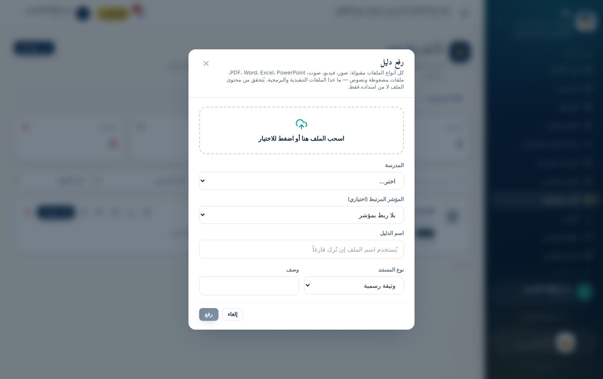

# الوحدة السادسة: الملفات رفعاً وتنزيلاً (لجميع المتدربين)

**مدة الوحدة:** 30 دقيقة · **الشرائح:** 39–42

**بعد هذه الوحدة يستطيع المتدرب أن:**

- يعرف أنواع الملفات التي تقبلها المنصة، والممنوعة منها، ولماذا.
- يعرف الحد الأقصى لحجم الملف، ويصغّر ملفه إذا تجاوزه.
- يعاين الملفات داخل المنصة، وينزّلها، ويشاركها برابط مؤقت.
- ينزّل بيانات المنصة وتقاريرها بالصيغة التي يحتاجها: PDF، أو Excel، أو CSV، أو غيرها.

## 1. رفع الملفات: كل الأنواع الشائعة مقبولة

المنصة تقبل **كل أنواع الملفات الشائعة** في العمل المدرسي:

| الفئة | الصيغ المقبولة | أمثلة من الواقع |
|----------------|----------------------------------------------------------------------|----------------------------------|
| **الصور** | JPG، PNG، WebP، GIF، BMP، TIFF، HEIC (صور آيفون)، ICO | صورة لوحة المدرسة، صورة محضر موقّع |
| **الفيديو** | MP4، MOV، WebM، MKV، AVI | مقطع قصير من حصة أو نشاط |
| **الصوت** | MP3، M4A، WAV، OGG، FLAC | تسجيل مقابلة، رسالة صوتية |
| **المستندات** | PDF، Word (DOC و DOCX)، PowerPoint (PPT و PPTX)، RTF، ومستندات LibreOffice (ODT و ODS و ODP) | خطة، تقرير، عرض تقديمي |
| **الجداول** | Excel (XLS و XLSX)، CSV | كشف درجات، سجل حضور |
| **الملفات المضغوطة** | ZIP، RAR، 7Z | مجموعة صور في ملف واحد |
| **النصوص** | TXT، JSON، XML، YAML، MD، LOG | ملاحظات نصية |

### الممنوع رفعه، ولماذا

تمنع المنصة **الملفات التنفيذية والبرمجية**، لأنها قد تحمل فيروسات أو برامج ضارة، وليست شواهد تعليمية أصلاً:

- برامج ويندوز وأندرويد وماك: `exe`، `msi`، `apk`، `dmg`، `bat`، `cmd`…
- ملفات البرمجة وصفحات الويب: `js`، `php`، `py`، `html`، `svg`…
- الاختصارات وصور الأقراص: `lnk`، `iso`.

### المنصة تفحص المحتوى لا الاسم

لا يكفي تغيير امتداد الملف. المنصة تقرأ **بداية محتوى الملف** وتتأكد أنه فعلاً من النوع الذي يدّعيه. فلو سُمّي برنامج تنفيذي باسم `خطة.pdf`، يُرفض فوراً برسالة:

> «نوع الملف غير مسموح أو محتواه لا يطابق امتداده. الملفات التنفيذية والبرمجية محظورة.»

## 2. حجم الملف

- **الحد الأقصى على الاستضافة الحالية: نحو 4 ميجابايت للملف الواحد.**
- إن تجاوز ملفك الحد تظهر رسالة: **«حجم الملف أكبر مما تسمح به الاستضافة…»** أو **«حجم الملف يتجاوز 4 ميجابايت»**.

### كيف أصغّر ملفي؟

| نوع الملف | الطريقة |
|--------------------|----------------------------------------------------------------------|
| **صورة من الجوال** | التقط الصورة بدقة أقل من إعدادات الكاميرا، أو أرسلها لنفسك في واتساب ثم احفظها (يصغّرها تلقائياً) |
| **عدة صور لوثيقة واحدة** | اجمعها في ملف PDF واحد بتطبيق ماسح ضوئي مثل Microsoft Lens أو Adobe Scan |
| **PDF كبير** | احفظه من جديد بخيار «تقليل الحجم»، أو قسّمه إلى ملفين |
| **فيديو** | قصّه إلى أهم 30–60 ثانية، أو صدّره بدقة 480p. للفيديو الطويل ارفع ملخصاً قصيراً |
| **مجموعة ملفات** | اضغطها في ملف ZIP واحد، وتأكد أن حجمه في الحدود |
| **ملف صوتي** | سجّل بصيغة MP3 أو M4A بجودة متوسطة |

> **قاعدة عملية:** الشاهد الجيد **واضح ومختصر**. صورة واضحة لمحضر موقّع أقوى من فيديو طويل.

## 3. أين أرفع الملفات؟

| المكان | من | لماذا |
|----------------------------------------|-------------------------|-----------------------------------------|
| **الأدلة والشواهد ← رفع دليل** | الجميع عدا ولي الأمر | المكان الرئيسي لكل الشواهد وملفات الإنجاز |
| **الاختبار التفاعلي ← 📎 أرفق صورة أو ملفاً** | مدير المدرسة ومنسق الجودة | شاهد للمؤشر أثناء الإجابة |
| **الاستمارة ← رفع الشواهد** على المؤشر | مدير المدرسة ومنسق الجودة | شاهد لمؤشر، خصوصاً قبل إعلان التحسّن |
| **التقييم الميداني ← شواهد المؤشر** | المفتش | شاهد ميداني أثناء الزيارة |
| **خطط التحسين ← رفع دليل** على الإجراء | المسؤول عن الإجراء | إثبات إنجاز الإجراء التصحيحي |
| **التواصل ← المواد التعليمية ← مادة جديدة** | الإدارة والمدرسة والمعلم | مشاركة مواد تعليمية |

## 4. المعاينة والتنزيل والمشاركة

على كل ملف في **الأدلة والشواهد**:

| الزر | ما يفعله |
|---------------|----------------------------------------------------------------------|
| 👁 **معاينة** | يعرض الملف داخل الصفحة دون تنزيله: **الصور، وPDF، والفيديو، والصوت، والنصوص** |
| ⬇ **تنزيل** | ينزّل الملف بصيغته الأصلية واسمه الأصلي |
| 📋 **نسخ رابط مؤقت** | رابط **صالح 5 دقائق** فقط. يفيد لإرسال الملف لزميل له صلاحية |
| 🕘 **سجل النسخ** | كل النسخ السابقة للملف، وتنزيل أي منها |

> **حماية الملفات:** الملفات محفوظة بشكل خاص. لا يوجد رابط عام دائم لأي ملف، ولا يفتح الملف إلا من له صلاحية على مدرسته. ويُسجَّل كل تنزيل في سجل التدقيق.

الملفات التي لا تُعاين داخل المتصفح، مثل Word وExcel وZIP، تُنزَّل وتُفتح ببرنامجها على جهازك.

## 5. تنزيل بيانات المنصة بكل الصيغ

| ما تريد تنزيله | من أين | الصيغ | من يستطيع |
|--------------------------------|---------------------------------|-------------------------------------------|-------------------------|
| **بيانات دخول مدراء المدارس** (دفعة) | المستخدمون ← حسابات مدراء المدارس | **PDF** للطباعة، و**Excel**، و**CSV** | مدير النظام |
| **بيانات دخول مستخدم واحد** | بطاقة بيانات الدخول | **طباعة** (أو حفظ PDF)، و**ملف نصي**، ونسخ، وواتساب | مدير النظام |
| **قائمة المستخدمين** | المستخدمون ← تصدير | **Excel** و**CSV** | مدير النظام |
| **كشف المدارس** | المدارس | **Excel** و**CSV** | مدير النظام والمفتش |
| **جدول متابعة الجودة** | متابعة الجودة والتحسين | **CSV** | مدير النظام والمفتش |
| **دليل الاتصال** | دليل الاتصال | **CSV**، وملف جهات اتصال **VCF** للهاتف | مدير النظام والمفتش |
| **التقارير** | التقارير | **PDF** عربي، و**Excel**، و**CSV** | الإدارة والمدرسة |
| **استمارة التقييم الذاتي** | التقييم الذاتي ← طباعة الاستمارة | **طباعة** أو **حفظ PDF** | المدرسة والإدارة |
| **شهادة التقدير** | متابعة الجودة ← الشهادة | **طباعة** أو **حفظ PDF** | مدير النظام |
| **الشواهد والمواد** | الأدلة والشواهد، والتواصل | **الصيغة الأصلية** للملف | حسب الصلاحية |
| **النسخة الاحتياطية** | لوحة الإدارة | ملف قاعدة بيانات **SQL** | مدير النظام |

### متى أختار كل صيغة؟

- **PDF:** للطباعة والأرشفة والإرسال الرسمي. شكله ثابت على كل الأجهزة.
- **Excel:** للفرز والتصفية والحساب والرسوم البيانية.
- **CSV:** لنقل البيانات إلى برنامج أو نظام آخر. يفتح في Excel أيضاً.
- **VCF:** لاستيراد أرقام مدراء المدارس إلى جهات اتصال هاتفك دفعة واحدة.

### الحفظ بصيغة PDF من نافذة الطباعة

عند الضغط على أي زر **«طباعة»** في المنصة:

1. تظهر نافذة الطباعة.
2. من خانة **الطابعة** (أو الوجهة) اختر **«حفظ بتنسيق PDF»**.
3. اضغط **«حفظ»**، واختر مكان الملف على جهازك.

## تطبيقات عملية: الوحدة السادسة

**التطبيق 6-1: ثلاثة أنواع**

1. ارفع صورة من جوالك، وملف PDF، وتسجيلاً صوتياً قصيراً أو مقطع فيديو قصيراً.
2. عاين كل ملف بزر 👁.

- [ ] **نجحت إذا:** ظهرت الملفات الثلاثة، وعملت معاينة كل منها داخل الصفحة.

**التطبيق 6-2: تصغير ملف كبير**

1. صوّر 4 صفحات بجوالك، واجمعها في ملف PDF واحد بتطبيق ماسح ضوئي.
2. تأكد أن حجمه أقل من 4 ميجابايت، ثم ارفعه.

- [ ] **نجحت إذا:** رُفع الملف دون رسالة خطأ.

**التطبيق 6-3: الرابط المؤقت**

1. انسخ رابطاً مؤقتاً لأحد ملفاتك، وافتحه فوراً في نافذة جديدة.
2. انتظر 6 دقائق، ثم افتحه مرة أخرى.

- [ ] **نجحت إذا:** فُتح الملف أول مرة، وظهرت رسالة انتهاء الرابط في المرة الثانية.

**التطبيق 6-4: التنزيل بالصيغة المناسبة (للإدارة والإشراف)**

1. نزّل تقريراً بصيغة PDF ثم بصيغة Excel.
2. احفظ استمارة مدرسة تدريبية بصيغة PDF من نافذة الطباعة.

- [ ] **نجحت إذا:** فتحت الملفات الثلاثة على جهازك.
